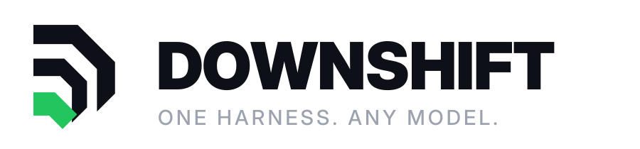

<div align="center">

<picture>
  <source media="(prefers-color-scheme: dark)" srcset="docs/brand/downshift-logo-dark.svg">
  
</picture>

### Compact verbose output. Let the orchestrator pick each subagent's model. Cut AI coding agent token use.

Downshift compacts verbose command output, applies the model the orchestrator chose for each
subagent (bounded by your policy), and learns which commands need new compressors. Its own code
never calls an LLM.

[](https://github.com/tiagovilasboas/downshift/actions/workflows/ci.yml)
[](LICENSE)
[](https://go.dev)
[](https://github.com/tiagovilasboas/downshift/releases)

[Get Started](#get-started) · [Features](#features) · [Token Savings](#token-savings) · [Documentation](#documentation)

**Reduce AI coding agent token use, with no LLM call in Downshift's own code.** Downshift is a token
optimization and model delegation tool for AI coding agents — Claude Code, Cursor, Codex, OpenCode,
Antigravity, and KiroCrew. It compacts verbose command output before it fills the context
window, applies the orchestrator's model choice for each subagent within the bounds you declare,
and counts the tokens it saved, per harness.

</div>

---

## The Problem

AI coding agents (Claude Code, Cursor, Codex, KiroCrew, and others) spend most of their context
window on verbose command output that carries little signal — a problem that context engineering
and token optimization guides keep circling back to. Every byte of tool output is a token you
pay for at API rates, on every turn:

```
$ go test -count=1 ./internal/...
ok      github.com/tiagovilasboas/downshift/internal/accounting    0.331s
ok      github.com/tiagovilasboas/downshift/internal/adapters/antigravity    0.595s
ok      github.com/tiagovilasboas/downshift/internal/adapters/claudecode    4.204s
... 53 more lines ...
ok      github.com/tiagovilasboas/downshift/internal/worktree    2.596s
```

That run prints **3,957 bytes** to say that everything passed. Your agent's context window holds every byte.

## The Solution

Downshift compacts that run to its header and one line per package:

```
Go test: PASS (53 packages ok, 4 without tests) under github.com/tiagovilasboas/downshift/internal/
ok accounting
ok adapters/antigravity
...
```

**3,956 → 998 bytes** for that run, as the compactor reports it, with the PASS/FAIL status and the
exit code kept. One run on this repository, not a benchmark. On a synthetic test corpus: 82.3% fewer
bytes on compacted files (26 of 248), 23.7% overall
([evidence](docs/evidence/compaction-corpus-2026-10-21.md)). Bytes, not LLM tokens.

---

## Why

- **Mechanical subagent work runs on a smaller model.** The orchestrator picks the agent, model and
  effort; Downshift applies that choice within your `policy.json`, and `downshift report` measures
  the tokens it moved. On Claude Code the small tier is the newest Haiku, run through its native
  alias (observed 2026-10-28). [Evidence](docs/guides/evidence.md)
- **Doubt keeps the requested model.** An unconfident routing decision leaves the spawn unchanged.
  A wrong choice by the orchestrator is not caught by a built-in floor: declare one in `policy.json`
  if a task must never go to a small model. [Architecture](docs/design/architecture.md)
- **No LLM call in Downshift's code, no prompts in telemetry.** Routing is deterministic code.
  Telemetry keeps counts, hashes and timings in `~/.downshift/events.jsonl`. See
  [Privacy & Security](#privacy--security).

---

## True north and the research behind it

**The orchestrator LLM decides; Downshift applies the decision inside your policy, keeps the context
small, and measures the result as cost per accepted task.** The full direction, with what each study
shows and does not show, is in **[docs/true-north.md](docs/true-north.md)**.

What the published work says, and what we take from it:

| Study | What it shows | What we take from it |
|---|---|---|
| [Anthropic, multi-agent research system](https://www.anthropic.com/engineering/multi-agent-research-system) (2025-06-13) | Opus 4 leading Sonnet 4 subagents beat single-agent Opus 4 by 90.2% on an internal research eval, at about 15× the tokens of a chat. Coding has fewer parallel tasks | A strong lead with cheaper workers can pay on independent work; the token price is part of the result |
| [Claude Opus 4.5 system card](https://assets.anthropic.com/m/64823ba7485345a7/Claude-Opus-4-5-System-Card.pdf), section 2.7 | The lead model moved results more than the worker model (Opus lead over Haiku workers 87.0% against Opus alone 74.8%). *Table not yet checked against the PDF* | Look at the planning step, not only at the implementation |
| [Anthropic, patterns and problems in multiagent systems](https://www.anthropic.com/research/multiagent-systems) (2026-08-13) | A swarm found 266 vulnerabilities on 27M tokens, independent agents 21 on 6.5M; on the same directories the cost per finding was comparable | More agents widen the search; they do not make each token more productive |
| [Anthropic, research with 60 subagents](https://www.anthropic.com/research/riemann-zeta) (2026-08-10) | Of 60 subagents, 2 developed the key ideas and 30 produced nothing new; 13 validated | Few workers first; verification matters |
| [Anthropic, AI organizations can be more effective but less aligned](https://alignment.anthropic.com/2026/ai-organizations/) | Groups of agents scored higher on the goal and lower on ethics than single agents, depending on the model | Gates belong around the whole flow |
| [OpenAI, model guide for the GPT-6 family](https://openai.com/index/practical-guide-building-gpt-6/) (2026-10-02) | Pick model and reasoning effort by task; delegate independent work. *Page unreadable here; confirmed through summaries* | Let the caller choose model and effort per step |
| [OpenAI, builder's guide to GPT-5.6](https://openai.com/index/builders-guide-to-gpt-5-6/) | Retained reasoning and compaction moved ARC-AGI-3 from 13.3% to 38.3% with about six times fewer output tokens. *Page unreadable here; confirmed through summaries* | Smaller context is a real lever. A different mechanism from ours, so not proof of our numbers |

The orchestration patterns the routing design is built on are the Anthropic cookbooks
[orchestrator-workers](https://github.com/anthropics/claude-cookbooks/blob/main/patterns/agents/orchestrator_workers.ipynb),
[async multi-agent](https://github.com/anthropics/claude-cookbooks/blob/main/patterns/agents/async_multi_agent_orchestration.ipynb),
[plan big, execute small](https://github.com/anthropics/claude-cookbooks/blob/main/managed_agents/CMA_plan_big_execute_small.ipynb) and
[dynamic workflows](https://github.com/anthropics/claude-cookbooks/blob/main/claude_agent_sdk/08_Dynamic_workflows.ipynb),
plus the [coordination patterns](https://claude.com/blog/multi-agent-coordination-patterns) article.

**Value proven so far, and what is not.** Measured on Claude Code: routing mechanical delegated work to a
smaller tier used 24.1% fewer tokens per accepted run than `opusplan` (95% interval +2.1% to +46.7%,
acceptance 12 of 12; forced delegation, one operator, token counts, measured before the orchestrator
chose the model) ([four-arm record](docs/evidence/four-arm-mechanical-2026-10-21.md)). The hook applies the
orchestrator's choice on real spawns (10 of 10 honoured). **Not proven:** savings in everyday use (the
report flips sign between a 30-day and a 7-day window), the Compactor's effect on model tokens, and that
the orchestrator uses the MCP tools unprompted. None of these studies measures Downshift; they justify
the experiment in [section 6 of the true-north page](docs/true-north.md#6-the-experiment-that-decides-it),
and its answer comes from our own runs.

---

## Get Started

```bash
# Install
curl -fsSL https://raw.githubusercontent.com/tiagovilasboas/downshift/main/install.sh | sh
# "has no <os>/<arch> archive yet"? Pick a tag from https://github.com/tiagovilasboas/downshift/releases
# (sh -s <tag>) or run: go install github.com/tiagovilasboas/downshift/cmd/downshift@<tag>

# Configure your harness (Claude Code, Cursor, Codex, KiroCrew, ...)
downshift setup

# Verify
downshift doctor
```

That's it. On Claude Code, Downshift now rewrites allowlisted commands and applies the orchestrator's subagent model choices
within your policy. Other harnesses differ; see [Harness Support](#harness-support-claude-code-cursor-codex-and-more).

Prefer to check the download first? Get the archive from [Releases](https://github.com/tiagovilasboas/downshift/releases)
and verify it with `checksums.txt`; each release carries a build-provenance attestation.

<details>
<summary>Manual installation</summary>

Download from [Releases](https://github.com/tiagovilasboas/downshift/releases) and
verify with `checksums.txt`. Releases include build-provenance attestation.

</details>

---

## Features

### 1. Output Compaction (default: on)

Wraps allowlisted commands to compress verbose output while preserving exit codes
and failure details.

```bash
downshift compact -- go test ./...
downshift compact -- cargo build --release
downshift compact -- pnpm test
downshift compact -- git status
```

**Compresses** (output is strictly shorter): `go test`, `go test -v`, `git diff/show`,
`eslint`, `ruff`, `mypy`, `golangci-lint`, `go build`, `cargo build`, `dotnet build`,
`tsc`, `pytest`, `jest`, `vitest`, `playwright`, `cargo test`, `phpunit`, `gradle`, `maven`
and more — see [harness matrix](docs/reference/harness-matrix.md) for the full list.

**Allowlisted** (pass-through, safe to wrap): Go · Rust/Cargo · Python (pytest, pip, uv, ruff, mypy) ·
Node.js (npm, pnpm, yarn, bun) · PHP (composer, phpunit, pest) · Git · Docker ·
Kubernetes · Terraform · AWS CLI · and [70+ more](docs/reference/supported-tools.md)

### 2. Subagent Model Delegation (the orchestrator chooses)

**The orchestrator chooses, Downshift applies, your policy bounds it, and Downshift measures.**
The lead session picks agent, model and effort for every delegation (the Orchestrator-Workers
pattern). Downshift never picks a model on its own: it applies that choice deterministically,
enforces what you declared in `policy.json` (profiles, ordered rules, quota gates, tier floors),
and reports the tokens, per harness. Your main session's model is never touched mid-turn, so
your prompt cache stays intact.

- **Precedence** (first match wins): a pinned model is kept; a declared profile; the first
  matching declared rule; the orchestrator's tier hint, which can only move down for now; else the
  requested model is kept. Doubt keeps the requested model (fail-open).
- **Refusals:** a model id the harness catalog does not know, and an `explicit_only` model, are
  never written.
- **Playbooks** (implemented): `downshift playbook list|show|edit|add|remove|restore|check` edits the
  work rules a delegated worker receives (General always applies; Backend and Frontend ship).
- **Orchestrator skill** (implemented): `downshift setup` installs `downshift-orchestrator`, guidance
  on splitting work and choosing model and effort per spawn.
- **MCP server** (`downshift mcp serve`, implemented): four information tools for the orchestrator, `providers` (the models this
  harness offers now), `playbook`, `status` (quota advice) and `apply` (what would be applied for a choice). The tools that
  start workers (`delegate`, `steer`, `result`, `cancel`) are specified, not built. See
  `docs/internal/plans/mcp-delegation-spec.md`.

Removed on 2026-10-28 (decision O8): the built-in agent-type table, the automatic upgrade after a
failure and the built-in risk floor. The protection against a risky task going to a small model is
now the orchestrator's judgment, guided by the playbook, plus floors you declare in `policy.json`.
A project that wants a hard floor must declare one; without it nothing stops a wrong choice.

Downshift's own code makes no LLM call, adds no token cost to the hot path and fails open.

### 3. Compressor Learning (auto-discovery)

Observes uncompacted commands and identifies candidates for new compressors.

```bash
$ downshift learning suggestions

Compressor suggestions (highest impact first):

→ 1. npm audit
      Count: 47 runs · Avg: 12.3 KB · Total: 578.1 KB

  2. pip show
      Count: 23 runs · Avg: 1.2 KB · Total: 27.6 KB
```

Runs after the output is written; stores counts and output shapes, never output text.

### 4. Code Intelligence (opt-in)

Indexes your repository in-process for reverse call graphs and targeted context.

```bash
downshift dci enable
downshift dci impact MyFunction  # Who calls this?
```

### 5. Token Accounting (v1)

Local token accounting: counts the tokens that ran on a cheaper model than the one requested,
and the tokens compaction removed from command output. Counts stay on your machine, and no
figure is converted to money.

```text
Routing tokens   = work + cache tokens of child spawns that ran on a cheaper model than requested
Compactor tokens = (raw bytes − emitted bytes) / 4        (estimate)
Tokens saved     = routing tokens + compactor tokens
```

**Caveats documented:** a cheaper child's whole token count counts as saved, with no
counterfactual for the extra turns it may need; compactor tokens are a bytes-per-4 estimate.
See [docs/reference/accounting.md](docs/reference/accounting.md).

---

## Token Savings

### Compaction (bytes, measured on a synthetic test corpus)

Compaction reduces clean, success-case outputs. Measured in bytes (not LLM tokens) on a
synthetic test corpus of 248 fixtures (Rung B evidence, not real-world traffic), of which 26 were compacted
([evidence](docs/evidence/compaction-corpus-2026-10-21.md)):

| Metric | Value |
|--------|-------|
| Compacted files (26 of 248, clean outputs) | 82.3% fewer bytes |
| Best cases (test runners, all pass) | 90–97% fewer bytes (flutter 97.4%, dart 97.3%, cargo 95.0%, pytest 95.0%, playwright 91.2%) |
| Overall corpus (all 248, includes failures and edge cases) | 23.7% fewer bytes |

*Your savings depend on your command mix. Clean outputs compress well; failures
and edge cases pass through unchanged (by design). Run `downshift stats` to see
your real numbers.*

### Evidence Methodology

Downshift follows a strict [Evidence Ladder](docs/guides/evidence.md):

1. **Bytes measured** — before/after on test corpus, reproducible
2. **Token estimate** — bytes/4, an approximation
3. **Control groups** — `DOWNSHIFT_CONTROL_SHARE` enables A/B comparison
4. **Your invoice** — the only source of truth for cost

We show byte counts and percentages, not dollar figures.

---

## Commands

### Daily Use

```bash
downshift session              # Current session savings
downshift stats                # Global statistics
downshift report --days=7      # Savings over time
downshift doctor               # Health check
```

### Compressor Learning

```bash
downshift learning suggestions # Candidates for new compressors
downshift learning stats       # Store statistics
downshift learning export      # Raw JSON
downshift learning clear       # Reset
```

### Inspection

```bash
downshift session --why        # Why each spawn changed or was kept
downshift watch                # Live dashboard
downshift models check         # Verify catalog pricing
```

---

## Harness Support: Claude Code, Cursor, Codex and more

Downshift was built with Claude Code. The status word says how much was verified on the real
harness, per the [Harness Matrix](docs/reference/harness-matrix.md):

| Harness | Compaction | Model Routing | Status | Setup |
|---------|------------|---------------|--------|-------|
| **Claude Code** | Automatic rewrite | Rewrite, observed honored | Completed | `downshift setup claude-code` |
| **Codex** | `downshift compact` run by the agent | Rewrite emitted, honored inferred | Functional | `downshift setup codex` |
| **Cursor** | `downshift compact` run by the agent | Rewrite emitted, honored unconfirmed | Functional | `downshift setup cursor` |
| **OpenCode** | `downshift compact` run by the agent | Adapter and conformance tests; no live spawn yet | Beta | Plugin in development |
| **Antigravity** | `downshift compact` run by the agent | One observed child on one build | Experimental | `downshift setup antigravity` |
| **KiroCrew** | `downshift compact` run by the agent | Policy mode (allow/block, no rewrite) | Functional | `downshift setup kirocrew` |

**KiroCrew note:** KiroCrew's preToolUse hook only supports allow/block decisions (no `updated_input`),
so model routing works in policy mode — blocking a spawn with a message telling the agent to respawn
at the recommended tier. Token counts are not exposed by the ACP provider; `downshift doctor` shows
these limitations with a `!` warning. See `downshift help kirocrew` for details.

Only Claude Code rewrites a command into its compact form automatically. On every other
harness the compact command works when the agent runs it directly.

### How Each Harness Works

- **Claude Code** — Native PreToolUse/PostToolUse hooks. Downshift rewrites shell commands
  automatically via plugin. Model routing via spawn interception. *This is the reference implementation.*

- **Codex** — PreToolUse hook rewrites the spawn model. The next spawn is the only signal that
  it was honored (inferred, not observed). Compaction is `downshift compact`, run by the agent.

- **Cursor** — `preToolUse` on `Task` plus `cursor-touch` on `sessionStart` /
  `beforeSubmitPrompt` (composer baseline cache when the spawn omits `model`);
  `subagentStop` → `end cursor` (child-end link verified on 3.27.12). Child
  executor model is still absent from the transcript, so honor is unconfirmed.
  Compaction: agent runs `downshift compact`; `setup` also adds Shell hooks
  (unverified live).

- **KiroCrew** — Steering-based. Agent follows `downshift-compact.md` steering to wrap
  commands. Model routing is policy-mode only (allow/block, no rewrite) because
  KiroCrew's preToolUse hook has no `updated_input` channel.

- **OpenCode** — Adapter and shared conformance suite are in the repository; the forwarding
  plugin is in development and no live spawn is observed yet.

- **Antigravity** — One child observed on desktop 2.21.1 (requested `pro`, executed
  `flash_lite`). Experimental.

Run `downshift setup` to auto-detect and configure all installed harnesses.

### Inside your harness

- **Skills:** four ship with Downshift: `downshift-setup`, `downshift-audit`, `harness-engineer` and
  `cost-reducer`. The Claude Code plugin exposes them as `/downshift:<name>`, and `/downshift:status`
  shows the session's subagent tree and routing reasons. See [skills](skills/README.md).
- **MCP server:** `downshift setup` registers `downshift mcp serve` in Claude Code and Codex (skip it
  with `--no-mcp`). The orchestrator can then ask which models the harness offers now and what would
  be applied for a choice.

---

## Documentation

### Direction
- [True north: the direction, the research and the proof so far](docs/true-north.md)

### Getting Started
- [Installation Guide](docs/guides/install.md)
- [Configuration](docs/guides/config.md)
- [Quickstart Tutorial](docs/guides/quickstart.md)

### Features
- [Output Compaction](docs/features/compaction.md)
- [Model Routing](docs/features/routing.md)
- [Compressor Learning](docs/features/learning.md)
- [Code Intelligence (DCI)](docs/features/dci.md)

### Reference
- [Supported Tools](docs/reference/supported-tools.md)
- [Harness Matrix](docs/reference/harness-matrix.md)
- [CLI Reference](docs/reference/cli.md)
- [Configuration Options](docs/reference/config-options.md)

### Architecture
- [Architecture: import graph, domains, known gaps](docs/design/architecture.md)
- [Domains and their boundaries](docs/domains/README.md)

### Contributing
- [Contributing Guide](CONTRIBUTING.md)
- [Development Setup](docs/contributing/development.md)
- [Adding Compressors](docs/contributing/compressors.md)

---

## When to use it, and when not

Use Downshift when your sessions spawn subagents that would inherit the most expensive model, and when you
want the policy you declared, not a router, to bound those choices. Do not expect much when you rarely spawn
subagents, when the work needs judgment on the raw material (keep the requested model there), or when you need
savings in money: Downshift reports tokens. Savings on everyday use are not established yet. The full list,
with the companions that complement it, is in [when to use Downshift](docs/guides/when-to-use.md).

## Safety boundaries

- **Hooks fail open.** A hook that errors, times out or receives a payload over 1 MiB leaves the spawn with the
  model the orchestrator asked for.
- **A broken policy is refused.** `downshift policy check` names the bad field. A `policy.json` that does not load
  applies nothing: the hook keeps the requested model rather than guessing a policy.
- **No LLM call in Downshift's code, and telemetry holds no prompts or file paths.**
- **Write workers are off by default.** They run only with `DOWNSHIFT_WORKERS=bypass`, each in its own git
  worktree, and refuse to run outside a git repository. Downshift never merges their branches.
- **No approval gate for risky actions.** Downshift does not stop a deploy, merge or secret change on its own. If
  you need that, enforce it in your harness or your policy.

---

## Privacy & Security

- **Prompts never leave memory** — task text is evaluated in-process, never logged
- **Local telemetry only** — counts, hashes, timings in `~/.downshift/events.jsonl`
- **No LLM call in Downshift's code** — the orchestrator's model choice is applied locally and deterministically
- **Fail-open** — any error leaves the command/spawn unchanged

---

## FAQ

### How do I reduce token usage in Claude Code, Cursor, or Codex?

Install Downshift, run `downshift setup`, and it hooks into your harness. Verbose command
output is compacted before it reaches the context window, and each subagent runs on the model the orchestrator chose, bounded by your policy. On Claude Code the rewrite is automatic; on other harnesses the agent
runs `downshift compact -- <command>` directly. Check your own numbers with
`downshift session` and `downshift report`.

### Does subagent model routing break prompt caching?

No. Downshift applies the model choice to whole subagent spawns, not individual turns of your main session. Your
main session keeps the same model for the entire conversation, so its cached prefix is never
invalidated by a mid-session model switch.

### Does it work with harnesses other than Claude Code?

Yes — see [Harness Support](#harness-support-claude-code-cursor-codex-and-more). Compaction works on every harness because it
is a plain shell command, no hook required. Model routing depth varies per harness and is
documented honestly in the [harness matrix](docs/reference/harness-matrix.md).

### How much does it save?

Compaction measured 82.3% fewer bytes on compacted outputs (23.7% over the whole synthetic
corpus) — see [Token Savings](#token-savings) for the full methodology. Routing savings
depend on your task mix and are measured, not promised, by `downshift report`.

### How is this different from `/compact` in Claude Code?

Claude Code's `/compact` summarizes conversation history after it is already in your context
window. Downshift's compactor shrinks command output — `go test`, `git diff`, `pytest` —
before it enters the context at all. They are complementary, and Downshift's compaction
works the same way on every harness, including ones without a compact command.

### What is context engineering for coding agents?

Keeping the smallest set of high-signal tokens in the model's context window. Downshift
automates the tool-output half of it deterministically: verbose command output is one of the
largest avoidable consumers of context in a coding-agent session, and compaction cuts it
before it is ever sent to the model.

---

## Status

**Beta** (v0.1.3; changes since are under `[Unreleased]` in the CHANGELOG). Not yet stable: the beta label stays until the exit criteria close. See [Beta Exit Criteria](docs/reference/beta-exit.md).

---

## License

Apache License 2.0. See [LICENSE](LICENSE).

---

<div align="center">

**Downshift** by [Tiago Vilas Boas](https://github.com/tiagovilasboas)

Conceptual backbone: [Harness engineering (Fowler)](https://martinfowler.com/articles/harness-engineering.html)

</div>
