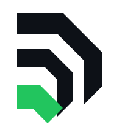
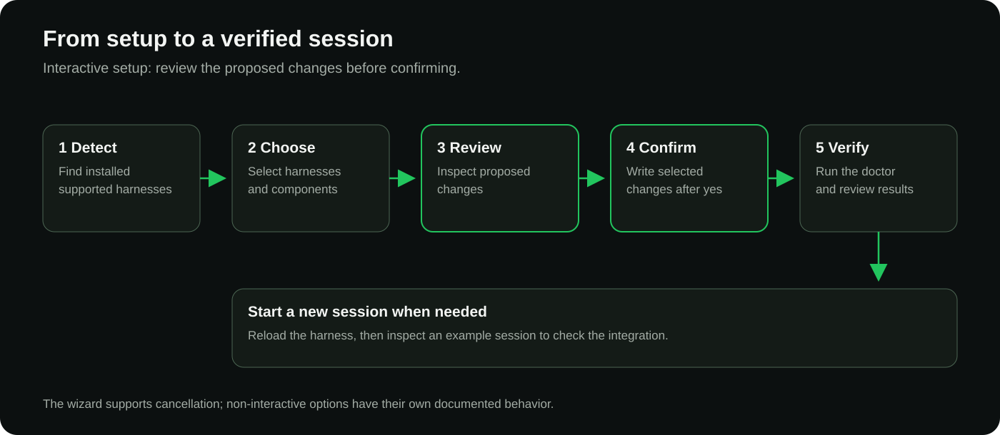
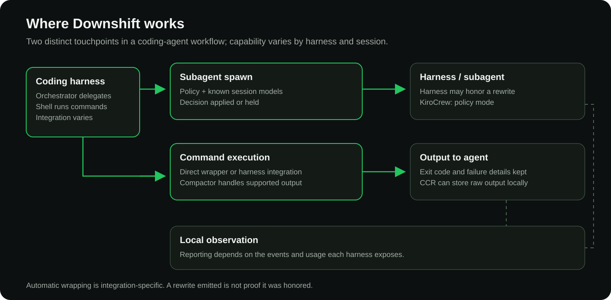
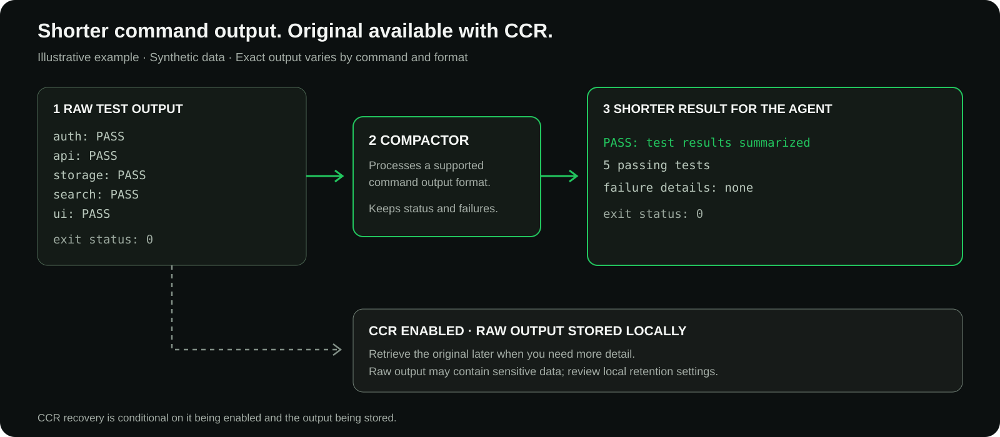
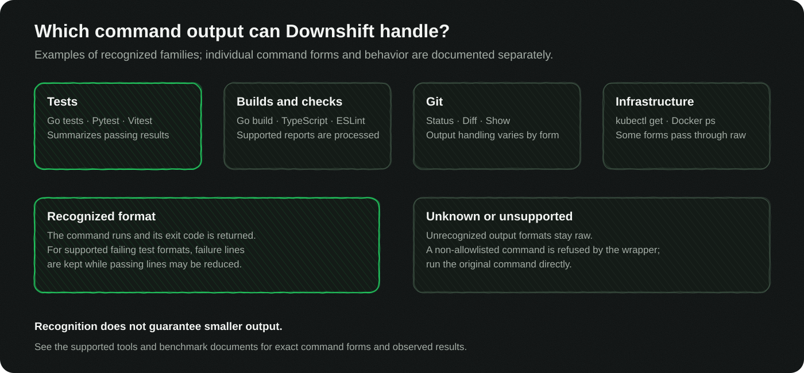
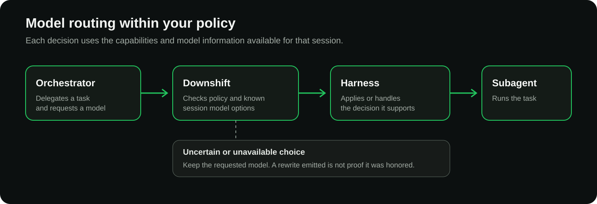
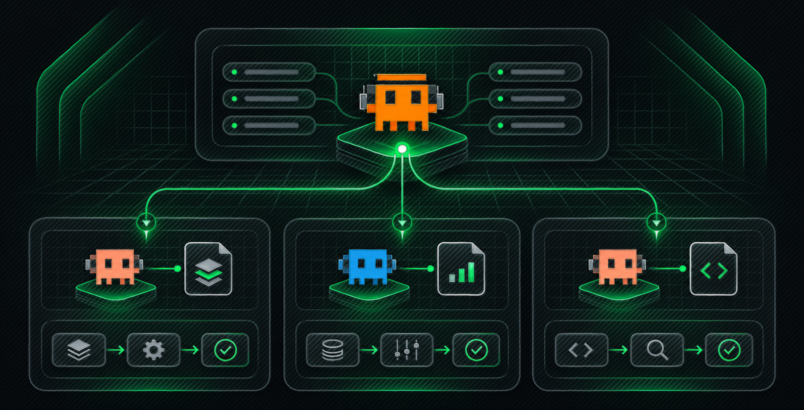
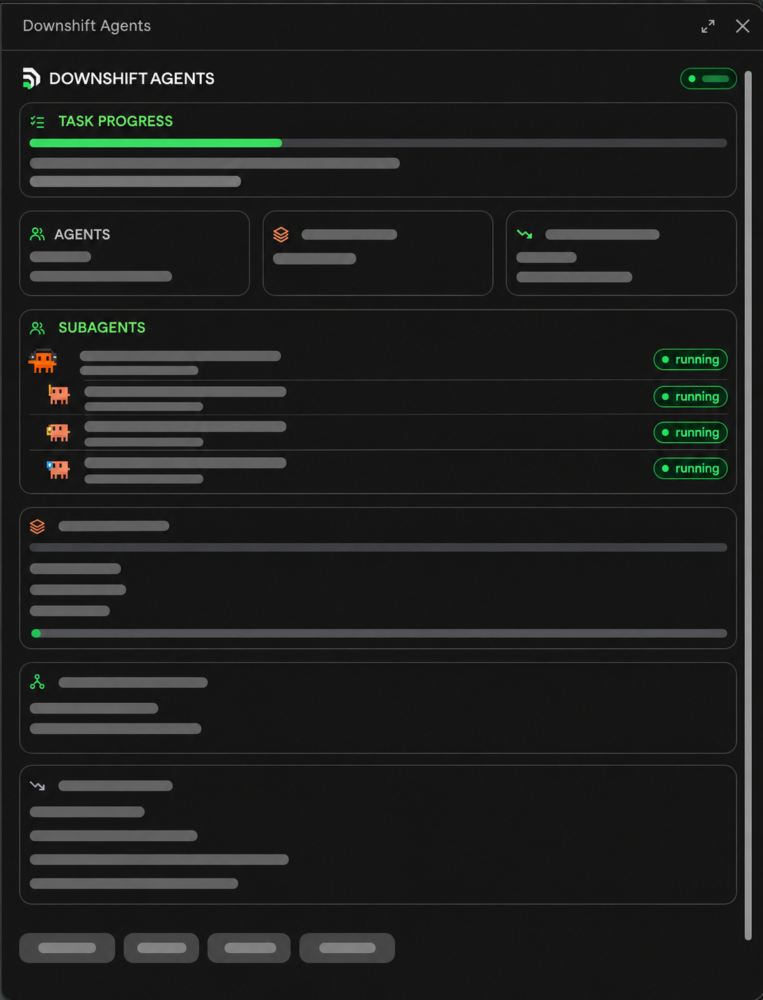

<div align="center">
<picture>
  <source media="(prefers-color-scheme: dark)" srcset="docs/brand/downshift-mark-darkbg.svg">
  
</picture>

# Downshift

### Cut the token waste in Claude Code, Codex and other coding agents.

AI coding agents spend much of their context on test logs, build output and status dumps, and every subagent runs on your main model unless something sets another. That burns tokens and fills the context window. Downshift is an open-source CLI that compacts supported command output before the agent reads it, with failures and exit codes kept: 69.4% fewer bytes on a 113-fixture benchmark. It also applies the model and effort chosen for each subagent, within the policy you declare. Single Go binary.

Works with coding harnesses including Claude Code and Codex CLI; integration capabilities and available models vary by harness and session.

[Get started](#get-started) · [Documentation](https://github.com/tiagovilasboas/downshift-ai/blob/main/docs/guides/install.md) · [Harness support](https://github.com/tiagovilasboas/downshift-ai/blob/main/docs/reference/harness-matrix.md) · [Evidence](#what-the-evidence-shows) · [Contributing](https://github.com/tiagovilasboas/downshift-ai/blob/main/CONTRIBUTING.md)

[English](README.md) · [Português (Brasil)](https://github.com/tiagovilasboas/downshift-ai/blob/main/docs/pt-br/README.md)

**Open source · Apache 2.0 · Product status: beta**
</div>


## Get started

Install a compatible release binary, choose your harness, review the proposed configuration, and verify the setup. For integrated routing, the relevant supported harness must be installed; the direct compactor can also be run as a standalone CLI. The interactive setup wizard can configure hooks, MCP, skills and session policy depending on your selections. It shows its proposed changes and asks before writing.

Release archives target macOS and Linux on arm64 and amd64, and Windows on amd64. Asset availability varies by release; check the release page for your platform and verification files. The shell installer in the guide is for macOS and Linux.

[Releases](https://github.com/tiagovilasboas/downshift-ai/releases) · [Installation guide](https://github.com/tiagovilasboas/downshift-ai/blob/main/docs/guides/install.md) · [Quickstart](https://github.com/tiagovilasboas/downshift-ai/blob/main/docs/guides/quickstart.md) · [Configuration](https://github.com/tiagovilasboas/downshift-ai/blob/main/docs/guides/config.md) · [Update](https://github.com/tiagovilasboas/downshift-ai/blob/main/docs/reference/cli.md#downshift-update) · [Undo setup](https://github.com/tiagovilasboas/downshift-ai/blob/main/docs/reference/cli.md#downshift-setup) · [Uninstall](https://github.com/tiagovilasboas/downshift-ai/blob/main/docs/reference/cli.md#downshift-uninstall)

```bash
# macOS & Linux (arm64 / amd64)
curl -fsSL https://raw.githubusercontent.com/tiagovilasboas/downshift-ai/main/install.sh | bash

# In your repository:
downshift setup
downshift doctor

# Later, on any OS: install the next release and refresh every harness
downshift update
```

[](docs/brand/readme-media/setup-flow.png)

## Token optimization for AI coding agents

For developers using AI coding agents, long test suites, build logs, and repetitive terminal outputs do not just consume tokens — they cause context rot. As verbose scrollback accumulates in the context window, the model's recall of earlier system prompts, architectural invariants, and business constraints degrades. Downshift compacts supported command output before it reaches the agent, preserving working-memory focus, exit codes, and failure details verbatim. Shorter output protects context capacity and reduces billable tokens on every subsequent turn.

Downshift also applies model choices and reasoning effort for delegated work within the policy you declare. High-effort frontier models stay reserved for architectural trade-offs, security audits, and difficult root-cause debugging, while mechanical subagents run on proportional, cost-effective tiers without invalidating your main session's prompt cache.

| Capability | What it does |
| --- | --- |
| **Context & output compaction** | Prevents context degradation by cutting clean command noise while preserving failure logs. |
| **Desktop read compaction** | Shortens `agent-desktop` accessibility-tree reads with every field kept, and sends a repeat read of the same window as the lines that changed ([guide](docs/guides/agent-desktop.md)). |
| **Subagent model & effort routing** | Applies model tier and reasoning effort at the spawn boundary within your policy. |
| **Local reporting & telemetry** | Measures tokens and context preserved without sending prompts or code outside your machine. |

[See when to use Downshift](https://github.com/tiagovilasboas/downshift-ai/blob/main/docs/guides/when-to-use.md) · [Explore the architecture](https://github.com/tiagovilasboas/downshift-ai/blob/main/docs/design/architecture.md)

Select any diagram to view it at full size.

## Where Downshift works

[](docs/brand/readme-media/operating-surfaces.png)

Downshift participates at two distinct points: a subagent spawn can be checked against policy and known session models, and supported command output can be compacted before it reaches the agent. Integration and observation differ across harnesses; direct compactor invocation is available where automatic wrapping is not.

## Reduce command output, keep the details

[](docs/brand/readme-media/compaction.png)

A supported command runs as usual. Downshift gives the agent a shorter view while preserving the exit code and failure details. With **Command Context Recovery (CCR)** enabled, eligible raw output can be stored locally and retrieved later; repeated lines may be folded in the displayed result. Wrapping depends on the harness, and direct compactor invocation is available. Output reduction varies by command and format.

[](docs/brand/readme-media/command-families.png)

Downshift recognizes selected test, build, lint, Git and infrastructure command forms. Recognized formats can be compacted or passed through depending on the family and output. Unknown output formats stay raw; a command outside the allowlist is refused by the wrapper and can be run directly. Failure details and the command exit code are preserved. See the supported-tools reference for exact forms.

```bash
# Run any allowlisted command through the compactor:
downshift compact -- go test ./...
```

Clean output is compacted to save context tokens, while non-zero exit codes and failure logs are preserved in full.

[Compaction](https://github.com/tiagovilasboas/downshift-ai/blob/main/docs/features/compaction.md) · [Supported tools](https://github.com/tiagovilasboas/downshift-ai/blob/main/docs/reference/supported-tools.md) · [CCR](https://github.com/tiagovilasboas/downshift-ai/blob/main/docs/guides/ccr.md)

### Desktop apps: computer use with fewer tokens

An agent that drives desktop apps with `agent-desktop` reads the app's accessibility tree as JSON after every action. Downshift compacts those reads too:

- **First read of a window:** one line per element, every field kept (a test decodes it back to the same JSON).
- **Repeat read of the same window:** only the lines that changed, with the full read one `downshift retrieve` away.
- **Every harness:** automatic in Claude Code; elsewhere through `downshift compact -- agent-desktop snapshot ...`.

On synthetic fixtures, a first read had 53–60% fewer bytes, a repeat read after one action 97% fewer, and a read, act, verify loop of three reads 84.9% fewer. Not yet measured on a live desktop.

```bash
downshift compact -- agent-desktop snapshot --app Files -i
```

[agent-desktop guide](https://github.com/tiagovilasboas/downshift-ai/blob/main/docs/guides/agent-desktop.md)

## Route subagents within your policy

[](docs/brand/readme-media/routing.png)

The orchestrator chooses the work to delegate. Downshift applies model decisions at the subagent spawn boundary, subject to your policy and the model information known for that harness and session. When it cannot establish a safe choice, the requested model stays in place.

Integration depth varies. A rewrite emitted by Downshift does not by itself prove that the harness honored it. Downshift's routing code makes no additional LLM call. The choice applies to a subagent spawn; Downshift does not change the main session's model mid-turn.

[Model routing](https://github.com/tiagovilasboas/downshift-ai/blob/main/docs/features/routing.md) · [Policy](https://github.com/tiagovilasboas/downshift-ai/blob/main/docs/guides/policy.md) · [Session models](https://github.com/tiagovilasboas/downshift-ai/blob/main/docs/reference/session-models.md)

## See your agents at work



Downshift includes agent profiles and orchestration playbooks for research, implementation, review, security, documentation and more. A lead coordinates independent work and brings the results together.

<p align="center"></p>

*Sanitized illustration based on a Claude Code session screenshot. Task labels, model names and session metrics are concealed. This is an edited visual preview, not a benchmark or an unaltered screenshot.*

<a id="5-agent-orchestration-context-triggers"></a>
### Agent orchestration (context triggers)

In your coding harness chat, describe your task and type:
- `downshift full-power` (alias `potencia-total`): activates the domain leads within your session capacity ceiling.
- `downshift shift <squad>`: activates a specific domain squad (`core`, `quality`, `security`, `leadership`).

[Agent guide](https://github.com/tiagovilasboas/downshift-ai/blob/main/docs/guides/agents.md) · [Agent catalog](https://github.com/tiagovilasboas/downshift-ai/blob/main/docs/agents/README.md)

## Works with your coding harness

Downshift was built with Claude Code and supports other harnesses at different stages of verification. **Supported** means `doctor` verified the hook in a real session; **Beta** means the hook ran in a real session and is written up, but `doctor` has not verified it; **Experimental** means the effect is unconfirmed or seen once. Criteria and evidence: [support tiers](https://github.com/tiagovilasboas/downshift-ai/blob/main/docs/reference/harness-matrix.md#support-tiers).

| Harness | Tier | Routing evidence |
| --- | --- | --- |
| Claude Code | Supported | Rewrite observed on a real child; `doctor` reads it from real sessions. |
| Codex | Beta | Rewrite emitted; honor inferred, not directly observed. Needs the hooks feature flag and `/hooks` trust; `doctor` reads the flag and names the fix. |
| OpenCode | Beta | Routing and child usage observed on OpenCode 2.2.5 through the bridge plugin. |
| KiroCrew | Beta | Policy block and retry observed; no in-place rewrite. |
| Kiro IDE | Beta | Hook payload captured live; observation-only, no rewrite. |
| Cursor | Experimental | Rewrite emitted; executor honor unconfirmed. |
| Antigravity | Experimental | One child observed on one build. |

Models available to one harness or session are not assumed to be available to another. See the [full harness matrix](https://github.com/tiagovilasboas/downshift-ai/blob/main/docs/reference/harness-matrix.md) for integration details, evidence and limits.

## What the evidence shows

| Measurement | Result | Scope |
| --- | --- | --- |
| Lossless output compaction | **59.3% fewer bytes** | 64 lossless fixtures in a synthetic corpus. |
| Output compaction with CCR | **69.4% fewer bytes** | 113-fixture synthetic corpus (52.6% with CCR off), command output and agent-desktop reads; displayed repetitions may be folded and raw output is recoverable. |
| Balanced compaction, large outputs | **76.3% fewer bytes** | 4 real outputs of this repository over 16 KB (`go test -v`, `git show`, `git log -p`, `grep -rn`); 35.0% with the lossless compressor alone. Cut lines stay retrievable with `downshift retrieve`. |
| Subagent routing | **24.1% fewer tokens per accepted run** | Controlled 46-run Claude Code study on mechanical tasks, conducted before decision O8. |

These are separate measurements in different units and workloads. The synthetic corpus totals include only fixtures the compactor processed, excluding preserved fixtures. The routing result is historical evidence; it does not establish the effect of the implementation after O8. Savings in unconstrained everyday use have not been established. Token estimates based on bytes are not an invoice or a measurement of plan limits.

[Compaction benchmark](https://github.com/tiagovilasboas/downshift-ai/blob/main/docs/reference/bench.md) · [Routing study](https://github.com/tiagovilasboas/downshift-ai/blob/main/docs/evidence/four-arm-mechanical-2026-10-21.md) · [Evidence guide](https://github.com/tiagovilasboas/downshift-ai/blob/main/docs/guides/evidence.md)

## Research behind the design

Downshift's design starts from Anthropic's published work on orchestration. A strong lead plans and checks, cheaper workers do bounded work, and every extra agent has to earn its tokens.

- [How we built our multi-agent research system](https://www.anthropic.com/engineering/multi-agent-research-system) (2025): an Opus lead with Sonnet subagents beat a single Opus agent by 90.2% on research, at about 15× the tokens of a chat. The same post notes that coding parallelizes less than research.
- [Patterns and problems in emerging multiagent systems](https://www.anthropic.com/research/multiagent-systems) (2026): a coordinating swarm found 266 vulnerabilities to the independent agents' 21, largely by searching more ground; inside the same directories, tokens per finding were comparable.
- [Riemann zeta research with 60 subagents](https://www.anthropic.com/research/riemann-zeta) (2026): of 60 subagents, 2 developed the key ideas, 30 tried and failed, and 13 validated the arguments.

How each finding maps to a design principle, and what it does not show: [True north](https://github.com/tiagovilasboas/downshift-ai/blob/main/docs/true-north.md) · [Reconciliation](https://github.com/tiagovilasboas/downshift-ai/blob/main/docs/evidence/anthropic-references-benchmark-reconciliation-2026-11-07.md)

## Built for inspection and control

- Hooks fail open: errors or timeouts leave the requested spawn unchanged.
- Routing runs locally and makes no additional LLM call. Telemetry records counts, hashes and timings rather than prompts.
- CCR can store raw command output locally. Redaction covers common credential shapes, but secrets in arbitrary formats can remain; review the [raw-output limitations](https://github.com/tiagovilasboas/downshift-ai/blob/main/docs/reference/known-limitations.md#raw-output-kept-by-ccr) and configuration before using sensitive output.
- Write workers are opt-in and run in separate worktrees. Downshift does not merge their branches or provide an approval gate for deploys and other risky actions.

| Command | What it does |
|---|---|
| `downshift setup [--dry-run]` | Configure hooks for detected harnesses with preview |
| `downshift doctor` | Diagnostic health check and automated repair |
| `downshift compact -- <cmd>` | Run allowlisted command with compacted clean output |
| `downshift retrieve <id>` | Retrieve raw output from local CCR storage |
| `downshift session [--why]` | Show session subagent tree and decision reasons |
| `downshift stats` | Summary of routing decisions and token savings |
| `downshift report` | Consolidated report of tokens routed per completed task |
| `downshift policy check` | Validate `.downshift/policy.json` |
| `downshift quota` | Inspect model quotas and windows across providers |
| `downshift mcp serve` | Run local stdio MCP server (13 native tools) |

[Safety](https://github.com/tiagovilasboas/downshift-ai/blob/main/docs/features/safety.md) · [Telemetry](https://github.com/tiagovilasboas/downshift-ai/blob/main/docs/features/telemetry.md) · [Known limitations](https://github.com/tiagovilasboas/downshift-ai/blob/main/docs/reference/known-limitations.md)

## FAQ

**How do I reduce token usage in Claude Code, Codex or Cursor?** Install Downshift and run `downshift setup`. Supported command output is compacted before it reaches the context window, and each subagent runs on the model chosen for it, bounded by your policy. On Claude Code the rewrite is automatic; elsewhere the agent runs `downshift compact -- <command>`. Check your numbers with `downshift session` and `downshift report`.

**Do Claude Code subagents burn my usage limit faster?** They can. Each subagent starts with a fresh context and sends its own requests, which count toward the same usage limits as your main conversation, and it runs on your main model unless something sets another. Put routine subagents on a smaller model: `downshift policy init` writes an `explore` profile that sends Explore to the small tier. [Guide](https://downshift-ai.vercel.app/guides/claude-code-subagents-usage-limit/)

**Does Downshift save my Claude Code usage limit?** Not measured yet. Downshift reports the tokens that ran below your session model and the bytes compaction removed. How a plan converts tokens into its 5-hour and weekly limits is not published, so no limit saving is claimed.

**Does subagent routing break prompt caching?** No. The choice applies to whole subagent spawns, not to turns of your main session, which keeps one model for the whole conversation.

**How is this different from `/compact`?** `/compact` summarizes conversation history already in the context window. Downshift shrinks command output before it enters. They are complementary.

**How is this different from `CLAUDE_CODE_SUBAGENT_MODEL`?** That variable sets one default model for every subagent nothing else sets. Downshift applies the model chosen for each spawn within a policy you declare, keeps the requested model when in doubt, records where tokens ran, and also works in Codex, Cursor and OpenCode.

## Documentation and community

[Quickstart](https://github.com/tiagovilasboas/downshift-ai/blob/main/docs/guides/quickstart.md) · [CLI reference](https://github.com/tiagovilasboas/downshift-ai/blob/main/docs/reference/cli.md) · [Architecture](https://github.com/tiagovilasboas/downshift-ai/blob/main/docs/design/architecture.md) · [Português (Brasil)](https://github.com/tiagovilasboas/downshift-ai/blob/main/docs/pt-br/README.md)

Found a bug or want to contribute? Read the [contributing guide](https://github.com/tiagovilasboas/downshift-ai/blob/main/CONTRIBUTING.md) or [open an issue](https://github.com/tiagovilasboas/downshift-ai/issues).

## License

[Apache License 2.0](https://github.com/tiagovilasboas/downshift-ai/blob/main/LICENSE). Downshift by Tiago Vilas Boas.
