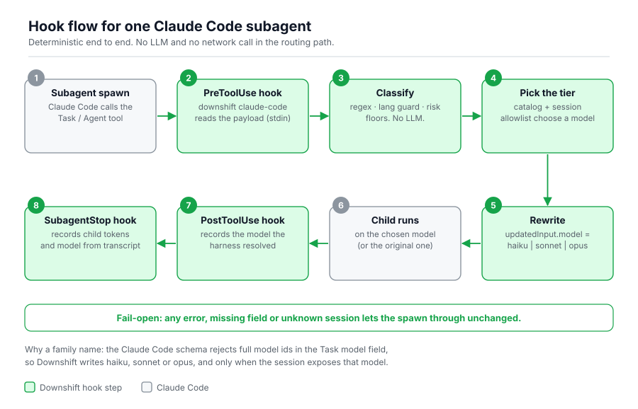
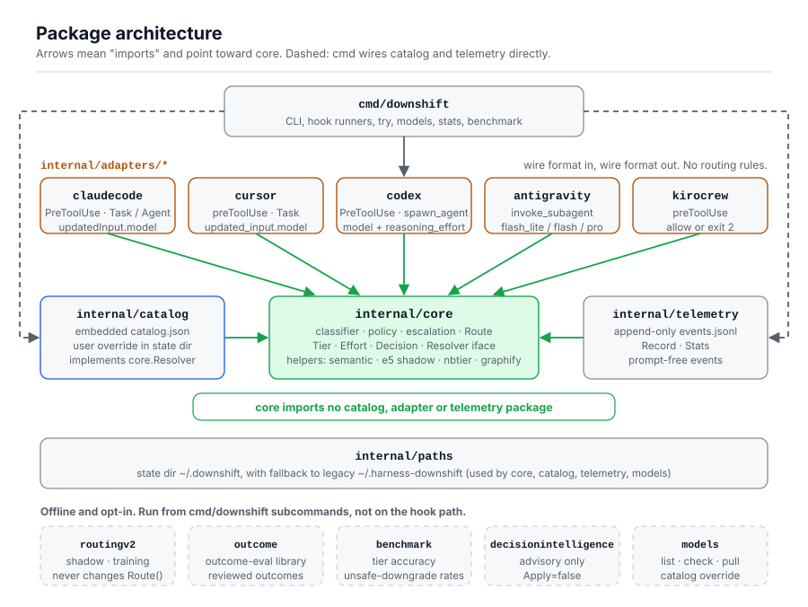

<div align="center">

<picture>
  <source media="(prefers-color-scheme: dark)" srcset="docs/brand/downshift-logo-dark.svg">
  
</picture>

**Cheaper subagents for your coding agent. Doubt never spends money.**

harness-downshift by Tiago de Carvalho Vilas Boas · https://github.com/tiagovilasboas/downshift

[](https://github.com/tiagovilasboas/downshift/actions/workflows/ci.yml)
[](LICENSE)
[](https://go.dev)
[](https://github.com/tiagovilasboas/downshift/releases)
[](#status)

[Install](docs/install.md) · [Docs](docs/README.md) · [Harness support](#harness-support) · [Contributing](#contributing)

</div>

Downshift is a hook for your coding harness. When Claude Code starts a subagent, it picks a right-sized model for that task: easy work runs on Haiku, hard work keeps Opus. Your session model never changes. Start with two commands:

- **Cheaper easy subagents.** A trivial rename runs on Haiku 5.5. The list-price gap to Opus 5.5 is about 97% ($0.10 vs $4.00 per 1M input tokens). Your real saving depends on your task mix; `downshift stats` estimates it from your runs.
- **Guardrails.** Unsure upshifts are held, risky tasks keep a floor, and anything unknown leaves the spawn unchanged.
- **Visible.** A statusline, a stderr line per routed subagent, and `downshift session --tree` (or `/downshift`) show what was routed and why.

```bash
curl -fsSL https://raw.githubusercontent.com/tiagovilasboas/downshift/main/install.sh | sh
downshift setup
```

`setup` prints a diff and asks before it writes. Preview with `downshift setup --dry-run` first, then open a new Claude Code session.

> **Beta.** Whether a rewrite is applied depends on the harness and plan, not only on Downshift. Read [plan compatibility](docs/install.md#plan-compatibility--read-before-installing) before installing, and see [Harness support](#harness-support) for what has been verified.

## Quickstart (Claude Code)

1. **Install.** Use the one-liner above (macOS / Linux). `go install` and Windows are in [install.md](docs/install.md).
2. **Preview, then apply.**
   ```bash
   downshift setup --dry-run   # prints the settings diff; writes nothing
   downshift setup             # asks, backs up your settings, then wires the hooks
   ```
   `setup` merges the hooks into `~/.claude/settings.json` using this binary's absolute path, keeps your other keys, and is idempotent. `downshift setup --undo` restores the latest backup. It also finds Cursor, Codex and Antigravity if they are installed.
3. **Open a new session.** Subagents it spawns now go through the hook.
4. **Check it.**
   ```bash
   downshift doctor                              # checklist: binary, hooks, state, scores
   downshift try "rename the userId variable"    # what would be picked, and why
   ```

### What you will see

- **A stderr line per routed subagent**, for example `downshift: TRIVIAL task → downshift to claude-haiku-5-5`.
- **A statusline**, set by `setup` when none exists. It shows Claude's quota windows and, when data exists, the current session's routing summary.
- **Child endings.** The `PostToolUseFailure` and `SubagentStop` hooks record how each child ended (`completed`, `error`, `interrupted`, ...). `stats` prints them under "How children ended"; error text is never stored.
- **`downshift try`** (real output, trimmed):
  ```text
  assumed current: claude-opus-5-5 (harness default)
  → small: opus → haiku
  why: trivial task, no risk, confident
  ```
- **`downshift stats --days=1`** (real output, trimmed; estimates from catalog prices, not a bill):
  ```text
  Last 1 day · 77 subagents · net saved $15.51 (saved $33.72, cost more $18.21)
  Guardrails held 35 risky moves · frontier rewrites on doubt: 0
  Models: sonnet 39 · opus 29 · haiku 8
  ```
- **`downshift session --tree`**, also `/downshift` in Claude Code once the optional command is copied ([install.md](docs/install.md#the-downshift-command-claude-code)). Real output, trimmed. This sample session cost $4.72 more than the no-routing baseline, so savings are not guaranteed:
  ```text
  session · 30 subagents · $55.62 (without downshift: $50.90) · over $4.72
  ├─ subagent 1   opus    …       -  COMPLEX
  ├─ subagent 10  sonnet  ✓   $0.07  MEDIUM, unsure, risk floor
  ├─ subagent 22  haiku   ✓   $0.04  TRIVIAL, confident
  └─ subagent 30  haiku   …       -  TRIVIAL, confident
  ```

### Commands

| Command | Use it to |
|---|---|
| `downshift setup [--dry-run] [--undo]` | wire, preview or undo the hooks |
| `downshift doctor [--verbose] [--json]` | check binary, hooks, state and scores |
| `downshift try "<task>"` | see what would be picked, before any spawn |
| `downshift stats [--days=N]` | decisions and estimated savings |
| `downshift session --tree` | this session's subagents as a tree |

More: `downshift help --all` lists every command. `downshift watch` (live tree) and `downshift config` are being built.

<details>
<summary>Manual setup</summary>

Prefer to edit `~/.claude/settings.json` yourself? Follow [Manual setup in install.md](docs/install.md#manual-setup-claude-code). The PreToolUse matcher is `Agent|Task`.

</details>

The session model list is optional on Claude Code: without one, Downshift infers the session from your current model and never upshifts past it. To set the list yourself, see [session-models.md](docs/session-models.md).

## What it is

Downshift is a single Go binary. Before a subagent spawns, it scores the task text, picks a tier (small / mid / frontier) and a reasoning effort, and rewrites **only that subagent's model** to one from your session's list. The parent session model never changes. The decision is deterministic, makes no network calls and needs no API keys; the only network call is the optional, at-most-daily refresh of public capability scores ([docs/scores.md](docs/scores.md)).

Learned tier memory stays in **shadow**: it is recorded for review and never changes a spawn. Maintainer eval numbers are in [benchmark/REPORT.md](benchmark/REPORT.md); weights are in [docs/complexity-weights.md](docs/complexity-weights.md).

**Example:** Your session runs Claude Sonnet 5.5. You spawn 3 subagents. Downshift may route them to Haiku, Sonnet and Opus based on task complexity. Billing and token usage happen at the subagent tier, not the session.

**What it is not:** an HTTP gateway or proxy (that is LiteLLM's job), a hosted model marketplace (OpenRouter), or an LLM-based classifier (Downshift uses deterministic signals + optional local MiniLM semantic scoring). It only acts on subagent spawns inside harnesses that expose a pre-tool hook. Comparison: [docs/when-to-use.md](docs/when-to-use.md).

## How it works
<picture>
  <source media="(prefers-color-scheme: dark)" srcset="docs/img/hook-flow-dark.svg">
  
</picture>

**Session model stays fixed. Subagent models get routed.**

```
Parent (e.g. Claude Sonnet 5.5) spawns 3 tasks:

  Task 1: "rename a variable"       → trivial    → Haiku (¢ cheaper)
  Task 2: "refactor a module"       → normal     → Sonnet (same tier)
  Task 3: "design a new algorithm"  → complex    → Opus ($ more capable)

Billing and token usage happen at the subagent tier, not the session.
```

**The routing loop:**

1. **Intercept.** The harness fires a `PreToolUse` hook when a subagent is about to start. Downshift reads the task text in memory only; prompts are never stored.
2. **Classify.** Deterministic signals (`internal/core`) + optional local MiniLM semantic scoring map the task to TRIVIAL, SIMPLE, MEDIUM, or COMPLEX (English and Portuguese vocabulary). The semantic score only raises, needs a regex signal behind it, and cannot create COMPLEX on its own. Weights and the tier map are in [docs/complexity-weights.md](docs/complexity-weights.md).
3. **Choose.** Policy picks small, mid, or frontier. The target must come from the session's model list, ordered least to most capable ([session-models.md](docs/session-models.md)). Doubt never spends money: an unconfident upshift, or an unconfident frontier pick with no known current model, is held. Only deterministic rules (risk floor, graph escalation, a tier floor) may move a task up.
4. **Remember, in shadow.** If `adapt-memory.json` has a reviewed hit or miss for that class and feature, Downshift records the tier it would use. The spawn still uses the classifier tier.
5. **Rewrite or stay out.** Downshift returns the new model in `updatedInput`. If anything is unknown or fails, it does nothing and the spawn runs unchanged (fail-open).

Internals: [docs/architecture.md](docs/architecture.md). The full runtime routing diagram is [here](docs/brand/downshift-routing-runtime-light.svg) ([dark](docs/brand/downshift-routing-runtime-dark.svg)).

<picture>
  <source media="(prefers-color-scheme: dark)" srcset="docs/img/architecture-dark.svg">
  
</picture>

## Project tier floor (optional)

A project can require a minimum tier with `.downshift/policy.json`. It only raises a tier, never lowers one; a missing or invalid file is ignored and the spawn routes as before. It applies to every harness and still passes the session allowlist and quota gates. Format, evidence per harness for where the project directory comes from, and limits: [config.md](docs/config.md#project-tier-floor-optional). The `stats` output counts the decisions it raised.

## Public capability scores (optional)

Downshift keeps a local cache of public capability scores (Epoch AI ECI, CC BY 4.0; Artificial Analysis via OpenRouter, local cache only) for the session models of each harness. Hooks refresh it in the background, at most once a day, and never wait for it. `DOWNSHIFT_SCORES=off` turns all of it off. Selection by score is shadow by default and changes routing only with `DOWNSHIFT_SCORE_ROUTING=1`. Sources, licences, privacy, the id map and the telemetry fields: [docs/scores.md](docs/scores.md).

## Harness support

| Harness | Subagent tool | Mechanism | Rewrite honored (evidence) |
|---|---|---|---|
| **Claude Code** | `Task` / `Agent`, paid plans | `PreToolUse` → `updatedInput.model` | Yes, observed 2026-10-06 ([write-up](docs/evidence/claude-code-rewrite-honored-2026-10-06.md)) |
| **Codex** | `spawn_agent` (`multi_agent_v2`) | `PreToolUse` → model + `reasoning_effort` | Inferred, not observed, 2026-10-02 ([write-up](docs/evidence/codex-rewrite-honored-2026-10-02.md)) |
| **Cursor** | `Task` | `preToolUse` → `updated_input.model` | Unconfirmed; discarded on Free and legacy Pro plans |
| **Antigravity** | `invoke_subagent` | `PreToolUse` overwrite | Observed 2026-10-09, desktop 2.21.1: [native child evidence](docs/evidence/antigravity-executor-ack.md); quota mapping still unresolved |
| **KiroCrew** | `spawn_run` / `spawn_sub_agents` | Native `preToolUse` policy (exit 0/2); no `updated_input` | Block and retry observed 2026-10-10 on Kiro CLI 2.29; not an in-place rewrite ([write-up](docs/evidence/kirocrew-native-hook-2026-10-10.md)) |
| **Grok CLI** | `spawn_subagent` | Config in `config.toml`, not a hook | No hook rewrite |

Adapters ship for all of the above; the table reports evidence, not just code. Plans, caveats and revalidation rules: [harness-matrix.md](docs/harness-matrix.md).

## Context optimization & native compression

Downshift includes a built-in, zero-dependency **Native Context Compressor** (`downshift context compress`) and event-driven **Context Sensor** to govern context token volume without altering critical failure traces.

- **Enable persists a flag, not a prompt rewrite.** `downshift context enable` saves the native provider as active, plus the exit-code contract. Claude Code PostToolUse then records `CompressExit` in observe mode, using the tool's real exit code. The hook cannot replace tool output, so the model still sees the original result. Prompts are not compressed. Safe mode on the CLI still requires `--exit 0`.
- **Zero external dependencies:** Pure in-process Go engine; zero Python, Rust, Node or LLM runtime requirements.
- **Fail-open & error preservation:** Safe squelch on verbose successes (`go test`, `git status`, logs); never touches errors, stack traces, or failing suites.
- **Bytes, not a token claim.** `downshift context benchmark` prints the four routing scenarios with `not measured` for cost and accuracy, then a measured byte table from checked-in fixtures (original bytes, reduced bytes, byte savings). The unit is bytes. The table is not tokens and not dollars.
- **Management CLI:**
  ```bash
  downshift context status      # Show optimization status & active provider
  downshift context providers   # List supported optimization providers
  downshift context doctor      # Inspect local compressor & harnesses
  downshift context enable      # Enable built-in native compressor (or specify provider)
  downshift context disable     # Revert configurations back to raw state
  downshift context metrics     # Sensor counts; token fields stay unavailable
  downshift context compress    # Compact stdin only with --exit 0 in safe mode
  downshift context benchmark   # Measured fixture bytes; routing cost stays not measured
  ```

See [the context optimization guide](docs/context-optimization.md) for architecture, harness contracts, and failure handling policies.

## Cost and metrics

- **Silent overspend alarm.** `downshift stats` prints `Frontier decisions N (on doubt, no deterministic lift: M)` and a WARNING when M is above zero. The `SEMANTIC_BOOST` reason code and its share show when the local embedder, not a rule, raised a tier. Both are prompt-free.
- **Estimated, not billed.** Routing-only savings use normalized units. With native tokens, `downshift stats --days=7` also calculates catalog-priced costs and a same-token baseline comparison. A [dated audit](docs/evidence/billing-gap-audit.md) matched five linked Claude Code records to native models/tokens, including both positive-saving records. These estimates are not an invoice; the controlled period comparison remains open.
- **Real usage on Claude Code (optional).** Add a `SubagentStop` hook running `downshift claude-code-subagent-stop` to record tokens and cost per subagent from its own transcript. Setup and limits: [session-models.md](docs/session-models.md#claude-code-real-usage).
- **How a child ended (Claude Code, optional).** Add `downshift claude-code-post-tool-use` under `PostToolUseFailure` too. It then records a closed status per Agent/Task child: `completed`, `launched` (background, not a success), `interrupted`, `error`, `stopped` (the child ended, with no outcome claim), or `unknown`. The field is absent when no status applies. The error text is never stored, and this is an observation, not a decision, so it does not change the decision counts. `downshift stats --by-harness` prints a Markdown review table (spawns, applied, held, upshift/downshift, effort and the linked tokens and estimated cost per harness and tier, plus the guardrail that held each spawn) for curating what the router chose; it holds counts only, no prompts. `downshift stats` prints a "How children ended" section when any are present, and the export carries them as `child_status`. When a failed (`error` or `interrupted`) child is followed by another spawn in the same session within 10 minutes, the same section adds a "Respawned after a failure" count. It is a hint only: the next spawn may be unrelated work, so it never becomes a tier label.
- **Cost per session and per subagent.** When priced usage records carry a session or agent id, `stats` shows how many sessions and subagents had cost, the mean and the maximum, and the three costliest sessions (hashed ids, short prefix). It is catalog-priced from recorded usage, an estimate and not a bill, and it reports only: Downshift cannot enforce a budget or a concurrency limit from a hook.
- **Baseline source.** Cost events carry `baseline_source` when a baseline was computed. Today it is always `requested` (the model the harness asked for). Estimates from other sources are not produced yet.
- **Local only.** Events go to a local `events.jsonl` in the state directory; prompts are not stored. Export format: [stats-export.md](docs/stats-export.md).
- **Classifier numbers.** Published tier accuracy, model pass rates, and the 2026-10-10 adapt comparison (per-task upper bound versus shared-shape memory) are in [benchmark/REPORT.md](benchmark/REPORT.md). Tune the classifier with `downshift try` and [docs/contrib/classifier.md](docs/contrib/classifier.md). Weights: [docs/complexity-weights.md](docs/complexity-weights.md).

## Documentation

[INSTALL](docs/install.md) · [CONFIG](docs/config.md) · [session models](docs/session-models.md) · [session discovery](docs/session-discovery.md) · [ARCHITECTURE](docs/architecture.md) · [complexity weights](docs/complexity-weights.md) · [HARNESS-MATRIX](docs/harness-matrix.md) · [WHEN-TO-USE](docs/when-to-use.md) · [examples](examples/README.md) · [full index](docs/README.md) · [Português](docs/pt/README.md)

Project: [ROADMAP](ROADMAP.md) · [GOVERNANCE](GOVERNANCE.md) · [beta exit criteria](docs/beta-exit.md) · [remaining tasks](docs/gap-tasks.md)

**For AI agents:** start with [docs/install.md](docs/install.md), [AGENTS.md](AGENTS.md) and [llms.txt](llms.txt).

## Contributing

The most valuable contribution is a **misrouted prompt**: open an issue with the `downshift try` output and the tier you expected. Evidence that a rewrite was (or was not) honored on your harness and plan is just as welcome. See [CONTRIBUTING.md](CONTRIBUTING.md).

Every feature must serve every harness: behaviour in shared layers, adapters only parse and emit. Read [docs/contrib/layering.md](docs/contrib/layering.md) before changing code.

## Status

**Beta.** The adapters ship, but the limiting factor is often harness or plan support rather than the router. Exit criteria are tracked in [docs/beta-exit.md](docs/beta-exit.md).

## License

Apache License 2.0. See [LICENSE](LICENSE), [NOTICE](NOTICE) and [docs/relicense.md](docs/relicense.md).

Downshift by Tiago de Carvalho Vilas Boas · https://github.com/tiagovilasboas/downshift

Conceptual backbone: [Harness engineering (Fowler)](https://martinfowler.com/articles/harness-engineering.html).
