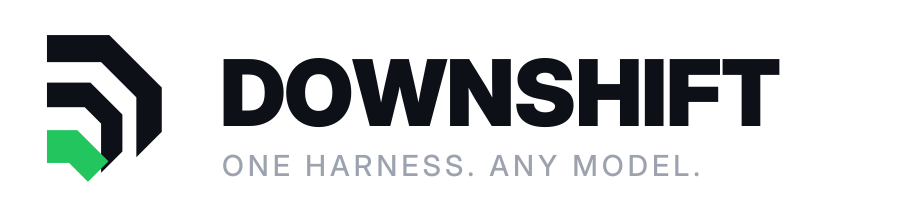

<div align="center">

<picture>
  <source media="(prefers-color-scheme: dark)" srcset="docs/brand/downshift-logo-dark.svg">
  
</picture>

### Compact verbose output. Let the orchestrator pick each subagent's model. Cut AI coding agent token use.

Downshift compacts verbose command output, applies the model the orchestrator chose for each
subagent (bounded by your policy), and learns which commands need new compressors. Its own code
never calls an LLM.


[](https://github.com/tiagovilasboas/downshift/actions/workflows/ci.yml)
[](LICENSE)
[](https://go.dev)
[](https://github.com/tiagovilasboas/downshift/releases)

[Install](#install) · [Features](#features) · [Agents](#agents) · [Commands](#commands) · [Documentation](#documentation)

</div>

Downshift is a token optimization and model delegation tool for AI coding agents: Claude Code, Cursor,
Codex, OpenCode, Antigravity, and KiroCrew (Experimental). It compacts verbose command output before it
fills the context window, applies the orchestrator's model choice for each subagent within the bounds you
declare, and counts, per harness, the tokens compaction saved and the tokens that ran on a cheaper model.

**Who it is for:** people whose agent sessions run long commands and spawn subagents, and who want the
policy they declared, not a router, to bound those choices.

**First action:** [install it](#install), run `downshift setup`, then `downshift doctor`.

## Contents

- [Install](#install)
- [What it does](#what-it-does)
- [Maturity](#maturity)
- [Features](#features)
- [Agents](#agents)
- [Commands](#commands)
- [Harness support](#harness-support)
- [Token savings](#token-savings)
- [Documentation](#documentation)
- [Safety, privacy and limits](#safety-privacy-and-limits)
- [FAQ](#faq) · [Status](#status) · [License](#license)

---

## Install

```bash
# Install
curl -fsSL https://raw.githubusercontent.com/tiagovilasboas/downshift/main/install.sh | sh
# "has no <os>/<arch> archive yet"? Pick a tag from https://github.com/tiagovilasboas/downshift/releases
# (sh -s <tag>) or run: go install github.com/tiagovilasboas/downshift/cmd/downshift@<tag>

# Configure your harness. In a terminal this opens the setup wizard: it shows the diff and asks before writing.
downshift setup

# Verify
downshift doctor
```

On Claude Code, Downshift now rewrites allowlisted commands and applies the orchestrator's subagent model
choices within your policy. Other harnesses differ; see [Harness support](#harness-support). To check the
download first, get the archive from [Releases](https://github.com/tiagovilasboas/downshift/releases) and
verify it with `checksums.txt`; each release carries a build-provenance attestation.

Guides: [Installation](docs/guides/install.md) · [Quickstart](docs/guides/quickstart.md) ·
[Configuration](docs/guides/config.md) · [Claude Code](docs/guides/claude-code.md)

---

## What it does

AI coding agents spend much of their context window on verbose command output that carries little signal.
A `go test -count=1 ./internal/...` run on this repository prints **3,957 bytes** to say that everything
passed. Downshift compacts it to a header and one line per package:

```
Go test: PASS (53 packages ok, 4 without tests) under github.com/tiagovilasboas/downshift/internal/
ok accounting
ok adapters/antigravity
...
```

**3,956 → 998 bytes** for that run, as the compactor reports it, with the PASS/FAIL status and the exit
code kept. One run on this repository, not a benchmark. Measurements on a synthetic corpus are in
[Token savings](#token-savings).

- **Mechanical subagent work runs on a smaller model.** The orchestrator picks the agent, model and
  effort; Downshift applies that choice within your `policy.json`, and `downshift report` measures the
  tokens it moved. On Claude Code the small tier is the newest Haiku, run through its native alias
  (observed 2026-10-28). [Evidence](docs/guides/evidence.md)
- **Doubt keeps the requested model.** An unconfident routing decision leaves the spawn unchanged. A wrong
  choice by the orchestrator is not caught by a built-in floor: declare one in `policy.json` if a task must
  never go to a small model. [Architecture](docs/design/architecture.md)
- **No LLM call in Downshift's code, no prompts in telemetry.** Routing is deterministic code. Telemetry
  keeps counts, hashes and timings in `~/.downshift/events.jsonl`.

**Direction.** The orchestrator LLM decides; Downshift applies the decision inside your policy, keeps the
context small, and measures the result as cost per accepted task. The research behind it, what each study
does and does not show, and what is proven so far (and what is not) are in
**[docs/true-north.md](docs/true-north.md)**. When to use it, and when not:
[when-to-use](docs/guides/when-to-use.md).

---

## Maturity

| Feature | Status |
|---|---|
| Output compaction (`downshift compact`; automatic rewrite in Claude Code) | Stable |
| Model delegation through hooks | Stable on Claude Code; Functional on Codex and Cursor |
| Workers (MCP `delegate`) | Beta on Claude (read-only by default, macOS and Linux). In development on Codex (no verified real run yet) and on Windows (off by default). Write mode is opt-in. |
| Planner (`downshift plan`) | In development |
| Setup wizard (`downshift setup`) | In development: it works and asks before writing, but its flow and harness coverage still change |
| Compressor Learning | In development |
| Token Accounting | In development |
| OpenCode | Beta |
| Antigravity, KiroCrew | Experimental |

In development means it works but its interface and behaviour may change between releases.

---

## Features

### 1. Output Compaction (default: on, stable)

Wraps allowlisted commands to compress verbose output while preserving exit codes and failure details.

```bash
downshift compact -- go test ./...
downshift compact -- git status
```

Compresses `go test`, `git diff/show`, `eslint`, `ruff`, `mypy`, `golangci-lint`, `go build`, `cargo build`,
`tsc`, `pytest`, `jest`, `vitest`, `playwright`, `cargo test`, `phpunit`, `gradle`, `maven` and more.
Failures keep every failure line byte for byte, and anything unknown keeps the run raw. CCR (native, always on) keeps
the raw output on disk so `downshift retrieve <id>` brings back any cut line.

Docs: [Output Compaction](docs/features/compaction.md) · [Supported tools](docs/reference/supported-tools.md) ·
[Harness matrix](docs/reference/harness-matrix.md) · [CCR](docs/guides/ccr.md) ·
[Benchmark](docs/reference/bench.md) · [Classification](docs/features/classification.md)

### 2. Subagent Model Delegation (stable on Claude Code, functional on Codex and Cursor)

The lead session picks agent, model and effort for every delegation. Downshift applies that choice
deterministically, enforces what you declared in `policy.json` (profiles, ordered rules, quota gates, tier
floors), and when nothing decided a spawn, moves a decisive `TRIVIAL` or `SIMPLE` task with no risk category
down to `small`. It never raises a tier on its own, and your main session's model is never touched
mid-turn, so your prompt cache stays intact. Precedence (first match wins): a pinned model; a declared
profile; the first matching declared rule; the orchestrator's tier hint (down only); the task-class rule;
else the requested model.

- **Playbooks:** `downshift playbook` edits the work rules a delegated worker receives.
- **Orchestrator skill:** `downshift setup` installs `downshift-orchestrator`.
- **MCP server:** `downshift mcp serve` exposes 13 tools. Six inform the orchestrator: `providers`,
  `status`, `playbook`, `apply`, `plan`, `retrieve`. Seven run workers: `delegate`, `collect`, `cancel`,
  `diff`, `send`, `steer`, `release`. Write workers run in their own git worktree and only when the owner
  turns on write mode.

Removed on 2026-10-28 (decision O8): the built-in agent-type table, the automatic upgrade after a failure
and the built-in risk floor. A project that wants a hard floor must declare one in `policy.json`.

Docs: [Model Routing](docs/features/routing.md) · [Policy](docs/guides/policy.md) ·
[Quota](docs/guides/quota.md) · [Subagents](docs/guides/subagents.md) · [Plan](docs/guides/plan.md) ·
[Safety](docs/features/safety.md) · [MCP server](docs/reference/cli.md#downshift-mcp-serve)

### 3. Compressor Learning (in development)

Observes uncompacted commands and ranks candidates for new compressors with `downshift learning
suggestions`. It runs after the output is written and stores counts and output shapes, never output text.

Docs: [Compressor Learning](docs/features/learning.md) · [Guide](docs/guides/compressor-learning.md)

### 4. Token Accounting (v1, in development)

Local token accounting, per harness and never summed across harnesses: the tokens compaction removed from
command output (a bytes-per-4 estimate), and the tokens that ran on a cheaper model than the session's.
Routing tokens are never added to tokens saved, and no figure is converted to money.

Docs: [Accounting](docs/reference/accounting.md) · [Report](docs/guides/report.md) ·
[Telemetry](docs/features/telemetry.md) · [Evidence ladder](docs/guides/evidence.md)

### 5. Agent Orchestration (context triggers)

A 14-agent squad you activate in natural language. Describe the task in chat, then say the trigger; see
[Agents](#agents).

Docs: [Agent System](docs/guides/agents.md) · [docs/agents](docs/agents/README.md)

### Inside your harness

- **Skills:** `downshift-setup`, `downshift-audit`, `harness-engineer` and `downshift-tune` ship with
  Downshift. In the Claude Code plugin they are `/downshift:<name>`, and `/downshift:status` shows the
  session's subagent tree and routing reasons. [Skills](skills/README.md)
- **Mod (Claude Code):** `downshift setup` installs the `downshift-agents` mod, a band above the prompt
  and a `/ds-agents` pane. It only observes; `--no-mods` skips it. [Mod](mods/downshift-agents/README.md)
- **MCP server:** registered in Claude Code and Codex by `downshift setup` (`--no-mcp` skips it).

---

## Agents

Downshift ships 14 agents in 6 domains. The orchestrator reads [`agents/config.toml`](agents/config.toml)
to decide which agent handles a task; the default tier is shown below.

| Agent | Domain | Default tier | One line |
|-------|--------|--------------|----------|
| [coder](agents/coder.md) | core | mid | Full-stack integrator: vertical slices, end-to-end integration |
| [coder-back](agents/coder-back.md) | core | mid | Backend: Go, Node, PHP, APIs, databases, concurrency |
| [coder-front](agents/coder-front.md) | core | mid | Frontend: React, Next.js, Tailwind, Canvas 2D, PWA |
| [refactor](agents/refactor.md) | core | mid | Code restructuring, cleanup |
| [researcher](agents/researcher.md) | core | small | Code analysis, dependency tracing |
| [tester](agents/tester.md) | quality | small | Run tests, coverage analysis |
| [debugger](agents/debugger.md) | quality | mid | Test failures, flaky tests |
| [reviewer](agents/reviewer.md) | quality | mid | Code review, test strategy, quality gates |
| [security](agents/security.md) | security | frontier | Security audit, threat modeling |
| [performance](agents/performance.md) | performance | mid | Profiling, bottleneck analysis |
| [documenter](agents/documenter.md) | support | small | READMEs, API docs, guides |
| [architect](agents/architect.md) | leadership | frontier | System design, cross-layer architecture |
| [platform](agents/platform.md) | leadership | frontier | Infra, DevOps, CI/CD, databases |
| [ai](agents/ai.md) | leadership | frontier | AI/LLM architecture, model routing, FinOps |

**Triggers.** Describe your task in chat, then say the trigger, without quotes:

```
User: I need to add rate limiting to the /api/users endpoint with tests
User: downshift full-power
```

- `downshift full-power` (aliases `potencia-total`, `potência-total`): the squad the task needs, up to 5
  agents at once. The orchestrator checks the `providers` strain block first and shrinks the squad when
  quota is low.
- `downshift shift <squad>`: one domain. Squads: `security`, `quality` (tester, debugger, reviewer),
  `core` (coder, coder-back, coder-front, refactor, researcher), `leadership` (architect, platform, ai).
- Explicit tasks work too: `downshift shift coder "fix the nil pointer in pool.go"`.

`downshift setup` writes the triggers into each harness's always-loaded instructions
([install](docs/guides/install.md#agent-triggers-every-harness-with-an-instructions-file)).

Docs: [Agent catalog and architecture](docs/agents/README.md) · [Routing](docs/agents/routing.md) ·
[Handoff](docs/agents/protocols/handoff.md) · [Escalation](docs/agents/protocols/escalation.md) ·
[Parallel slices](docs/agents/protocols/parallel-slices.md) · [Agent System guide](docs/guides/agents.md)

---

## Commands

Full list: [CLI reference](docs/reference/cli.md), or `downshift help --all`.

| Command | What it does | Docs |
|---------|--------------|------|
| `downshift setup [--dry-run]` | Wires the hooks into every harness found (backup, diff, `--undo`) | [setup](docs/reference/cli.md#downshift-setup) |
| `downshift doctor` | Checklist: binary, hooks per harness, state, with a fix per failure | [doctor](docs/reference/cli.md#downshift-doctor) |
| `downshift` | Full-screen console in a terminal on a configured machine | [console](docs/reference/cli.md#downshift-no-arguments-the-console) |
| `downshift compact -- <cmd>` | Cuts an allowlisted command's output to its PASS/FAIL summary, exit code kept | [compactor](docs/reference/cli.md#downshift-compactor) |
| `downshift retrieve <id>` | Reads back output the compactor kept in CCR | [retrieve](docs/reference/cli.md#downshift-retrieve) |
| `downshift session [--why]` | This session's subagents as a tree, and why each spawn changed or was kept | [session](docs/reference/cli.md#downshift-session) |
| `downshift stats` | Decisions and estimated token savings (not an invoice) | [stats](docs/reference/cli.md#downshift-stats) |
| `downshift report` | Routed tokens per completed task and rework; Compactor per harness and family | [report](docs/guides/report.md) |
| `downshift export` | One privacy-safe export an operator shares | [export](docs/reference/cli.md#downshift-export) |
| `downshift watch` | Live terminal view of routing events | [watch](docs/reference/cli.md#downshift-watch) |
| `downshift config` | Every effective setting with its value and source | [config](docs/reference/cli.md#downshift-config) |
| `downshift policy` | Check and manage `policy.json` | [policy](docs/reference/cli.md#downshift-policy) |
| `downshift quota` | Quota state and advice | [quota](docs/reference/cli.md#downshift-quota) |
| `downshift plan < plan.json` | Validates a delegation plan and prints it as a table | [plan](docs/guides/plan.md) |
| `downshift playbook` | Lists and edits worker playbooks | [playbook](docs/reference/cli.md#downshift-playbook) |
| `downshift models` | List, check, pull and discover the model catalog | [models](docs/reference/cli.md#downshift-models) |
| `downshift gateway on\|off` | Routes delegate workers through a local gateway such as 9router | [gateway](docs/reference/cli.md#downshift-gateway) |
| `downshift learning suggestions\|stats\|export\|clear` | Compressor Learning | [learning](docs/reference/cli.md#compressor-learning) |
| `downshift mcp serve` | MCP server, 13 tools: `providers`, `status`, `playbook`, `apply`, `plan`, `retrieve` inform; `delegate`, `collect`, `cancel`, `diff`, `send`, `steer`, `release` run workers | [mcp serve](docs/reference/cli.md#downshift-mcp-serve) |
| `downshift full-power`, `downshift shift <squad>` | Agent triggers | [Agents](#agents) |
| `downshift uninstall` | Removes what setup wrote | [uninstall](docs/reference/cli.md#downshift-uninstall) |
| `downshift version` | Prints the binary version | [version](docs/reference/cli.md#downshift-version) |

Read-only commands such as `session`, `doctor` and `report` open in the console when run by a person in a
terminal. Pipes, `--json`, `CI`, `DOWNSHIFT_PLAIN=1` and agent shells keep plain text.

---

## Harness support

Downshift was built with Claude Code. The status word says how much was verified on the real harness, per
the [Harness matrix](docs/reference/harness-matrix.md):

| Harness | Compaction | Model Routing | Status | Setup |
|---------|------------|---------------|--------|-------|
| **Claude Code** | Automatic rewrite | Rewrite, observed honored | Completed | `downshift setup claude-code` |
| **Codex** | `downshift compact` run by the agent | Rewrite emitted, honored inferred | Functional | `downshift setup codex` |
| **Cursor** | `downshift compact` run by the agent | Rewrite emitted, honored unconfirmed | Functional | `downshift setup cursor` |
| **OpenCode** | Automatic rewrite through the bridge plugin | Rewrite, observed honored on OpenCode 2.2.5 | Beta | `downshift setup opencode` |
| **Antigravity** | `downshift compact` run by the agent | One observed child on one build | Experimental | `downshift setup antigravity` |
| **KiroCrew** | `downshift compact` run by the agent | Policy mode (allow/block, no rewrite) | Experimental | `downshift setup kirocrew` |

Only Claude Code rewrites a command into its compact form automatically; on every other harness the compact
command works when the agent runs it directly. KiroCrew's preToolUse hook only supports allow/block
decisions, so routing there is policy mode, and the ACP provider exposes no token counts. Details per
harness: [Harness matrix](docs/reference/harness-matrix.md) · [Capability matrix](docs/reference/capability-matrix.md) ·
[Session models](docs/reference/session-models.md) · [KiroCrew guide](docs/guides/kirocrew-routing-guide.md)

---

## Token savings

Measured in bytes (not LLM tokens) on a synthetic corpus of 248 fixtures (Rung B evidence, not real-world
traffic), of which 26 were compacted ([evidence](docs/evidence/compaction-corpus-2026-10-21.md)):

| Metric | Value |
|--------|-------|
| Compacted files (26 of 248, clean outputs) | 82.3% fewer bytes |
| Best cases (test runners, all pass) | 90–97% fewer bytes (flutter 97.4%, dart 97.3%, cargo 95.0%, pytest 95.0%, playwright 91.2%) |
| Overall corpus (all 248, includes failures and edge cases) | 23.7% fewer bytes |

Your savings depend on your command mix; failures and edge cases pass through unchanged by design. Run
`downshift stats` for your real numbers. Savings on everyday use are not established yet. Downshift follows
an [Evidence Ladder](docs/guides/evidence.md) (bytes measured, token estimate, routed-spawn report, your
invoice) and shows byte counts and percentages, not dollar figures.

---

## Documentation

| Area | Pages |
|------|-------|
| **Getting started** | [Install](docs/guides/install.md) · [Quickstart](docs/guides/quickstart.md) · [Configuration](docs/guides/config.md) · [Claude Code](docs/guides/claude-code.md) · [When to use it](docs/guides/when-to-use.md) · [Public beta](docs/guides/public-beta.md) |
| **Features** | [Compaction](docs/features/compaction.md) · [Routing](docs/features/routing.md) · [Learning](docs/features/learning.md) · [Classification](docs/features/classification.md) · [Safety](docs/features/safety.md) · [Telemetry](docs/features/telemetry.md) |
| **Guides** | [Policy](docs/guides/policy.md) · [Quota](docs/guides/quota.md) · [Plan](docs/guides/plan.md) · [Report](docs/guides/report.md) · [CCR](docs/guides/ccr.md) · [Companions](docs/guides/companions.md) · [Operator](docs/guides/operator.md) · [Verification](docs/guides/verification.md) |
| **Agents** | [Overview](docs/agents/README.md) · [Routing](docs/agents/routing.md) · [Handoff](docs/agents/protocols/handoff.md) · [Escalation](docs/agents/protocols/escalation.md) · [Parallel slices](docs/agents/protocols/parallel-slices.md) · [Agent System guide](docs/guides/agents.md) · [Skills](skills/README.md) |
| **Reference** | [CLI](docs/reference/cli.md) · [Configuration options](docs/reference/config-options.md) · [Harness matrix](docs/reference/harness-matrix.md) · [Session models](docs/reference/session-models.md) · [Supported tools](docs/reference/supported-tools.md) · [Accounting](docs/reference/accounting.md) · [Beta exit criteria](docs/reference/beta-exit.md) |
| **Architecture** | [Architecture](docs/design/architecture.md) · [Domains](docs/domains/README.md) · [True north](docs/true-north.md) · [Evidence](docs/guides/evidence.md) · [Benchmark protocol](docs/guides/benchmark-protocol.md) |
| **Contributing** | [Contributing guide](CONTRIBUTING.md) · [Development setup](docs/contributing/development.md) · [Adding compressors](docs/contributing/compressors.md) · [Layering rule](docs/contrib/layering.md) |
| **Releases** | [CHANGELOG](CHANGELOG.md) · [v0.8.1 notes](docs/releases/v0.8.1.md) · [Releases](https://github.com/tiagovilasboas/downshift/releases) |

---

## Safety, privacy and limits

- **Hooks fail open.** A hook that errors, times out or receives a payload over 1 MiB leaves the spawn with
  the model the orchestrator asked for.
- **A broken policy is refused.** `downshift policy check` names the bad field; a `policy.json` that does
  not load applies nothing.
- **No LLM call in Downshift's code, and telemetry holds no prompts or file paths.** Prompts never leave
  memory; telemetry is local counts, hashes and timings.
- **Write workers are off by default.** Read-only workers are on by default for Claude (not on Windows, not
  yet for Codex). Write workers need `DOWNSHIFT_WORKERS=bypass` or `orchestration.workers: "write"`, each in
  its own git worktree, and Downshift never merges their branches.
- **Worker tokens are counted, not priced.** Each `collect` delivery carries the `tokens` its CLI reported, and
  `DOWNSHIFT_WORKER_TOKEN_BUDGET` (off by default) refuses new `delegate` calls for a CLI once its finished
  workers in the session have spent that many tokens. A worker killed before it reports usage is not counted.
- **No approval gate for risky actions.** Downshift does not stop a deploy, merge or secret change on its
  own; enforce that in your harness or your policy.

Docs: [Safety](docs/features/safety.md) · [Telemetry](docs/features/telemetry.md) ·
[When to use Downshift](docs/guides/when-to-use.md)

---

## FAQ

**How do I reduce token usage in Claude Code, Cursor, or Codex?** Install Downshift and run
`downshift setup`. Verbose command output is compacted before it reaches the context window, and each
subagent runs on the model the orchestrator chose, bounded by your policy. On Claude Code the rewrite is
automatic; elsewhere the agent runs `downshift compact -- <command>`. Check your numbers with
`downshift session` and `downshift report`.

**Does subagent model routing break prompt caching?** No. The choice applies to whole subagent spawns, not
turns of your main session, which keeps one model for the whole conversation.

**Does it work with harnesses other than Claude Code?** Yes, see [Harness support](#harness-support).
Compaction works everywhere because it is a plain shell command. Routing depth varies and is documented in
the [harness matrix](docs/reference/harness-matrix.md).

**How is this different from `/compact` in Claude Code?** `/compact` summarizes conversation history already
in the context window. Downshift shrinks command output before it enters the context. They are
complementary.

---

## Status

**Beta** (v0.8.1; changes since are under `[Unreleased]` in the [CHANGELOG](CHANGELOG.md)). Not yet stable:
the beta label stays until the exit criteria close. See [Beta Exit Criteria](docs/reference/beta-exit.md).

## License

Apache License 2.0. See [LICENSE](LICENSE).

---

<div align="center">

**Downshift** by [Tiago Vilas Boas](https://github.com/tiagovilasboas)

Conceptual backbone: [Harness engineering (Fowler)](https://martinfowler.com/articles/harness-engineering.html)

</div>
