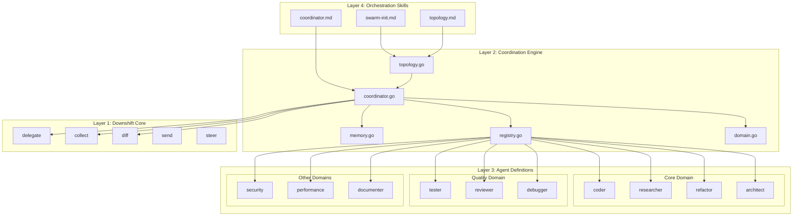
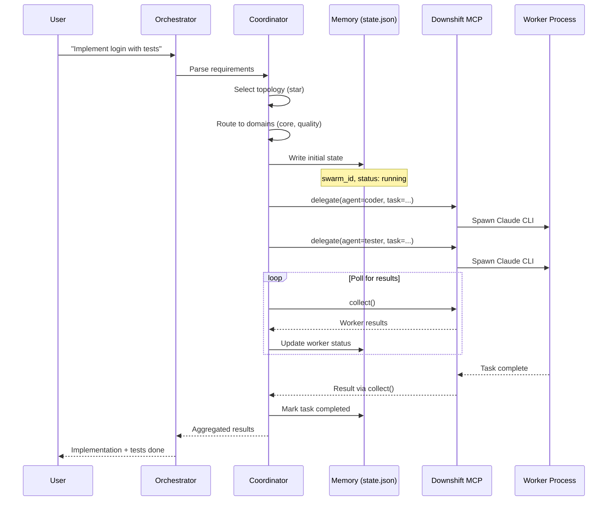
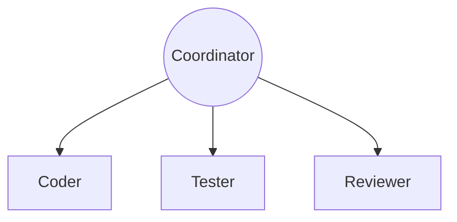
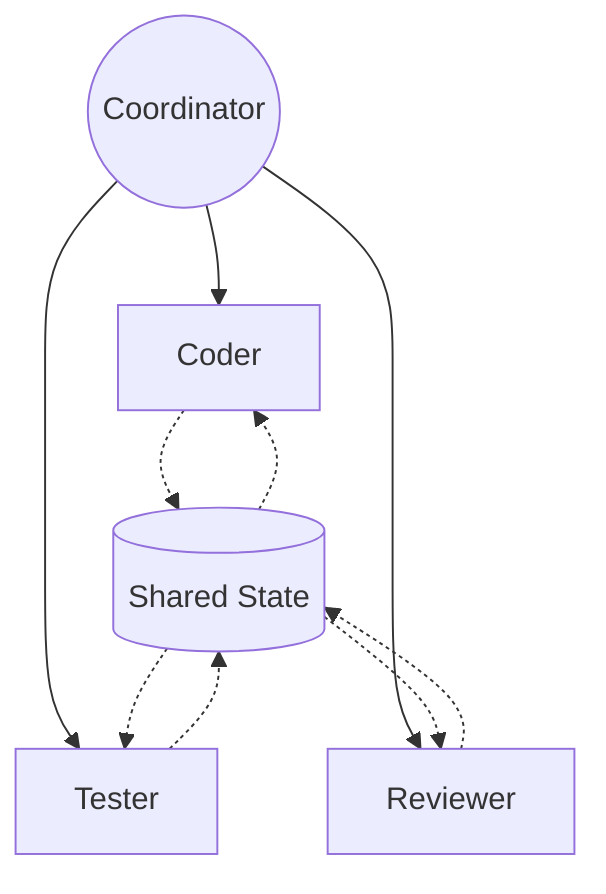
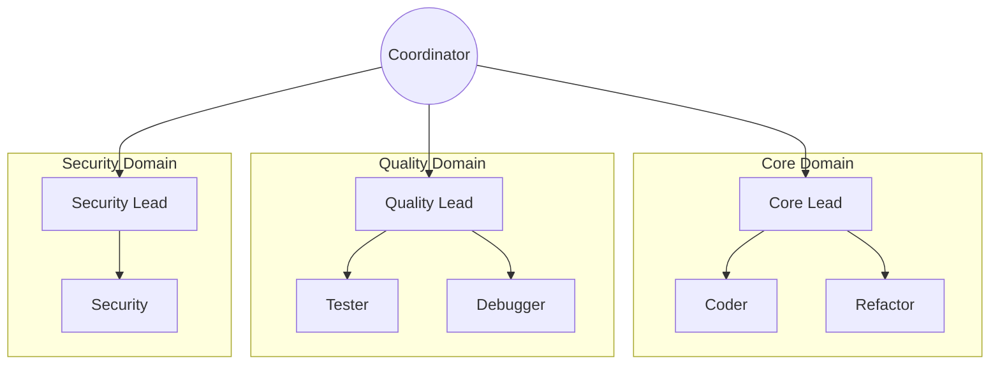
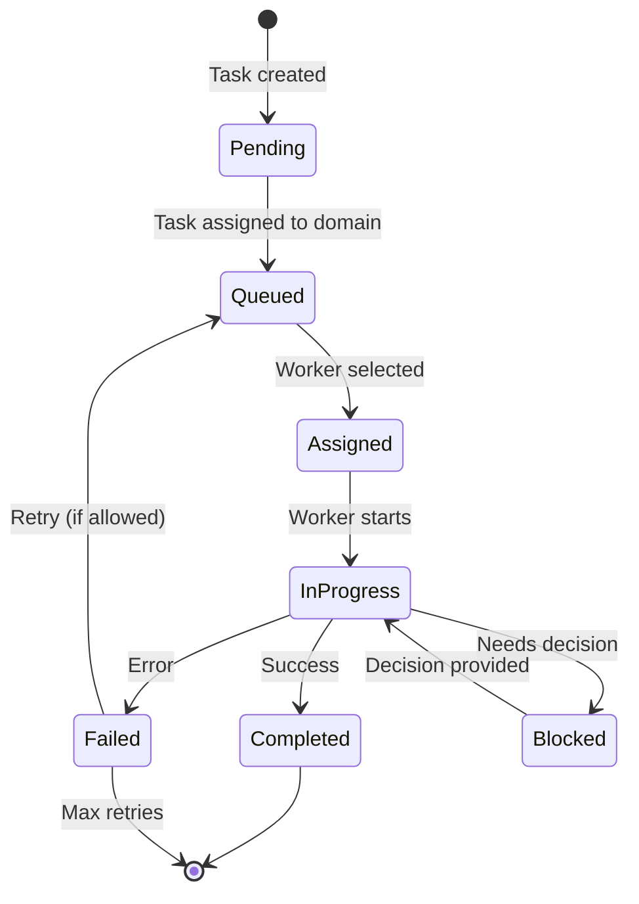
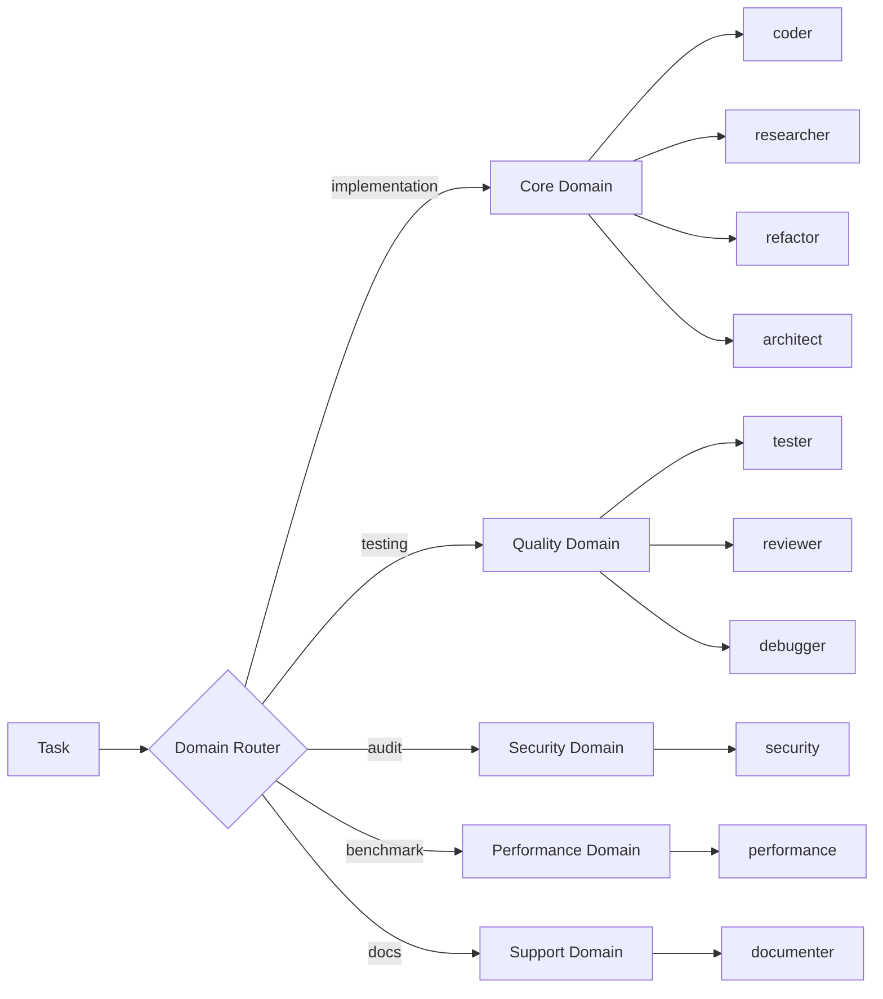
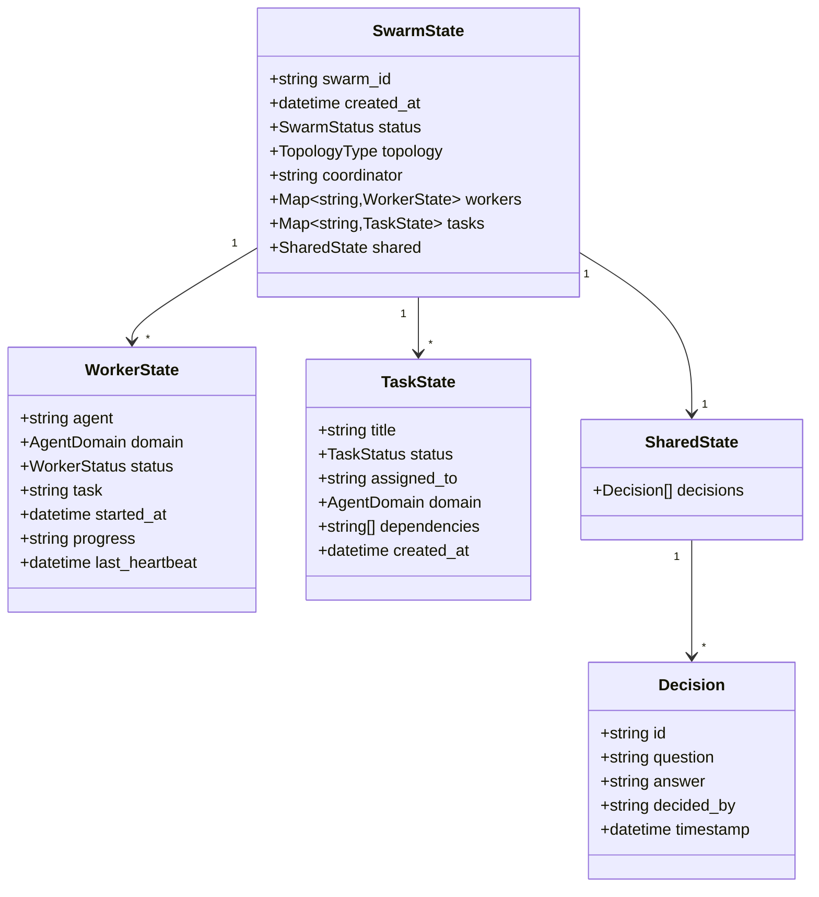
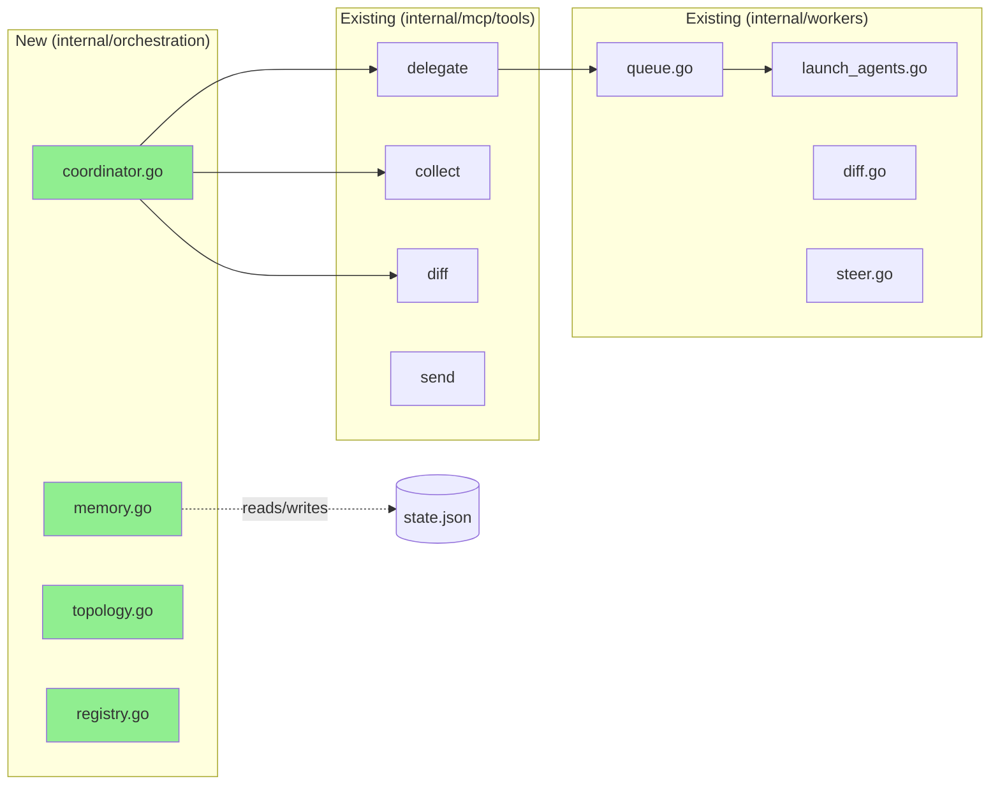
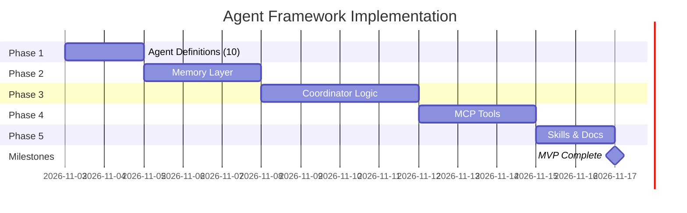

# Agent Framework Diagrams

Visual diagrams for the Downshift Agent Framework spike.

---

## 1. Architecture Overview

---

## 2. Data Flow

---

## 3. Topology Types

### Star Topology (Simple Tasks)

### Mesh Topology (Parallel Work)

### Hierarchical Topology (Complex Multi-Domain)

---

## 4. State Machine: Worker Lifecycle

---

## 5. Domain Routing

---

## 6. Memory File Structure

---

## 7. Integration with Existing Downshift

---

## 8. Roadmap Timeline

---

Downshift by Tiago Vilas Boas · https://github.com/tiagovilasboas/downshift
