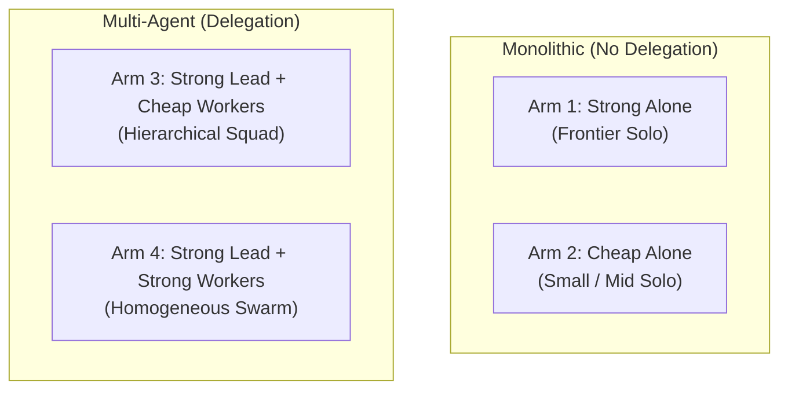
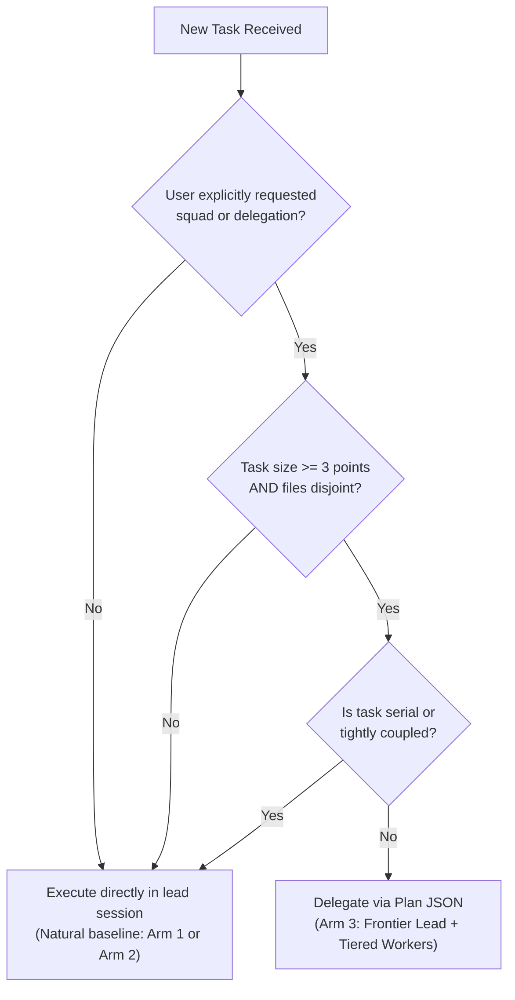

<!-- Copyright (c) 2026 Tiago Vilas Boas. SPDX-License-Identifier: Apache-2.0 -->

# Benchmark delegation boundaries and coordination overhead (2026-11-07)

Downshift by Tiago Vilas Boas · https://github.com/tiagovilasboas/downshift

What this document answers: when does delegating coding tasks to subagents reduce total token spend, when does
coordination overhead wipe out any saving, how do the four canonical evaluation arms compare, and why vendor claims
about multi-agent cost reduction do not transfer to everyday developer workflows.

This document resolves Issue #24 ("Benchmark delegation boundaries and coordination overhead", parent spike #21),
establishing the empirical boundaries for the orchestrator playbook in
[`skills/downshift-orchestrator/SKILL.md`](../../skills/downshift-orchestrator/SKILL.md).

---

## 1. The delegation tradeoff: when does a subagent pay for itself?

Subagent delegation is frequently treated as an automatic architectural improvement. In reality, spawning a subagent
introduces a substantial **coordination tax** that must be recouped through lower per-token pricing or parallel
throughput.

### 1.1 The token accounting of delegation

When a lead orchestrator executes a task directly, token consumption is bounded:

$$\text{Tokens}_{\text{solo}} = \text{Context}_{\text{base}} + \text{Input}_{\text{task}} + \text{Output}_{\text{solution}}$$

When the lead orchestrator delegates to a subagent, token consumption expands across multiple distinct categories:

$$\text{Tokens}_{\text{delegated}} = \text{Tokens}_{\text{lead}} + \sum_{i=1}^N \text{Tokens}_{\text{worker}, i} + \text{Tokens}_{\text{rework}}$$

Where:
1. **$\text{Tokens}_{\text{lead}}$ (Briefing & Review):** The parent agent generates task instructions, allowed file
   paths, and verification checks ($\text{Output}_{\text{brief}}$), waits for completion, and reads back the child's
   transcript or summary ($\text{Input}_{\text{review}}$).
2. **$\text{Tokens}_{\text{worker}}$ (Context Initialization & Work):** Each worker loads the complete harness system
   prompt, MCP tool schemas, and project workspace instructions ($\text{Context}_{\text{base}}$, typically 50,000 to
   100,000+ cached tokens per spawn) before generating its first line of code.
3. **$\text{Tokens}_{\text{rework}}$ (Failure Penalty):** If a cheaper child hallucinates, causes syntax errors, or
   fails the verification check, the parent must spend expensive frontier tokens diagnosing the failure, issuing
   follow-up turns, or performing the repair itself.

### 1.2 The breakeven threshold

Delegation achieves a net saving only when:

$$(\text{Price}_{\text{lead}} - \text{Price}_{\text{worker}}) \times \text{WorkTokens}_{\text{worker}} > \text{Price}_{\text{lead}} \times (\text{BriefTokens} + \text{ReviewTokens}) + \text{Price}_{\text{worker}} \times \text{BaseContextTokens} + \text{Cost}_{\text{rework}}$$

For short, trivial, or tightly coupled tasks (1–2 story points, 10–50 lines of code):
- $\text{WorkTokens}_{\text{worker}}$ is small (~200–500 tokens).
- $\text{BaseContextTokens}$ is massive (~80,000 tokens read from cache).
- $\text{BriefTokens} + \text{ReviewTokens}$ exceeds the actual work tokens.

Therefore, **small tasks mathematically cannot break even when delegated**. Inline execution by the lead agent is
cheaper in total tokens and significantly faster in wall-clock time, even when the lead runs on a frontier model.

---

## 2. The four-arm evaluation framework

To rigorously measure delegation efficiency and coordination overhead without conflating model capability with
architectural topology, Downshift defines a four-arm evaluation framework:

### 2.1 Description of the four arms

| Arm | Lead model | Worker model(s) | Topology | Intended role |
|---|---|---|---|---|
| **Arm 1: Strong Alone** | Frontier (`opus`) | None (0 workers) | Monolithic | **Natural quality ceiling & control baseline.** Direct inline execution; measures capability without delegation tax. |
| **Arm 2: Cheap Alone** | Small/Mid (`haiku` / `flash`) | None (0 workers) | Monolithic | **Low-cost lower bound.** Measures whether task complexity genuinely requires frontier reasoning or can be solved cheaply without coordination. |
| **Arm 3: Strong Lead + Cheap Workers** | Frontier (`opus`) | Small/Mid (`haiku` / `sonnet`) | Hierarchical | **Downshift target topology.** Frontier lead decomposes, briefs, and validates; cheaper workers execute independent mechanical slices. |
| **Arm 4: Strong Lead + Strong Workers** | Frontier (`opus`) | Frontier (`opus`) | Homogeneous | **High-cost swarm.** Tests whether multi-agent parallelism adds value when all agents run at maximum capability, isolating delegation overhead from model downgrade risks. |

### 2.2 Token accounting per arm

| Arm | Lead context & turns | Worker base context | Execution token tier | Risk of failure / rework |
|---|---|---|---|---|
| **Arm 1** | Single session, continuous cache hits | None (0 tokens) | Frontier list price | Low (Frontier achieves 100% on 40-task outcome suite) |
| **Arm 2** | Single session, continuous cache hits | None (0 tokens) | Small/Mid list price | High (Small fails 32.5% of development tasks, 66.7% of held-out smoke tasks) |
| **Arm 3** | Briefing output + review input turns | Repeated per worker (50k–100k cache read each) | Small/Mid list price | Moderate (requires prompt envelope & verification check) |
| **Arm 4** | Briefing output + review input turns | Repeated per worker (50k–100k cache read each) | Frontier list price (highest total spend) | Low per-worker failure; high token inflation from context duplication |

---

## 3. Empirical evidence from Downshift historical runs

Downshift's empirical benchmarks directly validate this delegation framework across multiple trial batches:

### 3.1 Batch b2: Unconstrained natural delegation (2026-10-15)

In batch b2 ([`subagent-routing-ab-2026-10-15.md`](subagent-routing-ab-2026-10-15.md)), four real bug-fix tasks were
evaluated under Claude Code with delegation optional.
- **Finding:** The parent agent spent many turns exploring and writing lengthy task briefs. The router applied **zero
  downshifts** because exploratory prompts were long and unstructured (`CLASSIFIER_UNCONFIDENT`).
- **Lesson:** Natural delegation without rigid interface boundaries produces high parent turn counts (13.9 vs 30.6
  turns, driven by agent variation, not routing) and fails to isolate delegable work.

### 3.2 Batch b5: Bounded mechanical delegation ceiling (2026-10-15)

In batch b5, four synthetic mechanical tasks (rename, doc comments, named constants, mirrored tests) were split into
five independent pieces each, with one subagent per piece (at least 3 spawns per run).
- **Finding:** 19 of 56 spawns (34%) were safely downshifted to cheaper models. Acceptance was 12/12 in both routed and
  control arms. Overall run cost fell by 12% (and by 33% on pure renames: $0.49 vs $0.74).
- **Lesson:** Delegation succeeds when tasks are **mechanical, parallel, and have disjoint file boundaries**.

### 3.3 Four-arm mechanical battery (2026-10-21)

In the controlled four-arm trial ([`four-arm-mechanical-2026-10-21.md`](four-arm-mechanical-2026-10-21.md)):
- Arm A (Opus fixed solo): 2.25M tokens per accepted run.
- Arm B (Native `opusplan`): 2.00M tokens per accepted run.
- Arm C (`opusplan` + Downshift routing): 1.52M tokens per accepted run (24.1% fewer tokens than B per accepted run).
- **Critical observation:** Cache read tokens accounted for **over 98%** of total tokens across all arms. Spawning
  unnecessary subagents incurs repeated 80,000+ token cache reads that easily wipe out small savings.

### 3.4 Quality gap from the 40-task outcome suite

Per [`evaluation-suite-inventory.md`](evaluation-suite-inventory.md):
- Frontier model: 40/40 (100.0%) pass rate.
- Small model: 27/40 (67.5%) pass rate.
- Even on TRIVIAL + SIMPLE tasks, the small model fails 4 of 20 tasks (80.0% vs 100.0%, a **−20.0pp gap**).
- **Implication:** If an orchestrator delegates non-mechanical reasoning to a cheap worker, there is a 20% to 33%
  probability of failure. The subsequent repair in the lead session erases all financial gains.

---

## 4. Scoping vendor results: defect search versus software engineering reality

Vendors have published benchmark results claiming multi-agent configurations reduce costs by approximately one-third
(e.g., Anthropic's multi-agent defect search experiments). While empirically valid for their specific setup, these
findings **do not generalize** to standard developer workflows.

### 4.1 Why defect search showed multi-agent savings

1. **Massive search space:** The benchmark involved searching through thousands of files across huge codebases to locate
   an obscure defect.
2. **Read-only fan-out:** Workers operated in read-only mode, scanning separate directories in parallel without file
   write locks or edit collisions.
3. **Cheap exploration:** Cheap models are effective at string search and file grep. Running 10 cheap searchers to find
   the file was cheaper than having a single frontier model scan the entire codebase sequentially.

### 4.2 Why everyday software engineering differs

| Property | Vendor defect search benchmark | Everyday software engineering (Downshift target) |
|---|---|---|
| **Primary operation** | Read-only search & retrieval | Reading, reasoning, editing, running tests, refactoring |
| **File boundaries** | Disjoint directories across thousands of files | 1 to 5 tightly coupled files in the same package |
| **Write conflicts** | None (read-only search) | High (concurrent edits cause git merge conflicts or overwrite work) |
| **Context proportion** | Small search snippets returned | Deep architectural context and type invariants required |
| **Rework consequence** | Missed search hit can be retried cheaply | Broken code breaks build, corrupts state, demands frontier fix |

### 4.3 Practical guidance: keep live four-arm execution scoped

Live four-arm execution requires executing full multi-turn sessions across all four arms ($0.50 to $2.00+ per run
across multiple repetitions), incurring substantial API costs and latency.

Because everyday coding tasks rarely exhibit the massive read-only search topology of vendor defect benchmarks,
**live four-arm evaluation should remain scoped and optional**. Teams should not run full four-arm batteries unless
evaluating a genuine high-volume, multi-file discovery workload. For standard feature and maintenance work, the
offline smoke evaluation set and two-arm (routed vs monolithic baseline) trials provide sufficient evidence.

---

## 5. Orchestrator decision framework

To operationalize these findings, the orchestrator playbook ([`skills/downshift-orchestrator/SKILL.md`](../../skills/downshift-orchestrator/SKILL.md))
enforces the following decision matrix:

### 5.1 Decision matrix

| Task characteristic | Recommended action | Target tier | Rationale |
|---|---|---|---|
| **1–2 story points (1 file, <50 lines)** | **Do not delegate** (Lead executes directly) | Session model | Briefing and child context initialization tokens exceed task work. |
| **Serial dependent steps ($A \rightarrow B \rightarrow C$)** | **Do not delegate** (Lead executes sequentially) | Session model | Passing intermediate state across subagents adds latency and context bloat. |
| **Shared / overlapping files** | **Do not delegate** (Lead executes sequentially) | Session model | Concurrent edits create merge conflicts and overwrite changes. |
| **Multi-file mechanical edits (AST-level)** | **Delegate in parallel wave** | `small` (with `[tier=small]`) | b5 proven ceiling: −33% cost on renames, 100% acceptance. |
| **Bounded independent modules (Disjoint files)** | **Delegate in parallel wave** | `mid` | Parallel execution reduces wall-clock time; mid tier handles bounded logic. |
| **Security, auth, schema migrations** | **Do not delegate to cheap tier** | `frontier` (or Lead) | High risk of failure; small models fail edge-case security invariants. |

### 5.2 The natural no-delegation baseline

A single monolithic session is the natural, default baseline. Orchestrators must never delegate simply because worker
tools (`delegate`, `collect`, `invoke_subagent`) exist. Spawning workers without clear parallelism and disjoint file
boundaries increases costs, inflates tokens, and degrades user experience.

---

## 6. Verification and test guardrails

The guidance in this document is protected by repository tests:
- `skills/orchestrator_skill_test.go`: Ensures the orchestrator skill contains required MCP tool references and trigger
  phrases without dollar signs (accounting strictly in tokens).
- `skills/shipped_text_test.go`: Guarantees that shipped skill text contains no stale model literals or unregistered MCP
  tool names.
- `cmd/downshift/doubt_held_e2e_test.go`: Proves that doubt never spends money.

---

## Related documentation

- [Orchestrator skill playbook](../../skills/downshift-orchestrator/SKILL.md)
- [Evidence ladder: what each saving figure means](../guides/evidence.md)
- [Subagents guide (layer 4, delegation)](../guides/subagents.md)
- [Benchmark protocol: three-arm and four-arm methodologies](../guides/benchmark-protocol.md)
- [Four-arm mechanical battery (2026-10-21)](four-arm-mechanical-2026-10-21.md)
- [Subagent routing A/B results (2026-10-15)](subagent-routing-ab-2026-10-15.md)
- [Evaluation suite inventory (Issue #23)](evaluation-suite-inventory.md)
