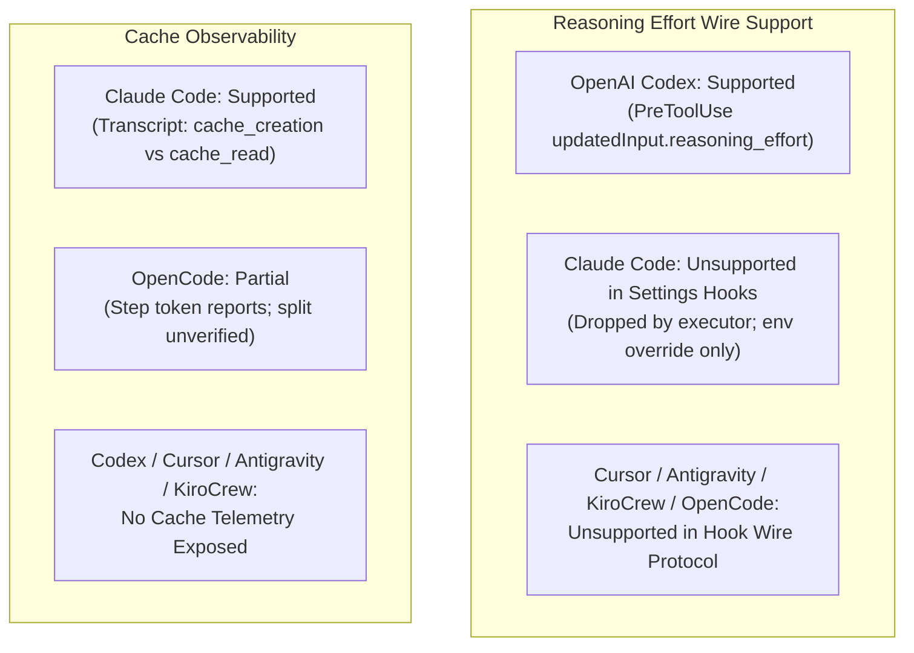
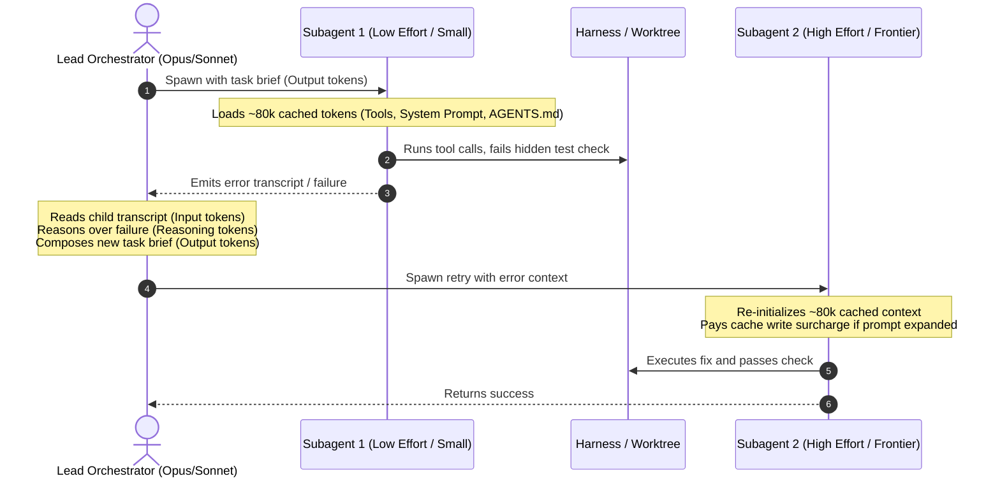
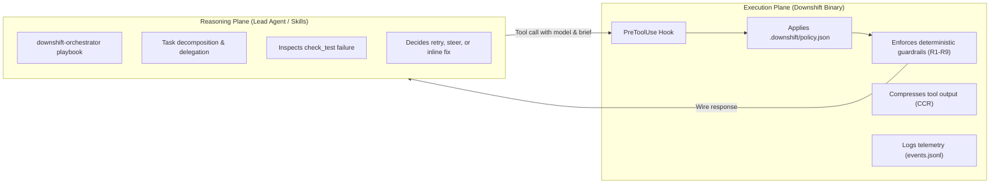
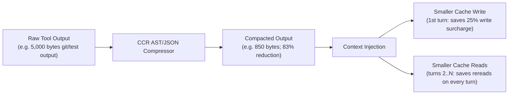

<!-- Copyright (c) 2026 Tiago Vilas Boas. SPDX-License-Identifier: Apache-2.0 -->

# Evaluation of reasoning effort, retry strategies, quality, and prompt caching (2026-11-07)

Downshift by Tiago Vilas Boas · https://github.com/tiagovilasboas/downshift

What this document establishes: a systematic evaluation of Anthropic's official optimization recommendations
("Optimizing for cost and intelligence") against Downshift's runtime architecture, per-harness hook reality, prompt
caching accounting, and retry economics in agentic coding workflows.

This document resolves Issue #25 ("Evaluate effort and retry strategies against quality and cache", parent spike #21),
reconciling [`harness-matrix.md`](../reference/harness-matrix.md), [`capability-matrix.md`](../reference/capability-matrix.md),
[`claude-execution-workflow-reconciliation-2026-11-07.md`](claude-execution-workflow-reconciliation-2026-11-07.md),
and [`delegation-boundaries-and-overhead-2026-11-07.md`](delegation-boundaries-and-overhead-2026-11-07.md).

---

## 1. Mapping Anthropic optimization guidance to Downshift architecture

Anthropic's official guide, [*Optimizing for cost and intelligence*](https://platform.claude.com/docs/en/about-claude/models/optimizing-for-cost-and-intelligence),
articulates three core pillars for production agent optimization:
1. **Prompt caching first:** Maximize cache hits for repetitive instructions, tool definitions, and system prompts.
2. **Effort scaling (`low`, `medium`, `high`, `xhigh`, `max`):** Allocate reasoning effort / thinking token budgets
   proportional to task difficulty rather than maxing out every call.
3. **Retry verifiable failures:** Leverage deterministic sensors (compilers, typecheckers, unit tests) to catch failures,
   attempting cheap execution first and retrying or escalating only when verification fails.

| Anthropic optimization recommendation | Vendor assumption / Scope | Downshift architecture & reality | Architectural status |
|---|---|---|---|
| **Prompt Caching First** | Static prefixes, API-level cache headers (`cache_control`), cache read discount up to 90%. | Downshift's **CCR (Context Compaction & Reduction)** actively compresses tool output *before* it enters context, shrinking initial cache writes and subsequent cache reads. Telemetry separates cache reads from billable tokens. | **Implemented & Active** (CCR in `internal/compressor`, telemetry in `internal/telemetry`) |
| **Effort Tuning** | Per-call reasoning effort parameters (`effort: "low"`, `"medium"`, `"high"`) or explicit thinking token budgets. | Downshift models `core.Effort`, catalog `effort_map`, and `ConstrainEffort`. However, hook wire support is largely nonexistent outside OpenAI Codex. Claude Code settings hooks drop `updatedInput.reasoning_effort`. | **Supported on Codex; None/Unobserved on other harnesses** |
| **Low-First / High-on-Failure Retries** | Assumes lightweight single-turn API calls where failed cheap calls have negligible penalty. | In agentic coding, failed subagents incur massive penalties: duplicated base context initialization (~80k tokens), parent coordination turns, and cache invalidation. Autonomous in-binary escalation violates Decision O8. | **Playbook-governed only** (`downshift-orchestrator`), never in Downshift binary |

---

## 2. Per-harness capability matrix: effort and cache observability

Harnesses differ sharply in their wire protocols and what telemetry they expose. Downshift adheres strictly to
Fowler's sensor principles: capabilities are recorded as facts from code and live evidence, never assumed from marketing text.

### 2.1 Complete per-harness capability breakdown

| Harness | Status | Wire reasoning effort (`CanApplyEffort`) | Cache token observability (`UsageSource`) | Evidence / Code reference |
|---|---|---|---|---|
| **Claude Code** | Completed | **None / Unsupported** (`CanApplyEffort: false`). Settings hooks ignore `updatedInput.reasoning_effort`. Global env `CLAUDE_CODE_EFFORT_LEVEL` takes precedence. Per-call `effort` on `Agent` tool is documented in vendor docs (v2.1.292+), but hook mutation is unobserved without internal mods. | **Supported** (`UsageTranscript`). Captured at `SubagentStop` from the child transcript. Parses `cache_creation_input_tokens` (cache write) and `cache_read_input_tokens` (cache read). | [`internal/core/capabilities.go:160`](file:///Users/tiago.boas/Github/downshift/internal/core/capabilities.go#L160), [`docs/evidence/claude-execution-workflow-reconciliation-2026-11-07.md`](claude-execution-workflow-reconciliation-2026-11-07.md) |
| **OpenAI Codex** (`multi_agent_v2`) | Functional | **Supported** (`CanApplyEffort: true`). PreToolUse on `spawn_agent` accepts `hookSpecificOutput.updatedInput.reasoning_effort` (`low`, `medium`, `high`). | **None / Unknown** (`UsageSource: UsageNone`). Codex hook payloads and rollout transcripts do not expose a reliable child prompt cache breakdown. | [`internal/adapters/codex/codex.go:234`](file:///Users/tiago.boas/Github/downshift/internal/adapters/codex/codex.go#L234), [`docs/evidence/native-quota-routing-2026-10-09.md`](native-quota-routing-2026-10-09.md) |
| **Cursor** | Functional | **None / Unsupported** (`CanApplyEffort: false`). `cursor.go` reads `reasoning_effort` for future-compatible telemetry, but wire output has no effort channel. | **None / Unsupported** (`UsageSource: UsageNone`). No child usage or cache tokens exposed at `subagentStop`. | [`internal/limits/registry.go:81`](file:///Users/tiago.boas/Github/downshift/internal/limits/registry.go#L81), [`internal/core/capabilities.go:168`](file:///Users/tiago.boas/Github/downshift/internal/core/capabilities.go#L168) |
| **Google Antigravity** | Experimental | **None / Unsupported** (`CanApplyEffort: false`). Wire format carries tier aliases (`pro`, `flash`, `flash_lite`) without reasoning effort fields. | **None / Unsupported** (`UsageSource: UsageNone`). `PostToolUse` result fields are undocumented; no child usage recorded. | [`internal/adapters/antigravity/`](file:///Users/tiago.boas/Github/downshift/internal/adapters/antigravity/), [`docs/evidence/antigravity-executor-ack.md`](antigravity-executor-ack.md) |
| **KiroCrew** | Experimental | **None / Unsupported** (`CanApplyEffort: false`). PreToolUse is allow/block (exit 0/exit 2) only; no `updated_input` channel exists to mutate model or effort. | **None / Unsupported** (`UsageSource: UsageNone`). ACP provider does not expose input/output/cache token metrics. | [`internal/adapters/kirocrew/`](file:///Users/tiago.boas/Github/downshift/internal/adapters/kirocrew/), [`docs/reference/harness-matrix.md`](../reference/harness-matrix.md#L55) |
| **OpenCode** | Beta | **None / Unsupported** (`CanApplyEffort: false`). Plugin bridge forwards `{action: "route", model: {providerID, id}}`; effort is not present in wire v1. | **Partial / Limited** (`UsageSource: UsagePayload`). Sums per-step token report (`session.step.ended`), but granular cache read vs write split is unverified. | [`internal/core/capabilities.go:205`](file:///Users/tiago.boas/Github/downshift/internal/core/capabilities.go#L205), [`internal/adapters/opencode/`](file:///Users/tiago.boas/Github/downshift/internal/adapters/opencode/) |
| **Gemini CLI** | Unhooked | **Unknown / None**. No native subagent PreToolUse hook protocol with reasoning effort modification. | **Unknown / None**. No local hook usage seam. | [`internal/console/shared/pick/`](file:///Users/tiago.boas/Github/downshift/internal/console/shared/pick/) |

---

## 3. The economics of retries and effort scaling in agentic coding

### 3.1 The flaw of the "low-first / high-on-verified-failure" strategy

In simple API batch processing (e.g. single-turn classification or data extraction), attempting a low-cost model first
and escalating on failure is mathematically sound whenever:

$$P_{\text{success}} \times \text{Cost}_{\text{low}} + (1 - P_{\text{success}}) \times (\text{Cost}_{\text{low}} + \text{Cost}_{\text{high}}) < \text{Cost}_{\text{high}}$$

$$\implies P_{\text{success}} > \frac{\text{Cost}_{\text{low}}}{\text{Cost}_{\text{high}}}$$

If Haiku costs 25% of Opus, a low-first strategy breaks even if Haiku succeeds more than 25% of the time.

**However, this arithmetic completely collapses in agentic coding harnesses.**

### 3.2 The hidden compounding penalties of agentic retries

When an autonomous coding subagent fails, the cost is never just the raw completion tokens of the child:

$$\text{Cost}_{\text{retry}} = \text{Cost}_{\text{child, attempt 1}} + \text{Cost}_{\text{parent, review}} + \text{Cost}_{\text{parent, rebrief}} + \text{Cost}_{\text{child, attempt 2}} + \text{Cost}_{\text{cache invalidation}}$$

1. **Worker Base Context Initialization:** Every subagent spawn in Claude Code or Codex loads the harness system prompt,
   all tool definitions, and project workspace context ($\approx 50,000\text{ to }100,000+$ cached tokens per spawn).
   A failed attempt forces this entire base context to be initialized and processed *twice*.
2. **Parent Coordination Expansion:** The lead orchestrator must ingest the failed subagent's error transcript
   (hundreds to thousands of input tokens), consume expensive frontier tokens diagnosing what went wrong, and generate
   a verbose secondary briefing.
3. **Cache Write Surcharges:** Appending failure logs, stack traces, and compiler errors changes the prompt prefix,
   often invalidating cache prefixes and incurring expensive cache write tokens ($1.25/M to $5.00/M) rather than cache reads ($0.10/M to $0.20/M).
4. **Wall-Clock Latency:** Two sequential multi-turn subagent runs double or triple the developer wait time (from 1–2 minutes to 4–6+ minutes).

### 3.3 The breakeven boundary

Per the empirical outcome data in [`evaluation-suite-inventory.md`](evaluation-suite-inventory.md):
- On **TRIVIAL + SIMPLE** tasks, small models succeed 80.0% of the time (16/20).
- On **MEDIUM** tasks, small models drop to 60.0% (6/10).
- On **COMPLEX** tasks, small models drop to 50.0% (5/10).

Because a single retry adds $\approx 100,000$ tokens of context re-reads plus parent reasoning tokens, **a failure rate
above 15–20% wipes out all price savings between Haiku/Sonnet and Opus**.

Therefore, starting low on medium or complex tasks is an anti-pattern in agentic coding. It produces higher total spend
and degraded latency compared to assigning the right tier from the beginning.

---

## 4. Why autonomous in-binary escalation violates Decision O8

Prior to late October 2026, Downshift experimented with automatic tier upshifts (`auto-upgrade-after-failure`, `raise_complex`).
On 2026-10-28, **Owner Decision O8** decisively redefined Downshift's boundary:

### 4.1 Core tenets of Decision O8

1. **The lead orchestrator chooses:** Model selection, effort, and retry strategies belong exclusively to the
   orchestrator (the user, project policy, or the lead LLM). Downshift does **not** pick models autonomously.
2. **Deterministic policy enforcement:** Downshift is a deterministic enforcement engine for user-declared rules
   ([`.downshift/policy.json`](../guides/config.md)), not an autonomous agent.
3. **Zero internal LLM calls:** Downshift executes locally in Go with zero network egress, no hidden model calls,
   and sub-millisecond hook execution. It never spends money to make a decision.
4. **Doubt never spends money:** An unconfident verdict or missing baseline holds the requested model; it never upshifts
   or retries autonomously (`guard` rules R1, R6, R7, R9).

### 4.2 Why in-binary retry logic is forbidden

If Downshift were to implement autonomous retry loops or dynamic effort auto-escalation inside the CLI binary:
- **Stateful multi-turn entanglement:** Downshift would need to intercept terminal exit codes, track run histories
  across independent tool invocations, and make stateful decisions about whether a failure was "recoverable".
- **Silent budget depletion:** Retrying or upshifting autonomously spends the developer's money without their explicit
  consent or orchestrator awareness.
- **Architectural violation:** Retrying belongs to the reasoning plane (the orchestrator LLM with full context of git
  diffs and error traces), not to the hook plane (the stateless edge filter).

### 4.3 The correct separation of concerns

- **Where retries belong:** In the orchestration skill ([`skills/downshift-orchestrator/SKILL.md`](file:///Users/tiago.boas/Github/downshift/skills/downshift-orchestrator/SKILL.md)).
  The orchestrator checks verification commands (`downshift compactor -- <cmd>`). If the worker fails, the orchestrator
  evaluates the diff, decides whether to reuse the worker context (`send`), correct course (`steer`), escalate tier, or
  take over the task inline.
- **Where Downshift acts:** Downshift deterministically enforces declared policies (e.g. `policy_floor`, `profiles`,
  `raise_complex`), compresses verbose tool results, and records exact token accounting.

---

## 5. Telemetry and observability of prompt caching and CCR

Downshift provides industry-leading transparency in distinguishing cache dynamics from work tokens.

### 5.1 Token classification in telemetry (`internal/telemetry/token_classes.go`)

Downshift decomposes recorded tokens into four orthogonal classes:

| Token Class | Telemetry field | Definition | Pricing significance |
|---|---|---|---|
| **Input Tokens** | `input_tokens` | Fresh prompt tokens processed without cache hit | Billed at standard input rate ($1.00–$4.00/M) |
| **Output Tokens** | `output_tokens` | Completion tokens generated by the model | Billed at standard output rate ($5.00–$20.00/M) |
| **Cache Write Tokens** | `cache_write_tokens` | Tokens written to prompt cache during cache creation | Billed at cache creation rate ($1.25–$5.00/M) |
| **Cache Read Tokens** | `cache_read` (`cached_tokens` − `cache_write_tokens`) | Tokens read from established prompt cache | Billed at cache read rate ($0.10–$0.20/M) |

### 5.2 Why cache reads are separated from billable routing tokens

In [`internal/telemetry/routing_tokens.go`](file:///Users/tiago.boas/Github/downshift/internal/telemetry/routing_tokens.go), Downshift defines:

$$\text{Tokens}_{\text{billable}} = \text{Input} + \text{Output} + \text{CacheWrite}$$

**Cache read tokens are explicitly excluded from the billable routing token total.**

There are two rigorous empirical reasons for this invariant:
1. **Cache reads follow prompt history, not worker efficiency:** A subagent running 10 turns reading the same 80,000-token
   context logs 800,000 cache read tokens. That massive number reflects how many turns the agent took, not the computational
   work or algorithmic efficiency of the model.
2. **Anthropic price parity on cache reads:**
   - `claude-haiku-4-5` cache read price: **$0.10 per 1M tokens**
   - `claude-sonnet-5-5` cache read price: **$0.10 per 1M tokens**
   - `claude-opus-5-5` cache read price: **$0.20 per 1M tokens**

Between Haiku and Sonnet, **the cache read price gap is exactly zero.** Downshifting a subagent from Sonnet to Haiku
yields zero savings on cache reads. Counting cache reads in routing savings would artificially inflate headline metrics
without saving a single cent on the invoice.

### 5.3 Context Compaction and Reduction (CCR) impact on prompt caching

While model routing acts on the price gap between models, **CCR (`downshift compact`) acts on the token volume itself.**

1. **Compacting at the source:** When an agent runs `downshift compact -- go test ./...` or git commands, CCR eliminates
   redundant headers, repetitive logs, and passing test boilerplate.
2. **Preventing cache bloat:** Because tool outputs persist across all subsequent turns of the session, compacting a
   10,000-token test failure down to 1,500 tokens saves 8,500 tokens on the initial cache write and 8,500 tokens on
   *every subsequent cache read* in that session.
3. **Synergy with routing:** Downshifting handles unit price; CCR handles volume. Together, they attack both sides of the
   cost equation without altering model reasoning quality.

---

## 6. Actionable playbook guidance for developers and orchestrators

Based on the evidence established in this analysis, the following rules govern effort, retries, and caching in Downshift:

### 6.1 Reasoning effort rules

1. **Do not rely on PreToolUse hooks to rewrite effort in Claude Code:** In Claude Code settings hooks, `reasoning_effort`
   is ignored by the executor. Configure reasoning effort via the global environment variable `CLAUDE_CODE_EFFORT_LEVEL`
   or pass `effort` explicitly in custom agent frontmatter (`agents/*.md`).
2. **Use Codex for programmatic effort routing:** On OpenAI Codex (`multi_agent_v2`), Downshift reliably mutates
   `updatedInput.reasoning_effort`. Use `effort_map` in `catalog.json` for fine-grained tier control.
3. **Match effort to task class in orchestrator prompts:**
   - Low effort: Read-only search, renames, documentation comments, formatting.
   - Medium effort: Bounded bug fixes, unit test implementation, refactoring within a module.
   - High effort: Cross-package architectural design, concurrency invariants, complex debugging.

### 6.2 Retry and delegation rules

1. **Never delegate tasks under 2 story points:** Direct inline execution by the lead agent avoids the ~80,000-token
   base context tax and eliminates coordination review tokens.
2. **Never apply "low-first" on medium or complex tasks:** The 40–50% failure rate on complex tasks guarantees that
   retries will cost far more than starting on Sonnet or Opus initially.
3. **Reuse worker context before respawning:** If a worker's initial attempt fails a test check, do not spawn a new worker.
   Use `send` or `steer` to feed the test failure back to the existing worker, preserving its warm context cache.

---

## Related documentation

- [Claude Code execution, model honor, and workflow reconciliation (2026-11-07)](claude-execution-workflow-reconciliation-2026-11-07.md)
- [Benchmark delegation boundaries and coordination overhead (2026-11-07)](delegation-boundaries-and-overhead-2026-11-07.md)
- [Post-O8 three-arm benchmark smoke protocol (2026-11-07)](post-o8-benchmark-protocol-2026-11-07.md)
- [Evaluation suite inventory: development tasks, held-out smoke set, and post-O8 verification](evaluation-suite-inventory.md)
- [Harness x plan x rewrite-honored matrix](../reference/harness-matrix.md)
- [Capability matrix](../reference/capability-matrix.md)
- [Orchestrator skill playbook](../../skills/downshift-orchestrator/SKILL.md)
