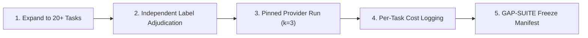

<!-- Copyright (c) 2026 Tiago Vilas Boas. SPDX-License-Identifier: Apache-2.0 -->

# Evaluation suite inventory: development tasks, held-out smoke set, and post-O8 verification

Downshift by Tiago Vilas Boas · https://github.com/tiagovilasboas/downshift

What this document answers: which evaluation tasks and benchmark datasets are recorded in Downshift's evidence ladder,
what each task tests, how acceptance is verified, which commits establish baselines, and how the minimal reproducible
evaluation set is run offline without expensive API calls.

This document serves as the authoritative inventory for Issue #23 ("Freeze independent coding tasks and reusable outcome
measurements", parent spike #21) and clarifies the boundary between the 40 development outcome tasks, the held-out
GAP-SUITE evaluation pool, and the live harness A/B tasks.

## Table of contents

1. [The 40 development outcome tasks](#1-the-40-development-outcome-tasks)
2. [Held-out outcome suite: GAP-SUITE](#2-held-out-outcome-suite-gap-suite)
3. [Minimal reproducible smoke evaluation set (post-O8 zero-cost)](#3-minimal-reproducible-smoke-evaluation-set-post-o8-zero-cost)
4. [Task categories and acceptance check mechanisms](#4-task-categories-and-acceptance-check-mechanisms)
5. [Baseline commits and provenance](#5-baseline-commits-and-provenance)
6. [Offline counterfactual replays versus live agent execution](#6-offline-counterfactual-replays-versus-live-agent-execution)
7. [GAP-SUITE roadmap and gating rules](#7-gap-suite-roadmap-and-gating-rules)

---

## 1. The 40 development outcome tasks

The development outcome suite consists of 40 Go coding tasks across four human-labeled complexity tiers (10 TRIVIAL, 10
SIMPLE, 10 MEDIUM, 10 COMPLEX). Each task directory contains:
- `task.json`: Unique identifier, label, and user prompt.
- `stub.go`: Initial interface and types presented to the model.
- `reference.go`: Known-good reference implementation.
- `check_test.go`: Hidden executable test verifying functional correctness.

Initial runs were recorded on 2026-10-03 using OpenRouter zero-data-retention endpoints across three fixed models:
- **Frontier:** `anthropic/claude-opus-5.5`
- **Mid:** `deepseek/deepseek-v4-flash`
- **Small:** `qwen/qwen3-coder-30b-a3b-instruct`

### 1.1 Complete task inventory

| Task ID | Label | Summary prompt | Small | Mid | Frontier |
|---|---|---|:---:|:---:|:---:|
| `t01-clamp` | TRIVIAL | `Clamp(v, lo, hi int) int` bounds `v` to `[lo, hi]` | PASS | PASS | PASS |
| `t02-reverse` | TRIVIAL | `Reverse(s string) string` reverses rune by rune | PASS | PASS | PASS |
| `t03-sum` | TRIVIAL | `Sum(xs []int) int` returns slice sum | PASS | PASS | PASS |
| `t04-max` | TRIVIAL | `MaxInt(xs []int) (int, bool)` largest element | PASS | FAIL | PASS |
| `t05-contains` | TRIVIAL | `Contains(xs []string, s string) bool` membership check | PASS | PASS | PASS |
| `t06-capitalize` | TRIVIAL | `Capitalize(s string) string` uppercases first letter | FAIL | FAIL | PASS |
| `t07-abs` | TRIVIAL | `Abs(x int) int` integer absolute value | PASS | PASS | PASS |
| `t08-ctof` | TRIVIAL | `CToF(c float64) float64` Celsius to Fahrenheit | PASS | PASS | PASS |
| `t09-count-even` | TRIVIAL | `CountEven(xs []int) int` counts even integers | PASS | PASS | PASS |
| `t10-join` | TRIVIAL | `JoinComma(xs []string) string` comma-separated join | PASS | PASS | PASS |
| `s01-word-freq` | SIMPLE | `WordFreq(text string) map[string]int` lowercase word counts | PASS | PASS | PASS |
| `s02-dedupe` | SIMPLE | `Dedupe(xs []string) []string` removes duplicates in order | PASS | PASS | PASS |
| `s03-chunk` | SIMPLE | `Chunk(xs []int, n int) [][]int` slice partition into chunks of `n` | PASS | PASS | PASS |
| `s04-fizzbuzz` | SIMPLE | `FizzBuzz(n int) []string` standard 1..n sequence | FAIL | FAIL | PASS |
| `s05-roman` | SIMPLE | `ToRoman(n int) string` converts 1..3999 to Roman numeral | PASS | PASS | PASS |
| `s06-slugify` | SIMPLE | `Slugify(s string) string` URL-safe slug formatting | FAIL | PASS | PASS |
| `s07-parse-kv` | SIMPLE | `ParseKV(s string) map[string]string` parses semicolon pairs | PASS | PASS | PASS |
| `s08-anagram` | SIMPLE | `IsAnagram(a, b string) bool` case/space-insensitive anagram | PASS | PASS | PASS |
| `s09-binary-search` | SIMPLE | `BinarySearch(xs []int, target int) int` index or -1 | PASS | PASS | PASS |
| `s10-to-snake` | SIMPLE | `ToSnake(s string) string` camelCase to snake_case preserving acronyms | FAIL | PASS | PASS |
| `m01-lru` | MEDIUM | `LRU` cache with `Get` / `Put` and eviction on capacity | PASS | PASS | PASS |
| `m02-merge-intervals` | MEDIUM | `Merge(intervals [][2]int) [][2]int` overlapping intervals | PASS | PASS | PASS |
| `m03-rpn` | MEDIUM | `EvalRPN(tokens []string) (int, error)` reverse Polish evaluation | PASS | PASS | PASS |
| `m04-semver` | MEDIUM | `CompareSemver(a, b string) (int, error)` SemVer 2.0 precedence | FAIL | PASS | PASS |
| `m05-csv-line` | MEDIUM | `ParseCSVLine(line string) ([]string, error)` escaped quotes and commas | FAIL | FAIL | PASS |
| `m06-token-bucket` | MEDIUM | `Bucket` rate limiter with continuous refill and clock injection | PASS | PASS | PASS |
| `m07-topo-sort` | MEDIUM | `TopoSort(deps map[string][]string) ([]string, error)` with tie-break | FAIL | PASS | PASS |
| `m08-word-wrap` | MEDIUM | `Wrap(text string, width int) []string` greedy wrap with long words | FAIL | PASS | PASS |
| `m09-spiral` | MEDIUM | `Spiral(m [][]int) []int` clockwise matrix traversal | PASS | PASS | PASS |
| `m10-retry` | MEDIUM | `Retry` with exponential backoff, injected sleep, context cancellation | PASS | PASS | PASS |
| `c01-dijkstra` | COMPLEX | `ShortestPath` on weighted directed graph using binary heap | PASS | PASS | PASS |
| `c02-expr` | COMPLEX | `Eval(expr string)` recursive-descent arithmetic parser with precedence | FAIL | FAIL | PASS |
| `c03-parallel-map` | COMPLEX | `ParallelMap` bounded worker pool with fail-fast context cancellation | FAIL | PASS | PASS |
| `c04-hash-ring` | COMPLEX | Consistent hash ring with virtual node replicas | PASS | PASS | PASS |
| `c05-lcs-diff` | COMPLEX | Line diff based on Longest Common Subsequence (` `, `-`, `+`) | PASS | PASS | PASS |
| `c06-trie-topk` | COMPLEX | Autocomplete prefix trie with weighted top-k retrieval | FAIL | FAIL | PASS |
| `c07-cron-next` | COMPLEX | `Next(spec, after)` standard 5-field cron calculation with steps | FAIL | FAIL | PASS |
| `c08-ledger` | COMPLEX | Concurrent double-entry ledger preventing overdraft and deadlocks | PASS | PASS | PASS |
| `c09-regex` | COMPLEX | Custom subset regex matcher (`.`, `*`, `+`, `?`) without `regexp` | FAIL | FAIL | PASS |
| `c10-sudoku` | COMPLEX | `Solve(board [9][9]int)` backtracking 9x9 Sudoku solver | PASS | FAIL | PASS |

### 1.2 Summary pass rates by tier

| Complexity label | Tasks | Small (`qwen3-coder-30b`) | Mid (`deepseek-v4-flash`) | Frontier (`claude-opus-5.5`) |
|---|--:|--:|--:|--:|
| TRIVIAL | 10 | 9/10 (90.0%) | 8/10 (80.0%) | 10/10 (100.0%) |
| SIMPLE | 10 | 7/10 (70.0%) | 9/10 (90.0%) | 10/10 (100.0%) |
| MEDIUM | 10 | 6/10 (60.0%) | 9/10 (90.0%) | 10/10 (100.0%) |
| COMPLEX | 10 | 5/10 (50.0%) | 5/10 (50.0%) | 10/10 (100.0%) |
| **All tasks** | **40** | **27/40 (67.5%)** | **31/40 (77.5%)** | **40/40 (100.0%)** |
| **TRIVIAL + SIMPLE** | **20** | **16/20 (80.0%)** | **17/20 (85.0%)** | **20/20 (100.0%)** |

**Key observations:**
- On TRIVIAL + SIMPLE tasks, the small tier is 16/20 (80.0%) versus 20/20 (100.0%) on the frontier tier: a **−20.0pp gap**.
- Router downshifting to small on seemingly simple tasks carries a failure risk that must be bounded by guardrails.
- Classifier routing recomputed on 2026-10-15 routed 6 tasks to small, 22 to mid, and 12 to frontier; 37 of 40 (92.5%) passed at the selected tier.

### 1.3 Frozen verification hashes

Per [baseline-freeze-2026-10-17.md](baseline-freeze-2026-10-17.md):
- Sorted directory names concatenated with each task's `check_test.go` sha256: `32854b9a`
- All four files per task (`task.json`, `stub.go`, `reference.go`, `check_test.go`): `11a43975`
- Labs reference commit: `bea9f36` (2026-10-11)
- Public sample fixtures checked into repo: `internal/outcome/testdata/t01-clamp` and `internal/outcome/testdata/t02-reverse`

---

## 2. Held-out outcome suite: GAP-SUITE

GAP-SUITE is the held-out outcome evaluation suite designed to validate model capability and tier memory on unseen tasks,
preventing evaluation leakage from the 40 development tasks.

### 2.1 Inventory and split structure

- **Total task candidate pool:** 21 task directories.
- **Complexity distribution:** 5 TRIVIAL, 4 SIMPLE, 8 MEDIUM, 4 COMPLEX.
- **Verification hash:** `f181fd4e` (sorted directory names and `check_test.go` sha256).
- **Lineage:** Tasks committed in labs `afaf34f`..`9b35d29` (2026-10-11).

### 2.2 Initial 6-task smoke run (2026-10-11)

In labs commit `3bc8757`, 6 of the 21 held-out tasks were evaluated in a single smoke run:

| Run tier | Pass rate | Spend (USD) | Note |
|---|:---:|--:|---|
| Frontier | 6/6 (100.0%) | $0.138 | Clean pass across all 6 held-out tasks |
| Mid | 4/6 (66.7%) | $0.004 | Served by four different providers during the run (unpinned provider flaw) |
| Small | 2/6 (33.3%) | $0.001 | 2 passed, 4 failed |
| **Total** | — | **$0.142** | Verified offline via `eval-outcome --verify` |

The remaining 15 tasks in the 21-task pool were left unrun to preserve held-out integrity.

### 2.3 Holdout boundary rule

> [!IMPORTANT]
> The GAP-SUITE tasks must never be used for tuning regex signals, adjusting semantic weights, or tuning tier-memory
> parameters (`internal/adapt/count_predictor.go`). They serve strictly as an independent evaluation gate.

---

## 3. Minimal reproducible smoke evaluation set (post-O8 zero-cost)

### 3.1 Post-O8 evaluation requirements

Under owner decision O8 (2026-10-28):
1. Model selection belongs to the orchestrator (user, settings, or harness).
2. The built-in classifier-driven tier downgrade and built-in risk floor (R5) were removed.
3. Downshift operates as an enforcement engine for declared project policy (`.downshift/policy.json`).
4. Moves up are deterministic only: project declared floor (`policy_floor`) and opt-in `raise_complex`.
5. Doubt never spends money: unconfident verdicts or missing baselines hold the requested model.

Post-O8 changes must be verified against regression using a reproducible smoke evaluation set that does **not** require
expensive API calls or network access.

### 3.2 Four-tier zero-cost smoke harness

The minimal smoke harness consists of four offline layers:

```mermaid
flowchart TD
    subgraph L1["Layer 1: Unit & Outcome Check Harness"]
        A["internal/outcome/testdata/ (t01, t02)"] --> B["outcome.Verify() / Check()"]
        B --> C["go test ./internal/outcome/..."]
    end
    subgraph L2["Layer 2: Classifier Regression Benchmark"]
        D["internal/benchmark/testdata/eval/ (seed.json, holdout.json)"] --> E["ClassifyWithSemantic()"]
        E --> F["go test ./internal/benchmark/..."]
    end
    subgraph L3["Layer 3: Structural Refactor Verification"]
        G["4 Mechanical Tasks (rename, constant, docs, mirror)"] --> H["9 Validated AST/Check Tests"]
    end
    subgraph L4["Layer 4: Policy & Guardrail Invariants"]
        I["Policy Floor & Doubt Tests"] --> J["R1-R9 Guards / Never Widen"]
        J --> K["make check"]
    end
```



#### Layer 1: Unit & outcome check harness (`internal/outcome`)
- **What it runs:** `go test -v ./internal/outcome/...`
- **What it verifies:**
  - Tasks `t01-clamp` and `t02-reverse` are executed in temporary throwaway Go modules (`os.MkdirTemp`).
  - Strict discriminating check: `stub.go` fails compilation or tests; `reference.go` passes all tests.
  - Verification that recorded solution files (`.go.txt`) reproduce `run.json` results offline.

#### Layer 2: Static classifier benchmark (`internal/benchmark`)
- **What it runs:** `go test -v ./internal/benchmark/...`
- **What it verifies:**
  - In-tree frozen seed net `internal/benchmark/testdata/eval/seed.json` (200 tasks, sha256 `e6091376`).
  - In-tree burned holdout `internal/benchmark/testdata/eval/holdout.json` (300 tasks, sha256 `8378233c`).
  - Evaluates `core.ClassifyWithSemantic` without API calls:
    - Tier accuracy: seed ≥ 73.5% (95% CI 67.0–79.1%), holdout = 100%.
    - Safety invariants: `FRONTIER→MID == 0`, `FRONTIER→SMALL == 0`.

#### Layer 3: Synthetic mechanical task checks (reusing b5 suite)
- **What it runs:** 4 mechanical refactoring tasks (`mech-rename`, `mech-constant`, `mech-doc-comments`, `mech-test-mirror`) at base commit `a8e389c`.
- **What it verifies:**
  - 9 validated structural checks per task that fail at the base commit and pass with known reference solutions.
  - Tests compiler and check determinism without live LLM calls.

#### Layer 4: Policy and guardrail invariant tests
- **What it runs:**
  - `cmd/downshift/doubt_held_e2e_test.go`: Verifies that doubt never spends money (`TestHookE2E_DoubtHoldsUpshiftAndUnknownFrontier`).
  - `cmd/downshift/policy_floor_e2e_test.go`: Verifies that project tier floors from `.downshift/policy.json` apply deterministically across all harness runners.
  - `internal/routing/guard/guard_test.go`: Verifies rules R1 through R9 (`never_widen`, foreign models, unconfident holds).

---

## 4. Task categories and acceptance check mechanisms

### 4.1 Task taxonomy

Evaluation tasks in Downshift are categorized into distinct operational types:

| Category | Typical scope | Primary failure mode | Role in evaluation |
|---|---|---|---|
| **TRIVIAL** | Leaf helper function, single slice/arithmetic op, no loops or 1 trivial loop | Off-by-one, type conversion | Sanity check for small models |
| **SIMPLE** | String manipulation, map counts, straightforward data parsing | Edge case formatting, whitespace | Downshift ceiling candidate |
| **MEDIUM** | State management, concurrency/time primitives, multi-step algorithms (LRU, token bucket, topo sort) | Concurrency race, boundary condition | Mid tier baseline |
| **COMPLEX** | Recursive-descent parsing, backtracking, graph traversal, concurrent double-entry ledger | Algorithm timeout, deadlock, syntax errors | Frontier necessity proof |
| **Mechanical** | Multi-file renames, doc comments, constant extraction, test mirroring | Incomplete edits, missed symbol references | Rung D ceiling case (34% downshift) |
| **Real bug fix** | Historical PR fixes from repository commit history | Context mismatch, regression | Rung D natural delegation test |

### 4.2 Acceptance check mechanisms

Acceptance check design follows Fowler's sensor principle:

1. **Clean-room module isolation:**
   ```go
   // From internal/outcome/outcome.go Check()
   dir, _ := os.MkdirTemp("", "outcome-"+t.ID+"-")
   // writes go.mod, solution.go, check_test.go
   cmd := exec.CommandContext(ctx, "go", "test", "-count=1", "./...")
   cmd.Dir = dir
   cmd.Env = append(os.Environ(), "GOWORK=off", "GOFLAGS=")
   ```
2. **Discriminating requirement:**
   - Every check must fail on `stub.go`.
   - Every check must pass on `reference.go`.
   - A check that passes on the stub is invalid and rejected by `eval-outcome --verify`.
3. **Non-LLM objective judge:**
   - Acceptance is strictly the process exit code (`0` for pass, non-zero for fail).
   - No LLM-as-a-judge is permitted in outcome evaluation.

---

## 5. Baseline commits and provenance

| Component | Baseline commit / SHA | Date | Verified artifacts / Hashes |
|---|---|---|---|
| Reference evaluation binary | `2c8f3f4` (`2c8f3f4c6c...`) | 2026-10-17 | Baseline freeze manifest reference commit |
| Development outcome runs (40 tasks) | `64cbac54` | 2026-10-03 | `benchmark/outcomes/runs/{small,mid,frontier}/run.json` |
| Mechanical tasks base commit | `a8e389c` | 2026-10-15 | Public v0.1.0-beta.12 changelog, 9 checks each |
| Real bug fix 1: `explore-plan-baseline` | `fb0dcb7` → `6e807fa` | 2026-10-15 | Base commit fails check; fix commit passes |
| Real bug fix 2: `antigravity-task-text` | `80ee141` → `8515e1c` | 2026-10-15 | Base commit fails check; fix commit passes |
| Real bug fix 3: `setup-named-group` | `7956b19` → `de9768f` | 2026-10-15 | Base commit fails check; fix commit passes |
| Real bug fix 4: `agent-type-telemetry` | `621e29a` → `2cb4dc6` | 2026-10-15 | Base commit fails check; fix commit passes |
| Seed regression net | `bea9f36` | 2026-10-11 | `tasks.json` (`e6091376`) |
| Burned holdout net | `bea9f36` | 2026-10-11 | `holdout.json` (`8378233c`) |
| GAP-SUITE candidate tasks | `afaf34f`..`9b35d29` | 2026-10-11 | 21 task dirs (`f181fd4e`) |
| GAP-SUITE 6-task smoke run | `3bc8757` | 2026-10-11 | Small 2/6, Mid 4/6, Frontier 6/6 ($0.142 total) |

---

## 6. Offline counterfactual replays versus live agent execution

Understanding the difference between offline counterfactual replay and live agent execution is essential to avoid
over-interpreting metrics.

| Dimension | Offline counterfactual replay | Live agent execution (A/B harness) |
|---|---|---|
| **What runs** | Pre-recorded prompt or solution evaluated against classifier or test check | Autonomous harness process (Claude Code, Cursor, Codex) executing tool calls |
| **Execution turns** | 1 turn (batch prompt evaluation or solution compilation) | Multi-turn interactive loop (10 to 40+ tool turns per task) |
| **Operating cost** | **$0.00** (Local CPU execution) | **$0.20 – $1.50+** per run in paid model tokens |
| **Execution time** | Milliseconds to seconds | Minutes to tens of minutes |
| **Determinism** | 100% deterministic | Stochastic (agent variation across turns, prompt drift) |
| **Token accounting** | Same-token counterfactual (assumes identical tokens on both models) | Actual observed tokens (measures divergence between Haiku, Sonnet, Opus) |
| **Rework / Retries** | None (single static check) | Observed retries, error recovery, subagent re-delegation |
| **Harness integration** | Bypassed | Fully exercised (stdin/stdout hook pipes, async transcript, child ends) |
| **What it proves** | Algorithmic correctness, guardrail conformance, baseline capability | Real-world economic savings, rework penalty, harness compatibility |

**Rule of interpretation:**
An offline counterfactual replay proves that Downshift's routing rules and classifier make the intended decision on a given
input string. It does **not** prove that a live agent session will save money or complete the task correctly. Real savings
require Rung D live validation.

---

## 7. GAP-SUITE roadmap and gating rules

### 7.1 Current status: open

GAP-SUITE remains open in `docs/internal/gap-tasks.md`. The initial 6-task smoke run demonstrated that the evaluation
machinery works and confirmed that the small model fails on complex held-out logic (2/6 pass), while the frontier model
passes reliably (6/6 pass). However, the suite is not yet ready to serve as a promotion gate.

### 7.2 GAP-SUITE closure criteria

To close GAP-SUITE and enable tier-memory promotion, five milestones must be completed:



1. **Task set expansion:** Complete and validate all 21 tasks in the pool (plus any new additions) ensuring topics are strictly outside the 40 development tasks.
2. **Independent label adjudication:** Human review of complexity labels to prevent subjective bias.
3. **Pinned provider per tier:** The initial mid-tier run was split across four OpenRouter providers. The final benchmark run must pin a single reproducible provider per tier.
4. **Statistical variance bounds (k=3):** Run three independent passes per task per tier to establish confidence intervals and measure model stochasticity.
5. **Freeze manifest:** Issue a formal sha256 freeze manifest recording per-task cost, tokens, and pass rates.

### 7.3 Gating rule for tier memory (GAP-MEMORY-COUNTS)

> [!CAUTION]
> Count-based tier memory (`internal/adapt/count_predictor.go`) and set-based memory (`AdjustTier`) score 34/40
> leave-one-task-out on the development suite against 37/40 for the classifier.
>
> Tier memory **must remain in shadow mode** until GAP-SUITE is fully closed and proves that memory-adjusted routing
> reduces cost per completed task without degrading quality below the classifier baseline.

---

## Related documentation

- [Evidence ladder: what each saving figure means](../guides/evidence.md)
- [Baseline freeze manifest (2026-10-17)](baseline-freeze-2026-10-17.md)
- [Subagent routing A/B results (2026-10-15)](subagent-routing-ab-2026-10-15.md)
- [Four-arm mechanical battery (2026-10-21)](four-arm-mechanical-2026-10-21.md)
- [Delegation boundaries and coordination overhead (2026-11-07)](delegation-boundaries-and-overhead-2026-11-07.md)
- [Runtime and evidence task queue](../internal/gap-tasks.md)
- [Published classifier & outcome metrics](../benchmark/report.md)
