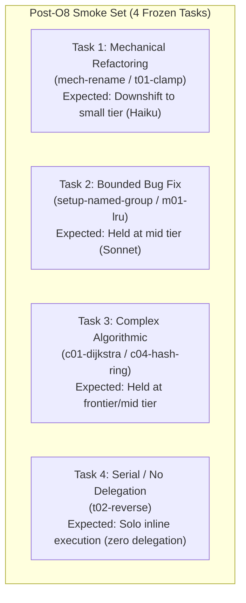

<!-- Copyright (c) 2026 Tiago Vilas Boas. SPDX-License-Identifier: Apache-2.0 -->

# Post-O8 three-arm benchmark smoke protocol: fixed Opus, native opusplan, and Downshift O8 (2026-11-07)

Downshift by Tiago Vilas Boas · https://github.com/tiagovilasboas/downshift

What this document establishes: a reproducible, small, directional post-O8 benchmark smoke protocol comparing fixed
Opus, native `opusplan`, and Downshift O8 on Claude Code. It reconciles Issue #22 (parent spike #21),
[`benchmark-protocol.md`](../guides/benchmark-protocol.md), [`evaluation-suite-inventory.md`](evaluation-suite-inventory.md),
and [`claude-execution-workflow-reconciliation-2026-11-07.md`](claude-execution-workflow-reconciliation-2026-11-07.md).

---

## 1. Context and rationale for a post-O8 smoke

### 1.1 Evolution of the comparison baseline

Prior three-arm and A/B evaluations (such as [`subagent-routing-ab-2026-10-15.md`](subagent-routing-ab-2026-10-15.md) and
[`controlled-suite-opusplan-natural-2026-10-29.md`](controlled-suite-opusplan-natural-2026-10-29.md)) operated under
pre-O8 assumptions or relied on the in-process `DOWNSHIFT_NO_ROUTE=1` control switch.

Since late October 2026, the runtime baseline changed fundamentally:
1. **Decision O8 (2026-10-28):** Automatic classifier-driven tier downgrading and mandatory risk floors were removed.
   The lead orchestrator (user, settings, or harness) selects the baseline model; Downshift acts as a deterministic
   enforcement engine for declared project policies ([`.downshift/policy.json`](../guides/config.md)).
2. **Removal of the control switch (2026-11-02):** The `DOWNSHIFT_NO_ROUTE=1` switch and `DOWNSHIFT_CONTROL_SHARE` were
   completely removed from the code. Spawns with Downshift hooks installed are always routed. Control arms now run
   cleanly without Downshift hooks installed, and Downshift records nothing for them.
3. **Anthropic multi-model baseline:** Claude Code shipped native `opusplan` as an official configuration setting
   (Opus plans during plan mode, Sonnet executes delegated subagents by default).
4. **Agent type policy profiles (PR #18):** Downshift introduced explicit agent-type profiles (e.g. mapping `Explore` to
   small/Haiku tier and `Plan` to mid/Sonnet tier) and deterministic bounds (`policy_floor`, `raise_complex`).
5. **Model honor and workflow reconciliation (Issue #26):** Verified that Claude Code honors `updatedInput.model` for
   ordinary delegated subagents (`Agent` / `Task` tool calls), while Anthropic Managed Agents and Workflows bypass local
   hooks entirely.

### 1.2 The central research question

The central question left open by the [evidence ladder](../guides/evidence.md) is:
> **Does Downshift O8 save tokens or cost beyond what native `opusplan` already saves, in which task categories, at what
> quality and failure cost, and what remains unmeasured?**

### 1.3 Why start with a small directional smoke?

A comprehensive benchmark across all 6 task categories (24 tasks × 3 arms × 6 repetitions = 432 live runs) would cost
hundreds of dollars and tens of millions of tokens.

Per Issue #22 guidance, a **small directional smoke** using frozen fixtures is the mandatory P0 prerequisite:
- A new 20-task suite is **not** a prerequisite for detecting integration failures.
- A smoke **cannot** establish broad economic savings or non-inferiority.
- A smoke **does** verify:
  1. Hook coexistence and execution stability without harness timeouts or schema rejections.
  2. Model honor: verifying that `updatedInput.model` rewritten by Downshift is actually executed by the child agent.
  3. Policy differentiation: confirming whether Downshift routes mechanical or exploratory tasks to cheaper tiers while
     native `opusplan` leaves them on Sonnet.
  4. Safety invariants: confirming that complex or doubtful tasks remain held on mid/frontier tiers (`FRONTIER→SMALL == 0`).
  5. Telemetry capture: confirming that usage records, child ends, and cache metrics are cleanly recorded in
     an isolated state directory.

---

## 2. The three arms specification

The three arms compare identical prompts, identical harness versions, and identical repository commits under three
distinct operational configurations:

| Arm | Name | Session model | Subagent default | Downshift hooks | How configured |
|---|---|---|---|---|---|
| **Arm A** | Fixed Strong | `claude-opus-5-5` | Inherits Opus | **Not installed** | Pinned `"model": "opus"` in `.claude/settings.json` without Downshift hooks |
| **Arm B** | Native `opusplan` | `opusplan` (Opus plans) | Sonnet (`claude-sonnet-5-5`) | **Not installed** | Pinned `"model": "opusplan"` in `.claude/settings.json` without Downshift hooks |
| **Arm C** | `opusplan` + Downshift O8 | `opusplan` (Opus plans) | Sonnet (governed by policy) | **Wired** (`PreToolUse`, `PostToolUse`, `SubagentStop`) | Pinned `"model": "opusplan"` with Downshift hooks installed in isolated `DOWNSHIFT_STATE_DIR` |

### 2.1 Environmental isolation and state hygiene

- **No removed control switch:** Arms A and B run *clean*, with zero Downshift binaries or hooks in `.claude/settings.json`.
  They generate no `events.jsonl` and incur zero hook latency overhead.
- **Isolated state directory for Arm C:**
  ```bash
  export DOWNSHIFT_STATE_DIR="$(mktemp -d /tmp/downshift-smoke-arm-c-XXXXXX)"
  ```
  Arm C records only its own decisions and usage events, avoiding telemetry contamination from other work.
- **Declared policy for Arm C:**
  ```json
  {
    "policy_floor": "small",
    "profiles": {
      "explore": "small",
      "plan": "mid"
    },
    "raise_complex": true
  }
  ```
  This exercises the PR #18 agent-type profiles and deterministic tier boundaries under O8.

---

## 3. Frozen task selection for the directional smoke

To minimize cost while spanning the behavioral spectrum, the smoke selects **4 frozen tasks** from the authoritative
[evaluation suite inventory](evaluation-suite-inventory.md) and historical controlled batches:



### 3.1 Task breakdown

| ID | Category | Fixture / Base commit | Prompt summary | Hidden check | Expected behavior across arms |
|---|---|---|---|---|---|
| **S1** | Mechanical / Parallel Slices | `mech-rename` (base `a8e389c`) or `t01-clamp` | Multi-file symbol rename across internal packages | 9 AST/compiler check tests | Arm A: Opus subagents.<br>Arm B: Sonnet subagents.<br>Arm C: Haiku subagents (downshift ceiling). |
| **S2** | Medium / Bounded Fix | `setup-named-group` (base `7956b19`) or `m01-lru` | Fix named capture group parsing in regex config | Discriminating unit test suite | Arm A: Opus.<br>Arm B: Sonnet.<br>Arm C: Sonnet held (no unsafe downshift). |
| **S3** | Complex / Algorithmic | `c01-dijkstra` or `c04-hash-ring` | Shortest path on weighted graph with priority queue | `check_test.go` integration check | Arm A: Opus.<br>Arm B: Sonnet.<br>Arm C: Frontier/Mid held (`FRONTIER→SMALL == 0`). |
| **S4** | Delegation Does Not Pay | `t02-reverse` (`internal/outcome/testdata/t02-reverse`) | Rune-by-rune string reversal | `check_test.go` unit test | Orchestrator solves inline in single turn; tests coordination overhead if delegated. |

### 3.2 Pre-run sensor validation (Fowler's principle)

Before running any arm:
1. Verify that the hidden acceptance check **FAILS** on the task's base commit or stub.
2. Verify that the hidden acceptance check **PASSES** when the known reference solution is applied.
3. Any check that passes on the base or stub is rejected and disqualified.

---

## 4. Measurement matrix: observed vs unknowns

Downshift maintains strict transparency regarding what is directly observed versus what is estimated or unknown.

| Dimension / Metric | Arm A (Fixed Opus) | Arm B (Native `opusplan`) | Arm C (`opusplan` + Downshift O8) | Telemetry status |
|---|---|---|---|---|
| **Requested model** | Manual from transcript (`claude-opus-5-5`) | Manual from transcript (`claude-sonnet-5-5`) | Observed: `requested_model` on decision event | Available in C; manual in A and B |
| **Executed child model** | Manual from transcript (`tool_response.outputFile`) | Manual from transcript (`tool_response.outputFile`) | Observed: `final_model` on decision, confirmed via `PostToolUse` / transcript | Available in C; manual in A and B |
| **Subagent billable tokens** | Manual from child transcript | Manual from child transcript | Observed: `input_tokens`, `output_tokens`, `cache_write_tokens` on `SubagentStop` | Available on Claude Code in C |
| **Subagent cache reads** | Manual from child transcript | Manual from child transcript | Observed: `cached_tokens` on `SubagentStop` (separated from billable tokens) | Available on Claude Code in C |
| **Parent session tokens** | Harness summary (`total_cost_usd`) | Harness summary (`total_cost_usd`) | Harness summary (`total_cost_usd`) | **Unobserved** by hooks inside session |
| **Wall-clock latency** | External timer | External timer | External timer (telemetry timestamps provide spawn deltas) | Manual external measurement |
| **Rework / Retries** | Manual hand count | Manual hand count | Observed: `downshift stats` respawn counts, `child_status: error|interrupted` | Available in C; manual in A and B |
| **Context compaction** | None | None | Observed: raw vs compacted bytes in Downshift log | Available in C |
| **Routing rationale** | None | None | Observed: `downshift session --why`, reason codes, guardrail rules | Available in C |
| **Invoice dollars** | Flat subscription / list price | Flat subscription / list price | Flat subscription / list price | **Unknown** (no invoice API) |

### 4.1 Boundaries and explicit unknowns

- **Parent-turn token breakdown:** Claude Code hooks execute only on tool use (`PreToolUse`, `PostToolUse`, `SubagentStop`).
  They do not observe prompt tokens consumed by the lead orchestrator during internal reasoning turns.
- **Duration fields:** Telemetry events contain discrete timestamps (`created_at`) but no duration or latency field.
  Total wall-clock duration must be timed externally by the test runner.
- **Child failure payloads:** If a subagent crashes silently or fails without emitting a standard error payload,
  `PostToolUseFailure` is uncaptured (GAP-CHILD-FAILURE). Hand counts of failed turns must supplement telemetry.
- **Invoice vs catalog pricing:** Claude Code subscription plans (Pro, Team, Enterprise) do not bill per-token.
  Reported dollars are catalog approximations derived from `total_cost_usd`, not actual invoices.

---

## 5. Execution protocol

### 5.1 Run configuration and budget

- **Repetition count:** $k = 3$ runs per task per arm ($4 \text{ tasks} \times 3 \text{ arms} \times 3 \text{ repetitions} = 36 \text{ runs}$).
  For a zero-spend dry run or rapid integration check, $k = 1$ ($12 \text{ runs}$) may be executed first.
- **Run order shuffling:** Runs must be interleaved across arms (e.g. `S1-ArmA-r1`, `S1-ArmB-r1`, `S1-ArmC-r1`,
  `S2-ArmB-r1`, `S2-ArmC-r1`, `S2-ArmA-r1`, ...) to eliminate time-of-day bias, gateway throttling, and cache warming bias.
- **Harness pinning:** Pinned Claude Code version (e.g. 2.1.319 or later), default reasoning effort, identical git commit.

### 5.2 Step-by-step runner procedure

```bash
# 1. Prepare isolated workspace and state
WORK_DIR="$(mktemp -d /tmp/downshift-smoke-run-XXXXXX)"
STATE_DIR="$(mktemp -d /tmp/downshift-state-arm-c-XXXXXX)"

# 2. Configure Arm C settings
cat <<EOF > "$WORK_DIR/.downshift/policy.json"
{
  "policy_floor": "small",
  "profiles": {
    "explore": "small",
    "plan": "mid"
  },
  "raise_complex": true
}
EOF

# 3. For each task in shuffled order:
#    a. Reset git repository to task base commit
#    b. Apply task prompt via headless harness invocation
#    c. Record wall-clock start and stop
#    d. Execute hidden acceptance check
#    e. Extract total_cost_usd and transcript tokens

# 4. At conclusion of Arm C runs, export sanitized telemetry:
DOWNSHIFT_STATE_DIR="$STATE_DIR" downshift stats --days=1 --export > arm_c_stats.json
DOWNSHIFT_STATE_DIR="$STATE_DIR" downshift report --days=1 --json > arm_c_report.json
```

---

## 6. Analysis and decision rules

### 6.1 Evaluation metrics

1. **Acceptance rate ($A$):**
   $$A_{\text{arm}} = \frac{N_{\text{passed}}}{N_{\text{total}}}$$
   Reported with 95% Wilson score confidence intervals.
2. **Cost per accepted task ($C_{\text{accepted}}$):**
   $$C_{\text{accepted}} = \frac{\sum_{i=1}^{N} \text{Cost}_i}{N_{\text{passed}}}$$
   All failed runs are charged directly to the task. A cheaper model that fails and requires re-runs is penalized.
3. **Billable subagent tokens:**
   $$\text{Tokens}_{\text{billable}} = \text{Input} + \text{Output} + \text{CacheWrite}$$
   Cache reads are reported separately and excluded from tier comparison arithmetic.
4. **Attribution check:**
   Within Arm C, tasks where Downshift applied a rewrite are analyzed separately from tasks where Downshift abstained or
   held the model. If Arm C applied zero rewrites on a task, any observed cost difference between Arm B and Arm C is
   statistically classified as **agent variation / noise**, not Downshift routing.

### 6.2 Decision gate: when to expand beyond the smoke

The smoke run is successful and authorises broader benchmarking (such as closing GAP-SUITE) **only when**:
- [x] Zero harness crashes, schema validation errors, or hook timeouts occurred across all Arm C runs.
- [x] Executed child models in Arm C match Downshift's recorded `final_model` (model honor verified).
- [x] Arm C acceptance rate is non-inferior to Arm B ($A_{\text{Arm C}} \ge A_{\text{Arm B}} - 0.10$).
- [x] S1 (Mechanical) demonstrates clean downshift to small tier (Haiku) with non-zero token savings.
- [x] S3 (Complex) demonstrates zero unsafe downgrades (`FRONTIER→SMALL == 0`).

If the smoke fails on any of these criteria, the benchmark stops immediately, and the failure is logged and triaged as a
defect before any further tokens are spent.

---

## 7. Privacy and telemetry integrity

- **Zero prompt leakage:** No task text, code diffs, file paths, or raw prompt strings leave the local machine.
- **Published artifacts:** Only opaque task IDs (`S1`–`S4`), aggregate token counts, pass/fail exit codes, Wilson
  intervals, and sanitized JSON exports from `downshift stats --export` and `downshift report --json` are published.
- **Independent reproduction:** Anyone with access to the frozen task hashes in [baseline-freeze-2026-10-17.md](baseline-freeze-2026-10-17.md)
  can reproduce the exact run sequence.

---

## Related documentation

- [Benchmark protocol: Opus fixed, native opusplan, opusplan with Downshift](../guides/benchmark-protocol.md)
- [Evaluation suite inventory: development tasks, held-out smoke set, and post-O8 verification](evaluation-suite-inventory.md)
- [Claude Code execution, model honor, and workflow reconciliation (2026-11-07)](claude-execution-workflow-reconciliation-2026-11-07.md)
- [Benchmark delegation boundaries and coordination overhead (2026-11-07)](delegation-boundaries-and-overhead-2026-11-07.md)
- [Controlled suite: routed versus control on Claude Code (2026-10-29)](controlled-suite-opusplan-natural-2026-10-29.md)
- [Evidence ladder: what each saving figure means](../guides/evidence.md)
- [Beta exit task map](../reference/beta-exit.md)
