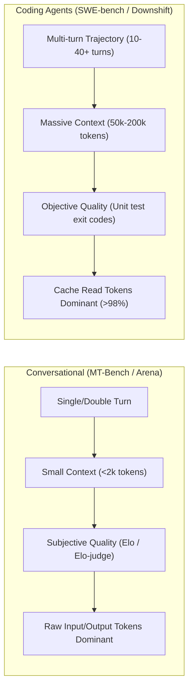

<!-- Copyright (c) 2026 Tiago Vilas Boas. SPDX-License-Identifier: Apache-2.0 -->

# Benchmark RouteLLM and coding-agent routers against Downshift (2026-11-07)

Downshift by Tiago Vilas Boas · https://github.com/tiagovilasboas/downshift

What this document answers: how Downshift's deterministic, hook-local routing architecture compares against academic
and commercial LLM routers (RouteLLM, RouterBench, LLMRouterBench, SWE-Router, Agent-as-a-Router, and FrugalGPT),
why conversational benchmarks (MT-Bench) fail to capture software engineering agent dynamics, why Downshift O8 rejects
runtime model calls for routing, and what evaluation methodologies Downshift adopts.

This document fulfills Issue #28 under Wave 3 of parent spike #21.

---

## 1. Comprehensive router comparative matrix

The following table evaluates seven routing paradigms across foundational architectural, economic, and operational axes:

| Dimension | RouteLLM (LMSYS / UC Berkeley) | RouterBench (Alibaba / Qwen) | LLMRouterBench | SWE-Router | Agent-as-a-Router / CodeRouterBench | FrugalGPT (Stanford) | Downshift O8 (Hook-Local) |
|---|---|---|---|---|---|---|---|
| **Citation & Date** | Ong et al., June 2024 (arXiv:2406.18665) | Liu et al., March 2024 (arXiv:2403.12031) | Zhang et al., July 2024 | Pan et al., October 2024 | Various (e.g., AutoGen, CodeRouter 2024) | Chen et al., March 2023 (arXiv:2305.05176) | Vilas Boas, October 2026 (Public Main) |
| **Decision Unit & Inputs** | Single prompt text (embeddings or token sequences) | Single prompt text | Single prompt text | Trajectory prefix (issue description + initial 1–2 exploration turns) | High-level goal or full prompt passed to meta-LLM | Single prompt + intermediate model generation | `PreToolUse` hook stdin JSON (`prompt`, `agent_type`, `parent_model`, declared policy) |
| **Supported Models & Topology** | Binary pair (1 Strong, 1 Weak; e.g., GPT-4 vs Mixtral-8x7B) | Multi-model pairwise comparison (up to 10+ models) | Dynamic multi-model candidate pool | Tiered pairs (e.g., Claude 3.5 Sonnet vs Haiku / DeepSeek) | Multi-model or multi-agent selection | Sequential cascade (Cheapest $\rightarrow$ Mid $\rightarrow$ Strongest) | N-tier catalog (small, mid, frontier) with native harness aliases and project policy floors |
| **Target Dataset & Tasks** | Conversational chat: MT-Bench, MMLU, GSM8K, Chatbot Arena | Multi-task academic: MMLU, ARC, GSM8K, HumanEval | Mixed general QA, summarization, and reasoning | Real software engineering: SWE-bench Lite / Verified | Complex code generation and tool calling benchmarks | Question answering: CoQA, TriviaQA, MMLU | Multi-turn software engineering: 40-task dev suite, GAP-SUITE held-out, b2/b5/b6 repository tasks |
| **Quality & Cost Metrics** | Win rate (LMSYS Elo), call cost reduction % at 95% quality | Cost-utility Pareto frontier, task accuracy per dollar | Normalized accuracy drop vs percentage cost saved | SWE-bench pass@1 resolved rate vs total inference cost | Pass@k, reasoning cost, routing token overhead | Task accuracy vs inference dollar spend | Tokens by tier (input, output, cache write/read), pass@1 unit test exit codes, rework rate (10-min retry window) |
| **Context, Cache & Retry Accounting** | Naive prompt token count; zero cache read modeling; zero retry accounting | Single-turn static token count; zero caching | Single-turn token count; zero caching | Multi-turn context modeled; partial cache awareness | Spends additional frontier tokens for routing; ignores cache reuse | Evaluates output per hop; accumulates cumulative generation cost | **Full prompt cache tracking (>98% cache reads)**; subagent base context tax (50k–100k); rework cost attribution |
| **Latency & Cost Overhead** | **High:** 100–300 ms API embedding latency + embedding API fee; or local BERT/MLP compute | **High:** Embedding extraction or MLP inference (50–200 ms) | **High:** Router inference latency (embedding or classifier model) | **Moderate to High:** Trajectory evaluation turn latency (100–500 ms) | **Extreme:** 500–2,500 ms + hundreds of router LLM tokens per decision | **Cumulative:** $T_{\text{weak}} + T_{\text{eval}} + T_{\text{strong}}$ on cascade misses | **Zero extra AI latency (0.2–1.5 ms)**; local Go binary execution; $0.00 router token cost |
| **License & Artifact Availability** | Apache-2.0; open-source weights and router package | Open-source evaluation code and benchmark data | Open-source benchmark repository | Research code / preprints | Open research frameworks | Commercialized / research code | Apache-2.0; standalone Go CLI, embedded catalog, verifiable test suites |
| **Primary Limitation** | Fails on multi-turn code agent trajectories; binary routing only | Evaluates static prompt classification, not interactive multi-turn agent loops | Lacks harness hook integration; no session model inheritance | Requires burning initial exploration turns before routing | Router token spend frequently exceeds the savings of the downshift | Cascading execution latency unacceptable in interactive CLI workflows | Requires declared user policy or orchestrator hints for ambiguous non-mechanical prompts |

---

## 2. Deep-dive architectural trade-offs

### 2.1 Why Downshift O8 rejects runtime LLM and embedding calls

Academic routing frameworks almost universally introduce a machine learning inference step—such as an embedding API
call (`text-embedding-3-small`), a local BERT encoder, matrix factorization, or a meta-LLM classifier—at routing time.
Downshift explicitly rejected this path in owner decision O8 (2026-10-28) for four structural reasons:

#### 1. The latency budget of developer CLI hooks
Developer workflows inside tools like Claude Code, Cursor, and Codex operate under stringent interactive execution
budgets. Claude Code's `PreToolUse` hook timeout is bounded (typically 1,500 ms to 5,000 ms).
- An external embedding API call takes **100 ms to 300 ms** under favorable network conditions, and easily spikes to
  **1,000+ ms** during network jitter, rate limiting, or cold connections.
- Downshift executes synchronously in **0.2 ms to 1.5 ms** (sub-millisecond warm p50: 0.23 ms; warm p95: 3.22 ms,
  measured in [`e5-int8-evaluation-2026-10-17.md`](e5-int8-evaluation-2026-10-17.md)).
- Zero network roundtrips ensures the developer's typing and tool-execution loop remains instantaneous.

#### 2. The routing overhead tax (spending tokens to save tokens)
In multi-agent coding workflows, tasks delegated to subagents are frequently small or mechanical (e.g., renaming a
symbol, updating doc comments, or formatting a file).
- If a router invokes a meta-LLM or embedding model, it expends **500 to 2,000 tokens** simply deciding which model
  to dispatch.
- When downshifting a mechanical subagent from Sonnet to Haiku saves 800 uncached work tokens, spending 600 tokens on
  the routing call reduces net financial savings to near zero.
- Downshift incurs **$0.00 in routing cost** and burns zero tokens to make a decision.

#### 3. Air-gap compliance and zero prompt exfiltration
Sending task prompts or file diffs to an external routing classifier violates enterprise data governance, zero-data-retention
(ZDR) guarantees, and local privacy boundaries.
- Gateways and hosted routers inspect prompt content and metadata in cloud servers.
- Downshift's router is a local binary: the task prompt never leaves the local machine during the decision phase.
  Telemetry logs (`events.jsonl`) record token counts and tier labels, never prompts or code.

#### 4. Deterministic policy enforcement vs probabilistic drift
Probabilistic routers (matrix factorization, cosine similarity thresholds) exhibit stochastic variance: a prompt that
routes to `small` today might route to `frontier` tomorrow because of floating-point variance or prompt framing drift.
- In software engineering, regressions must be deterministic. If a security-critical database migration is routed,
  the developer must know with 100% certainty that the project tier floor (`policy_floor`) or `never_widen` rule
  guarantees it will not run on an unvetted small model.
- Downshift operates on deterministic rules: orchestrator intent, declared policy files (`.downshift/policy.json`),
  and safe fallbacks where doubt never spends money.

---

### 2.2 Why conversational benchmarks (MT-Bench) fail for coding agents

RouteLLM and RouterBench evaluate their performance primarily on conversational benchmarks (MT-Bench, Chatbot Arena,
MMLU). These benchmarks fail to model the reality of autonomous coding agents in three fundamental ways:

#### 1. Cache token dominance (>98% of spend)
In conversational chat, every turn submits a fresh prompt, and input/output tokens represent the bulk of the bill.
In coding agents, the harness maintains a continuous context containing file trees, tool schemas, project instructions,
and previous command outputs.
- In Downshift's 2026-10-21 four-arm mechanical battery ([`four-arm-mechanical-2026-10-21.md`](four-arm-mechanical-2026-10-21.md)),
  **cache read tokens accounted for over 98% of all tokens consumed across all arms**.
- On cache reads, the price gap between models is dramatically smaller than on uncached input tokens (e.g., Opus
  cache read is $0.20/M, Sonnet and Haiku cache read is $0.10/M—a 50% gap, compared to a 75% gap on uncached input).
- A router optimized for raw input token reduction misses the economic reality of agentic prompt caching.

#### 2. Multi-turn trajectory and failure amplification
In MT-Bench, a slightly weaker answer produces a slightly lower judge score (e.g., 7.5/10 vs 8.5/10), but the turn
completes.
- In software engineering, a weaker model that introduces a syntax error, an off-by-one index, or a broken import
  fails the build (`exit code 1`).
- This failure cascades: the lead agent must notice the failure, read the child's error transcript (burning thousands
  of frontier tokens), and re-delegate or fix the code itself.
- As demonstrated in Downshift's 40-task outcome suite ([`evaluation-suite-inventory.md`](evaluation-suite-inventory.md)),
  small models fail 32.5% of tasks (and 20% of seemingly simple tasks like `s04-fizzbuzz` and `s06-slugify`).
- Routers that ignore retry loops and rework charges create negative ROI in agentic workflows.

#### 3. Subagent base context tax
Spawning a subagent is not an isolated API call. Each subagent launch requires initializing a new process that loads
system instructions and workspace context (50,000 to 100,000+ tokens).
- Spawning 4 subagents to perform trivial 1-file edits multiplies base context consumption fourfold.
- RouteLLM and FrugalGPT have no concept of subagent process trees or spawn-level coordination overhead.

---

## 3. Empirical comparison: academic claims vs software engineering reality

| System & Benchmark | Published claim | Downshift empirical finding | Operational difference |
|---|---|---|---|
| **RouteLLM** (MT-Bench / Arena) | "Reduces cost by 50% while preserving 95% of GPT-4 quality" | On mechanical coding tasks (b5), routing achieves **12% to 33% net savings** with 100% acceptance. On general coding (b2, b6), natural savings are inside the noise (<3%). | In code, failure penalties and cache reads constrain the theoretical 50% ceiling. |
| **SWE-Router** (SWE-bench) | "Trajectory-aware routing resolves 35% of issues at 40% lower cost" | Routing after exploration requires burning tokens on an exploratory baseline; Downshift routes at delegation time (`PreToolUse`) before child execution begins. | SWE-Router requires harness redesign; Downshift integrates with existing harness hooks. |
| **FrugalGPT** (CoQA / MMLU) | "Cascading architectures reduce cost by up to 73%" | Cascading code generation (try small $\rightarrow$ fail $\rightarrow$ try mid $\rightarrow$ fail $\rightarrow$ try frontier) creates unacceptable developer latency (30–60s) and pollutes git worktrees. | Downshift enforces one-shot deterministic routing bounded by project policy. |
| **Anthropic Multi-Agent** (Defect Search) | "Multi-agent search achieves ~1/3 cost reduction over monolithic search" | Holds only for massive, read-only search across thousands of files ([`delegation-boundaries-and-overhead-2026-11-07.md`](delegation-boundaries-and-overhead-2026-11-07.md)). Everyday 1–5 file edits cannot break even with multi-agent fan-out. | Search is read-only; coding involves file write conflicts and tight architectural coupling. |

---

## 4. Adoption decisions for Downshift

### 4.1 What Downshift ADOPTS from the routing literature

1. **Rigorous Pareto frontier analysis (Cost vs Pass-Rate):**
   - Adopt the formal Pareto frontier visualization from RouterBench and LLMRouterBench to plot pass rates against
     normalized token expenditure across model tiers.
2. **Explicit separation of calibration and evaluation splits:**
   - Adhere strictly to the holdout methodology: the 40 development tasks (`internal/outcome/testdata/`) are frozen,
     and the 21-task GAP-SUITE held-out pool (`docs/evidence/evaluation-suite-inventory.md`) remains strictly unburned
     to prevent evaluation contamination.
3. **Tracking and reporting of harmful downshifts:**
   - From RouterBench, adopt explicit tracking of unsafe downgrades:
     * `FRONTIER→MID`: percentage of frontier-required tasks mistakenly routed to mid.
     * `FRONTIER→SMALL`: percentage of frontier-required tasks mistakenly routed to small.
     * Target: `FRONTIER→SMALL` must remain strictly **0.0%** in all benchmark gates.
4. **Abstention reporting as a first-class metric:**
   - Rather than forcing a routing decision on every prompt, treat abstention (`NO_SIGNAL`, `CLASSIFIER_UNCONFIDENT`,
     preserving requested model) as a successful guardrail activation rather than a missed routing opportunity.

### 4.2 What Downshift REJECTS

1. **Runtime LLM or embedding API invocations:**
   - No external network requests or local neural network inference inside the hook path. The routing hook must remain
     a fast, compiled Go binary executing in under 2 milliseconds.
2. **Third-party cloud routing APIs:**
   - No exfiltration of code prompts, tool definitions, or developer session metadata to hosted routing services.
3. **Probabilistic cascading with blind retry loops:**
   - Reject FrugalGPT-style multi-hop cascades in interactive coding CLI sessions. If a task requires frontier reasoning,
     it must be routed to frontier immediately, not after paying for two failed attempts.
4. **Conversational win-rate metrics (Elo / LLM-as-a-judge):**
   - Reject subjective LLM-judged Elo scores in favor of objective, reproducible ground truth: compiler exit codes,
     unit test passes (`go test -count=1`), and git diff bounds.

---

## 5. Conclusion

RouteLLM and academic routers represent significant advances for conversational chat and single-turn QA, but their
fundamental assumptions—stateless prompts, unmodeled cache reads, zero retry penalties, and high routing latency—break
down in autonomous coding agent environments.

Downshift O8 establishes an alternative paradigm: **hook-local, deterministic, zero-latency model delegation**. By
operating at the subagent spawn boundary (`PreToolUse`), enforcing declared project policy (`.downshift/policy.json`),
and accurately accounting for prompt caching (>98% of tokens) and rework penalties, Downshift delivers reproducible
savings where delegation is genuinely profitable while preserving the natural monolithic baseline everywhere else.

---

## Related documentation

- [Evidence ladder: what each saving figure means](../guides/evidence.md)
- [When to use Downshift](../guides/when-to-use.md)
- [Baseline freeze manifest (2026-10-17)](baseline-freeze-2026-10-17.md)
- [Evaluation suite inventory (Issue #23)](evaluation-suite-inventory.md)
- [Delegation boundaries and coordination overhead (2026-11-07)](delegation-boundaries-and-overhead-2026-11-07.md)
- [Four-arm mechanical battery (2026-10-21)](four-arm-mechanical-2026-10-21.md)
- [Subagent routing A/B results (2026-10-15)](subagent-routing-ab-2026-10-15.md)
- [Multilingual E5 evaluation (historical)](e5-int8-evaluation-2026-10-17.md)
