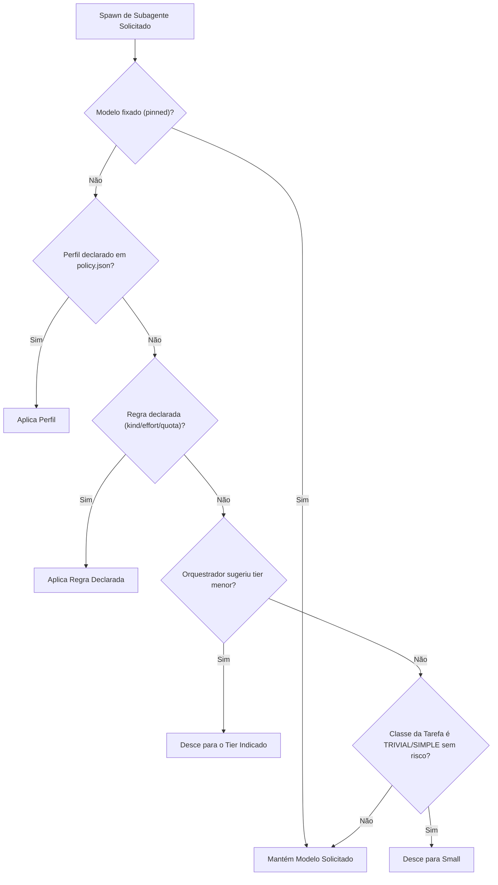

# Downshift — Documentação Oficial em Português (PT-BR)

> **Maturidade do produto: beta.** A versão publicada `v1.0.0` usa uma tag e um release estáveis,
> mas os [critérios de saída do beta](../reference/beta-exit.md) ainda não foram cumpridos.
> A aplicação da troca de modelo no Cursor e o uso independente por múltiplos operadores
> ainda precisam de comprovação. Veja também as [limitações conhecidas](../reference/known-limitations.md).

> Downshift por Tiago Vilas Boas  
> Repositório oficial: https://github.com/tiagovilasboas/downshift  
> Licença: Apache 2.0 · CLI: `downshift` · Go 1.27

## Economizar tokens no Claude Code com Downshift

O **Downshift** é uma ferramenta gratuita e open source para otimizar tokens em agentes de programação
com IA. Compacta a saída de testes e builds antes de ela ocupar o contexto e aplica, por subagente,
o modelo escolhido pelo orquestrador, dentro da sua política. Veja o resultado com `downshift report`.

Criado com **Claude Code**, também integra **Codex, OpenCode, Cursor, Antigravity e KiroCrew**, com
[capacidades diferentes por harness](#status-de-suporte-por-harness). Cursor, Antigravity e KiroCrew
são experimentais. Um único binário Go, licença Apache 2.0.

| Onde há desperdício | Como o Downshift atua |
|---|---|
| Saída repetitiva de testes e builds | Compacta comandos suportados e preserva falhas e códigos de saída |
| Trabalho mecânico em modelo caro | Aplica a escolha de modelo por subagente dentro da política declarada |
| Economia difícil de conferir | Mostra bytes compactados e tokens roteados por harness |

**Comece aqui:** [instale](#instalação-e-configuração-rápida), execute `downshift setup` e confira
com `downshift doctor`.

**Evidência com escopo:** [72,0% menos bytes](../reference/bench.md) em um corpus sintético de 107
fixtures com CCR ligado; [24,1% menos tokens por execução aceita](../evidence/four-arm-mechanical-2026-10-21.md)
em um ensaio controlado de tarefas mecânicas no Claude Code (46 execuções; IC 95% +2,1% a +46,7%).
São experimentos separados: não se somam nem garantem redução da fatura ou do limite do plano.

O código do Downshift não chama um LLM para rotear. A telemetria guarda contagens, hashes e tempos
localmente, sem prompts ou caminhos de arquivos. O harness continua usando o provedor de modelos;
o CCR guarda saídas de comandos localmente, com limites documentados. Hooks falham abertos.

---

## Sumário

- [Visão Geral e Propósito](#visão-geral-e-propósito)
- [Instalação e Configuração Rápida](#instalação-e-configuração-rápida)
- [Status de Suporte por Harness](#status-de-suporte-por-harness)
- [Resumo dos Benchmarks e Economia de Tokens](#resumo-dos-benchmarks-e-economia-de-tokens)
- [Compactor e CCR (Command Context Recovery)](#compactor-e-ccr-command-context-recovery)
- [Roteamento e Delegação de Modelos por Subagente](#roteamento-e-delegação-de-modelos-por-subagente)
- [Orquestração de Agentes e Gatilhos de Contexto](#orquestração-de-agentes-e-gatilhos-de-contexto)
- [Comandos Essenciais do CLI](#comandos-essenciais-do-cli)
- [Navegação da Documentação PT-BR](#navegação-da-documentação-pt-br)
- [Segurança, Privacidade e Governança](#segurança-privacidade-e-governança)
- [Perguntas Frequentes](#perguntas-frequentes)

---

## Visão Geral e Propósito

Agentes de codificação autônomos desperdiçam grande parte de suas janelas de contexto consumindo saídas gigantescas de comandos de terminal (como suítes de testes que passam com sucesso ou logs repetitivos de build) e delegando subtarefas mecânicas e simples aos modelos mais caros e lentos da categoria *frontier*.

O Downshift resolve esses dois desafios por meio de dois pilares complementares:

1. **Compactor com CCR sem perda de informação:**  
   Intercepta comandos permitidos (como `go test`, `vitest`, `pytest`, `cargo test`, `git status`, `npm install`, etc.) e resume execuções bem-sucedidas a sínteses concisas de `PASS/FAIL`. Com o sistema de CCR (*Command Context Recovery*) ativado por padrão, a saída bruta integral é gravada em um buffer seguro local (`~/.downshift/ccr/<id>.txt`), permitindo que o agente recupere qualquer trecho ou stack trace instantaneamente com `downshift retrieve <id>`. Em execuções com falha, 100% dos erros, asserções e stack traces do código da aplicação são preservados na íntegra.

2. **Roteamento e Delegação de Modelos por Subagente:**  
   O orquestrador líder da sessão decide o modelo e nível de esforço adequados para cada subagente delegado. O Downshift intercepta o evento de disparo via hook nativo (`PreToolUse`), valida a decisão contra as políticas declaradas em `policy.json` (pisos de modelo, travas de cota e regras por tipo de tarefa) e reescreve a chamada em tempo de execução. Trabalho mecânico ou simples é executado em modelos menores (*small*), economizando tokens e preservando o cache de prompt da sessão principal. Na dúvida, o modelo original solicitado pelo desenvolvedor é mantido inalterado.

---

## Instalação e Configuração Rápida

A instalação é feita em três comandos simples:

```bash
# 1. Baixar e instalar o binário oficial
curl -fsSL https://raw.githubusercontent.com/tiagovilasboas/downshift/main/install.sh | sh

# 2. Configurar os harnesses instalados na máquina (assistente interativo seguro)
downshift setup

# 3. Validar a integridade da instalação, hooks e permissões
downshift doctor
```

- O assistente `downshift setup` detecta automaticamente os agentes e harnesses suportados presentes no sistema, exibe um diff claro de qualquer alteração de configuração e pede confirmação antes de gravar.
- O utilitário `downshift doctor` executa um checklist rigoroso do binário, hooks ativos, diretórios de estado e conectividade de MCP, oferecendo comandos de autocorreção caso encontre inconsistências.

Para o passo a passo completo, consulte o [Guia de Início Rápido](guias/inicio-rapido.md).

---

## Status de Suporte por Harness

O Downshift foi projetado segundo a regra de camadas arquiteturais: a inteligência vive nas camadas compartilhadas e os adapters traduzem os eventos nativos de cada harness.

| Harness | Compactação | Roteamento de Modelos | Status Oficial | Modo de Configuração |
|---|---|---|---|---|
| **Claude Code** | Reescrita automática de comandos | Reescrita de modelo observada e honrada | **Completed** | `downshift setup claude-code` |
| **Codex** | Execução direta via `downshift compact` | Reescrita emitida e honrada inferida | **Functional** | `downshift setup codex` |
| **Cursor** | Execução direta via `downshift compact` | Reescrita emitida e honrada não confirmada | **Experimental** | `downshift setup cursor` |
| **OpenCode** | Reescrita automática via bridge plugin | Reescrita observada e honrada | **Beta** | `downshift setup opencode` |
| **Antigravity** | Execução direta via `downshift compact` | Suporte a rotas e subagentes locais | **Experimental** | `downshift setup antigravity` |
| **KiroCrew** | Execução direta via `downshift compact` | Modo de política (allow/block, sem reescrita in-place) | **Experimental** | `downshift setup kirocrew` |

> **Nota:** Claude Code e OpenCode reescrevem comandos permitidos para sua forma compactada de forma automática (via hooks nativos `PreToolUse` e bridge plugin). Em outros ambientes, a compactação opera por reescrita via hooks, políticas de orientação/advise (como o código de saída 2 no KiroCrew) ou execução direta via `downshift compact -- <comando>` (universal em qualquer terminal). Detalhes por harness: [Matriz de Harnesses](../reference/harness-matrix.md) e [Reconciliação de Evidências](../evidence/anthropic-references-benchmark-reconciliation-2026-11-07.md).

---

## Resumo dos Benchmarks e Economia de Tokens

Os ganhos do Downshift são medidos em bytes e contagens de tokens em um corpus de teste com **107 fixtures sintéticas** representativas do ciclo real de desenvolvimento:

| Métrica Avaliada | Resultado Obtido | Significado Técnico |
|---|---|---|
| **Corpus Geral (CCR desligado)** | **51.1%** de economia em bytes | Redução sem compactação agressiva de repetições |
| **Corpus Geral (CCR ativado)** | **72.0%** de economia em bytes | **Padrão atual:** máxima redução com recuperação integral via `downshift retrieve` |
| **Suítes Lossless (Testes)** | **65.2%** de economia em bytes | Preserva 100% de erros, falhas e stack traces da aplicação |
| **Picos de Redução** | **80% a 95%** de economia | *Progress* (94.5%), `cargo test` (93.0%), `flutter test` (92.3%), *lockfile diff* (91.2%), `npm install` (89.1%), `pytest` (86.7%), `playwright` (81.6%), `turbo` (79.6%), `tsc` (78.4%), `vitest` (74.3%) |

Em test runners *lossless*, o compilador e o framework de testes continuam gerando suas mensagens de falha completas: o Downshift corta apenas as linhas repetidas de testes que passaram com sucesso (`PASS`, `ok`), evidenciando imediatamente as falhas.

### Resultados Empíricos de Roteamento e Uso Real

Além do corpus de compactação, testes controlados mediram o impacto de roteamento e uso combinado:
- **Roteamento de Subagentes (Claude Code):** Em bateria controlada de 46 execuções em tarefas mecânicas delegadas ([bateria de quatro braços](../evidence/four-arm-mechanical-2026-10-21.md)), o roteamento sob `opusplan` nativo alcançou **24.1% menos tokens por tarefa aceita** (IC 95% +2.1% a +46.7%) e 16.5% por execução (+0.6% a +29.7%), com 100% (12/12) de aceitação. Mais de 98% dos tokens foram leituras de prompt cache.
- **Roteamento e Compactação Combinados (KiroCrew):** Em sessão real direcional avaliando 6 tarefas de controle, a combinação de política de roteamento com compactação via shell advise alcançou **até ~53% menos tokens por tarefa** ([reconciliação](../evidence/anthropic-references-benchmark-reconciliation-2026-11-07.md)).
- **Uso Cotidiano:** A economia no uso cotidiano natural e não restrito ainda **não está estabelecida** (telemetria de 30 dias registrou variação de −1.9%, dentro da margem de ruído). O Downshift segue uma [Escada de Evidências](../guides/evidence.md) e reporta contagens de tokens, bytes e retrabalho, nunca faturas em dólares.

Consulte a análise técnica aprofundada na [Referência de Benchmarks](referencia/benchmarks.md) e na [Reconciliação de Evidências](../evidence/anthropic-references-benchmark-reconciliation-2026-11-07.md).

---

## Compactor e CCR (Command Context Recovery)

O compactor envolve comandos verborrágicos mantendo integralmente o código de saída (*exit code*):

```bash
downshift compact -- go test ./...
downshift compact -- git status
```

### Como Funciona o CCR

A partir de 6 de novembro de 2026, o CCR vem **ativado por padrão**:
1. Toda saída bruta gerada é armazenada de forma segura em `~/.downshift/ccr/<id>.txt`.
2. O compactor insere um marcador transparente ao final da saída compactada:
   `[downshift compact: compacted 3956 to 998 bytes; full output: downshift retrieve 3f9a1c2b7d40]`
3. Sequências de 8 ou mais linhas repetitivas ou idênticas são dobradas (exibindo as 3 primeiras e as 2 últimas, com `[... N similar lines folded]`).
4. Se o agente ou o desenvolvedor precisar inspecionar a saída bruta completa ou linhas específicas, basta executar:

```bash
# Recuperar saída completa
downshift retrieve 3f9a1c2b7d40

# Filtrar por expressão regular ou intervalo de linhas
downshift retrieve 3f9a1c2b7d40 --grep "FAIL|panic"
downshift retrieve 3f9a1c2b7d40 --lines 50:120
```

Para detalhes de sanitização de credenciais e retenção de arquivos, veja o [Guia de Compactação e CCR](guias/compactacao-e-ccr.md).

---

## Roteamento e Delegação de Modelos por Subagente

Quando a sessão orquestradora delega trabalho a um subagente, o Downshift avalia a solicitação em milissegundos seguindo uma ordem estrita de precedência (a primeira regra que der *match* vence):



- **Dúvida mantém o modelo original:** Se a solicitação não puder ser classificada com alta confiança, o Downshift não altera o modelo solicitado (princípio *fail-open*).
- **Sem elevação não autorizada:** O Downshift nunca eleva o modelo além do solicitado pelo orquestrador, salvo se `routing.raise_complex: true` for explicitamente configurado no `policy.json`.
- **Integridade do cache de prompt:** O modelo da sessão principal do usuário nunca é alterado no meio do turno, garantindo 100% de reaproveitamento do *prompt cache*.

Veja todos os detalhes no [Guia de Roteamento de Modelos](guias/roteamento-de-modelos.md).

---

## Orquestração de Agentes e Gatilhos de Contexto

O Downshift acompanha um squad com 14 papéis de agentes especializados em 6 domínios de engenharia:
- **Core:** `coder`, `coder-back`, `coder-front`, `refactor`, `researcher`
- **Quality:** `tester`, `debugger`, `reviewer`
- **Security:** `security`
- **Performance:** `performance`
- **Support:** `documenter`
- **Leadership:** `architect`, `platform`, `ai`

### Gatilhos de Contexto (Context Triggers)

Você pode invocar o esquadrão no chat do seu agente usando gatilhos em linguagem natural:

```
Usuário: Preciso refatorar o pool de conexões do banco de dados e cobrir com testes
Usuário: downshift full-power
```

- `downshift full-power` (ou seus aliases em português `potência total` / `potencia-total`): Ativa os especialistas necessários para a tarefa atual (respeitando o limite de até 5 agentes simultâneos e checando as cotas de consumo antes de despachar).
- `downshift shift <squad>`: Ativa um domínio específico de engenharia (`core`, `quality`, `security`, `leadership`). Exemplos:
  - `downshift shift quality`
  - `downshift shift security`
  - `downshift shift coder "corrigir race condition no worker pool"`

---

## Comandos Essenciais do CLI

| Comando | Descrição e Finalidade |
|---|---|
| `downshift setup [--dry-run]` | Configura hooks nos harnesses detectados com diff prévio e confirmação |
| `downshift doctor` | Diagnóstico de integridade do ambiente com comandos de correção automática |
| `downshift compact -- <cmd>` | Executa um comando permitido e compacta a saída mantendo status e saída de erro |
| `downshift retrieve <id>` | Recupera a saída bruta mantida no buffer seguro do CCR |
| `downshift session [--why]` | Exibe a árvore de subagentes da sessão e a justificativa clara de cada decisão |
| `downshift stats` | Apresenta resumo de decisões tomadas e estimativa de tokens economizados |
| `downshift report` | Relatório consolidado de tokens direcionados por tarefa concluída |
| `downshift policy check` | Valida a sintaxe e a semântica do arquivo de política `policy.json` |
| `downshift quota` | Diagnóstico das cotas e janelas de consumo dos provedores configurados |
| `downshift mcp serve` | Inicia o servidor MCP local (expondo 13 ferramentas nativas para agentes) |

---

## Navegação da Documentação PT-BR

Para aprofundar seu conhecimento em cada área do Downshift, explore os guias e referências dedicados:

- 🚀 [Guia de Início Rápido](guias/inicio-rapido.md) — Instalação passo a passo, primeiro comando compactado e testes.
- 📦 [Guia de Compactação e CCR](guias/compactacao-e-ccr.md) — Funcionamento interno do compactor, ferramentas suportadas e recuperação de logs via CCR.
- 🔀 [Guia de Roteamento de Modelos](guias/roteamento-de-modelos.md) — Estrutura de regras BDI, guardrails, `policy.json` e otimização por subagente.
- 📊 [Referência de Benchmarks](referencia/benchmarks.md) — Metodologia de testes, tabela oficial detalhada de 107 fixtures e escada de evidências.

---

## Segurança, Privacidade e Governança

- **Fail-Open Garantido:** Qualquer erro inesperado, payload corrompido, timeout ou tamanho superior a 1 MiB faz o hook liberar a execução original imediatamente sem alteração.
- **Privacidade de Prompts e Código:** O Downshift nunca salva textos de prompts, arquivos do repositório ou parâmetros confidenciais em sua telemetria. O arquivo `events.jsonl` armazena apenas contagens, hashes e tempos.
- **Sanitização Heurística no CCR:** O buffer de CCR filtra ativamente linhas com padrões de credenciais, chaves de API, tokens JWT e blocos PEM. O armazenamento é local, com permissões restritas (0600/0700) e expiração automática em 24 horas.
- **Sem Portas dos Fundos ou LLMs Ocultos:** Toda decisão é tomada por código Go estático e determinístico inspecionável em código aberto.

---

## Perguntas Frequentes

**Os subagentes do Claude Code gastam o limite de uso mais rápido?** Podem gastar. A documentação de subagentes da Anthropic diz que cada subagente começa com um contexto novo e faz requisições próprias, que contam para os mesmos limites de uso da conversa principal, e roda no modelo principal se nada definir outro. O agente embutido Explore também roda no modelo principal. Coloque subagentes rotineiros num modelo menor; o `downshift policy init` oferece um perfil `explore` que manda o Explore para o tier pequeno e mostra antes em qual modelo isso resolve. [Guia](https://downshift-ai.vercel.app/pt-br/guias/subagentes-gastam-limite-claude-code/).

**Qual a diferença para `CLAUDE_CODE_SUBAGENT_MODEL`?** Essa variável define um modelo padrão para todo subagente que nada mais define, e sozinha não muda os agentes embutidos Explore e Plan. O Downshift aplica o modelo escolhido em cada chamada, dentro de uma política que você declara, mantém o modelo pedido na dúvida, registra onde os tokens rodaram e também funciona no Codex, Cursor e OpenCode.

**O Downshift economiza o limite do meu plano no Claude Code?** Ainda não foi medido. O Downshift mostra, por harness, os tokens que rodaram abaixo do modelo da sessão e os bytes que a compactação tirou; como um plano converte tokens nos limites de 5 horas e semanal não é publicado, então nenhuma economia de limite é prometida.

Mais guias em português: [https://downshift-ai.vercel.app/pt-br/guias/](https://downshift-ai.vercel.app/pt-br/guias/).
