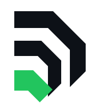
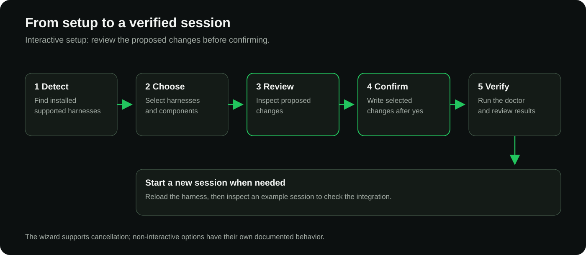
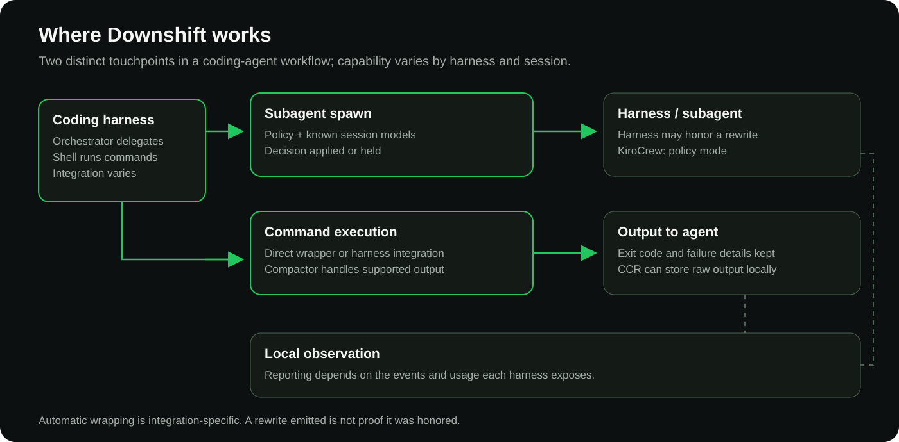
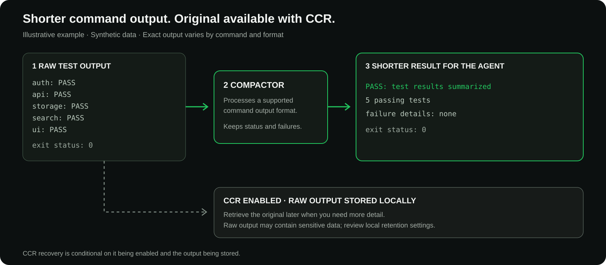
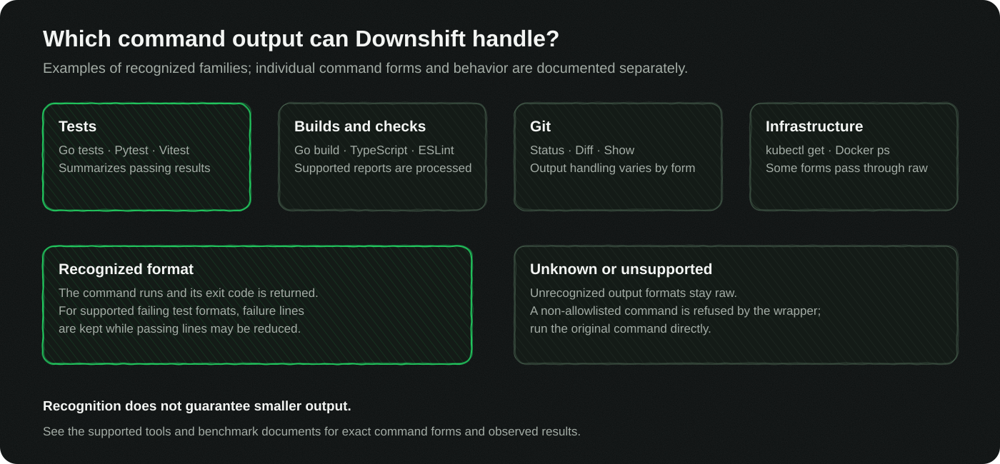
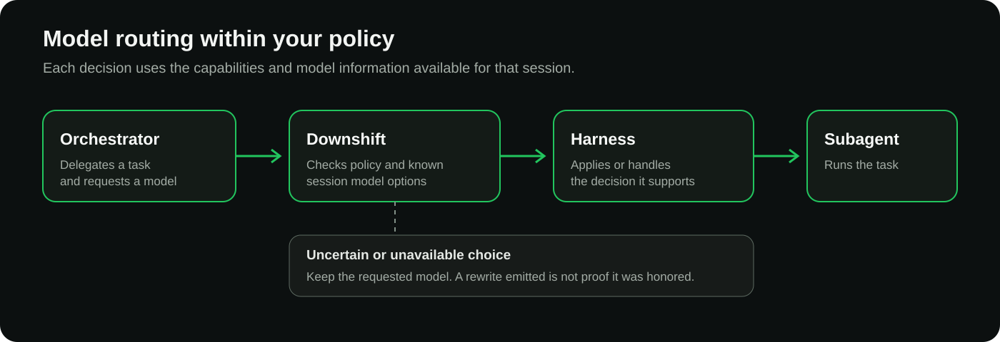
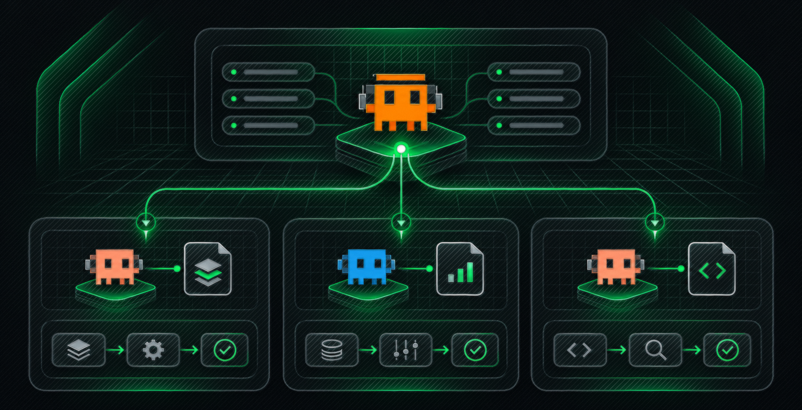
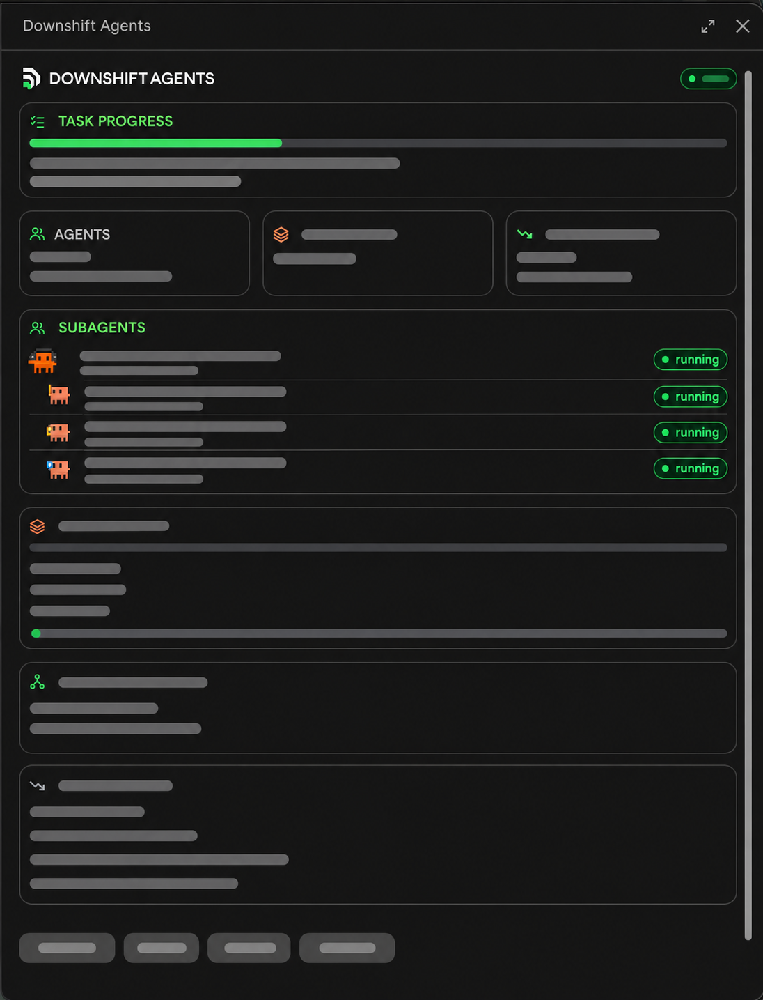

<div align="center">
<picture>
  <source media="(prefers-color-scheme: dark)" srcset="../brand/downshift-mark-darkbg.svg">
  
</picture>

# Downshift

### Corte o desperdício de tokens no Claude Code, no Codex e em outros agentes de programação.

Agentes de programação com IA gastam boa parte do contexto com logs de teste, saída de build e status, e cada subagente roda no seu modelo principal, a menos que algo defina outro. Isso queima tokens e enche a janela de contexto. Downshift é uma CLI open source que compacta a saída dos comandos suportados antes que o agente a leia, mantendo falhas e códigos de saída: 68,3% menos bytes num benchmark de 113 fixtures. Também aplica o modelo e o esforço escolhidos para cada subagente, dentro da política que você declara. Um único binário Go.

Funciona com harnesses de programação, incluindo Claude Code e Codex CLI; as capacidades de integração e os modelos disponíveis variam por harness e sessão.

[Comece aqui](#comece-aqui) · [Documentação](../guides/install.md) · [Suporte por harness](../reference/harness-matrix.md) · [Evidências](#o-que-as-evidências-mostram) · [Como contribuir](../../CONTRIBUTING.md)

[English](../../README.md) · [Português (Brasil)](README.md)

**Open source · Apache 2.0 · Maturidade do produto: beta**
</div>


## Comece aqui

Instale um binário de release compatível, escolha seu harness, revise a configuração proposta e verifique a instalação. Para o roteamento integrado, o harness compatível precisa estar instalado; o compactor também pode ser executado diretamente como CLI independente. O assistente interativo pode configurar hooks, MCP, skills e política de sessão conforme suas escolhas. Ele mostra as alterações propostas e pede confirmação antes de gravar.

Os pacotes de release atendem macOS e Linux em arm64 e amd64, e Windows em amd64. A disponibilidade dos arquivos varia conforme o release; confira a página de releases para sua plataforma e os arquivos de verificação. O instalador shell do guia atende macOS e Linux.

[Releases](https://github.com/tiagovilasboas/downshift-ai/releases) · [Instalação](../guides/install.md) · [Início rápido](../guides/quickstart.md) · [Configuração](../guides/config.md) · [Desfazer configuração](../reference/cli.md#downshift-setup) · [Desinstalar](../reference/cli.md#downshift-uninstall)

```bash
# macOS & Linux (arm64 / amd64)
curl -fsSL https://raw.githubusercontent.com/tiagovilasboas/downshift-ai/main/install.sh | bash

# No seu repositório:
downshift setup
downshift doctor

# Depois, em qualquer sistema: instala a próxima release e atualiza cada harness
downshift update
```

[](../brand/readme-media/setup-flow.png)

## Otimização de tokens para agentes de programação

Para desenvolvedores que utilizam agentes de código com IA, suítes longas de testes e saídas verbosas de build não apenas gastam tokens — elas diluem a janela de contexto. À medida que o histórico de terminal se acumula, a capacidade do modelo de reter instruções anteriores, invariantes de arquitetura e regras de negócio se degrada. O Downshift compacta a saída de comandos suportados antes de ela chegar ao agente, preservando o foco da memória de trabalho, códigos de saída e detalhes de falhas intactos. Saídas menores protegem a capacidade do contexto e reduzem o consumo de tokens a cada turno.

O Downshift também aplica escolhas de modelo e nível de esforço de raciocínio ao trabalho delegado, dentro da política que você declara. Modelos de fronteira com alto esforço permanecem dedicados a decisões de arquitetura, auditorias de segurança e investigação de bugs complexos, enquanto subagentes mecânicos rodam em modelos menores e mais ágeis, sem invalidar o cache de prompt da sessão principal.

| Capacidade | O que faz |
| --- | --- |
| **Compactação de contexto & saída** | Evita a degradação do contexto ao encurtar o ruído de comandos limpos, preservando logs de falha. |
| **Compactação de leituras do desktop** | Encurta as leituras da árvore de acessibilidade do `agent-desktop` sem perder campo, e manda uma releitura da mesma janela só com as linhas que mudaram ([guia](../guides/agent-desktop.md)). |
| **Roteamento de modelo & esforço por subagente** | Aplica o tier do modelo e o nível de esforço de raciocínio na criação do subagente conforme a política. |
| **Relatórios locais & telemetria** | Mede tokens e contexto preservados sem enviar prompts, código ou caminhos para fora da máquina. |

[Quando usar o Downshift](../guides/when-to-use.md) · [Arquitetura](../design/architecture.md)

Selecione um diagrama para vê-lo em tamanho maior. Os rótulos das artes estão em inglês; o texto abaixo explica cada fluxo em português.

## Onde o Downshift atua

[](../brand/readme-media/operating-surfaces.png)

O Downshift participa em dois pontos distintos: a criação de um subagente pode ser verificada contra a política e os modelos conhecidos da sessão, e a saída de comandos suportados pode ser compactada antes de chegar ao agente. Integração e observação variam entre harnesses; a execução direta do compactor está disponível quando não há encapsulamento automático.

## Reduza a saída dos comandos e mantenha os detalhes

[](../brand/readme-media/compaction.png)

Um comando suportado é executado normalmente. O Downshift mostra uma versão mais curta ao agente, preservando o código de saída e os detalhes de falhas. Com o **Command Context Recovery (CCR)** ativado, a saída bruta elegível pode ser armazenada localmente e recuperada depois; linhas repetidas podem ser agrupadas no resultado exibido. O encapsulamento depende do harness, e a execução direta do compactor está disponível. A redução da saída varia conforme o comando e o formato.

```bash
downshift compact -- go test ./...
```

A saída limpa é compactada enquanto falhas e códigos de saída são preservados.

[](../brand/readme-media/command-families.png)

O Downshift reconhece formas específicas de comandos de teste, build, lint, Git e infraestrutura. Formatos reconhecidos podem ser compactados ou repassados conforme a família e a saída. Formatos de saída desconhecidos permanecem brutos; um comando fora da lista permitida é recusado pelo encapsulador e pode ser executado diretamente. Os detalhes de falhas e o código de saída são preservados. Consulte a referência de ferramentas para conhecer as formas exatas.

[Compactação](../features/compaction.md) · [Ferramentas suportadas](../reference/supported-tools.md) · [CCR](../guides/ccr.md)

### Apps do desktop: computer use com menos tokens

Um agente que controla apps do desktop com o `agent-desktop` lê a árvore de acessibilidade do app em JSON depois de cada ação. O Downshift compacta essas leituras também:

- **Primeira leitura de uma janela:** uma linha por elemento, sem perder campo (um teste decodifica de volta para o mesmo JSON).
- **Releitura da mesma janela:** só as linhas que mudaram, com a leitura completa a um `downshift retrieve` de distância.
- **Todo harness:** automático no Claude Code; nos outros, por `downshift compact -- agent-desktop snapshot ...`.

Em fixtures sintéticos, a primeira leitura teve de 53% a 60% menos bytes, uma releitura depois de uma ação 97% menos, e um ciclo ler, agir, conferir de três leituras 84,9% menos. Ainda não foi medido num desktop real.

```bash
downshift compact -- agent-desktop snapshot --app Files -i
```

[Guia do agent-desktop](guias/agent-desktop.md)

## Roteie subagentes dentro da sua política

[](../brand/readme-media/routing.png)

O orquestrador escolhe o trabalho a delegar. O Downshift aplica decisões de modelo na criação do subagente, sujeito à sua política e às informações de modelos conhecidas para aquele harness e sessão. Quando não consegue estabelecer uma escolha segura, mantém o modelo solicitado.

A profundidade da integração varia. Uma reescrita emitida pelo Downshift, por si só, não comprova que o harness a aplicou. O código de roteamento do Downshift não faz uma chamada adicional a LLM. A escolha se aplica à criação do subagente; o Downshift não altera o modelo da sessão principal no meio do turno.

[Roteamento de modelos](../features/routing.md) · [Política](../guides/policy.md) · [Modelos da sessão](../reference/session-models.md)

## Veja seus agentes em ação



O Downshift inclui perfis de agentes e playbooks de orquestração para pesquisa, implementação, revisão, segurança, documentação e outras atividades. Um líder coordena o trabalho independente e reúne os resultados.

<a id="5-agent-orchestration-context-triggers"></a>
### Orquestração de agentes (gatilhos contextuais)

No chat do seu harness de programação, descreva sua tarefa e digite:
- `downshift full-power` (alias `potência total` / `potencia-total`): ativa os especialistas necessários respeitando o teto de capacidade da sessão.
- `downshift shift <squad>`: ativa um domínio específico (`core`, `quality`, `security`, `leadership`).

<p align="center"></p>

*Ilustração sanitizada baseada em um screenshot de uma sessão Claude Code. Nomes de tarefas, modelos e métricas da sessão foram ocultados. Esta é uma prévia visual editada, não um benchmark ou screenshot sem alterações.*

[Guia de agentes](../guides/agents.md) · [Catálogo de agentes](../agents/README.md)

## Funciona com seu harness de programação

O Downshift foi criado com Claude Code e oferece suporte a outros harnesses em diferentes estágios de verificação. **Suportado** significa que o `doctor` verificou o hook em uma sessão real; **Beta** significa que o hook rodou em uma sessão real e está documentado, mas o `doctor` ainda não o verificou; **Experimental** significa que o efeito não foi confirmado ou foi visto uma vez. Critérios e evidências: [níveis de suporte](../reference/harness-matrix.md#support-tiers).

| Harness | Nível | Evidência de roteamento |
| --- | --- | --- |
| Claude Code | Suportado | Reescrita observada em um subagente real; o `doctor` a lê de sessões reais. |
| Codex | Beta | Reescrita emitida; aplicação inferida, sem observação direta. Precisa da flag de hooks e da confiança via `/hooks`; o `doctor` lê a flag e indica a correção. |
| OpenCode | Beta | Roteamento e uso do subagente observados no OpenCode 2.2.5 pelo plugin ponte. |
| KiroCrew | Beta | Bloqueio por política e nova tentativa observados; sem reescrita de modelo no lugar. |
| Kiro IDE | Beta | Payload do hook capturado ao vivo; só observação, sem reescrita. |
| Cursor | Experimental | Reescrita emitida; aplicação pelo executor não confirmada. |
| Antigravity | Experimental | Um subagente observado em uma versão. |

Os modelos disponíveis para um harness ou sessão não são considerados disponíveis automaticamente em outro. Consulte a [matriz completa de harnesses](../reference/harness-matrix.md) para detalhes de integração, evidências e limites.

## O que as evidências mostram

| Medição | Resultado | Escopo |
| --- | --- | --- |
| Compactação de saída sem perda | **59,3% menos bytes** | 64 fixtures sem perda em um corpus sintético. |
| Compactação de saída com CCR | **68,3% menos bytes** | Corpus sintético de 113 fixtures (52,6% com CCR desligado), saída de comandos e leituras do agent-desktop; repetições exibidas podem ser agrupadas e a saída bruta pode ser recuperada. |
| Compactação balanced, saídas grandes | **76,3% menos bytes** | 4 saídas reais deste repositório acima de 16 KB (`go test -v`, `git show`, `git log -p`, `grep -rn`); 35,0% só com o compressor sem perda. As linhas cortadas voltam com `downshift retrieve`. |
| Roteamento de subagentes | **24,1% menos tokens por execução aceita** | Estudo controlado com 46 execuções no Claude Code para tarefas mecânicas, realizado antes da decisão O8. |

São medições separadas, com unidades e cargas de trabalho diferentes. Os totais do corpus sintético incluem apenas fixtures processadas pelo compactor e excluem fixtures preservadas. O resultado de roteamento é evidência histórica; ele não estabelece o efeito da implementação após O8. A economia no uso cotidiano sem restrições ainda não foi estabelecida. Estimativas de tokens baseadas em bytes não são uma fatura nem uma medida dos limites do plano.

[Benchmark de compactação](../reference/bench.md) · [Estudo de roteamento](../evidence/four-arm-mechanical-2026-10-21.md) · [Guia de evidências](../guides/evidence.md)

## A pesquisa por trás do design

O design do Downshift parte dos trabalhos publicados pela Anthropic sobre orquestração. Um líder forte planeja e confere, workers mais baratos fazem trabalho delimitado, e cada agente a mais precisa pagar os tokens que gasta.

- [How we built our multi-agent research system](https://www.anthropic.com/engineering/multi-agent-research-system) (2025): um líder Opus com subagentes Sonnet superou um único agente Opus em 90,2% em pesquisa, com cerca de 15× os tokens de um chat. O mesmo texto observa que programação se paraleliza menos que pesquisa.
- [Patterns and problems in emerging multiagent systems](https://www.anthropic.com/research/multiagent-systems) (2026): um enxame coordenado encontrou 266 vulnerabilidades contra 21 dos agentes independentes, em boa parte por cobrir mais terreno; nos mesmos diretórios, os tokens por achado foram comparáveis.
- [Riemann zeta research with 60 subagents](https://www.anthropic.com/research/riemann-zeta) (2026): de 60 subagentes, 2 desenvolveram as ideias centrais, 30 tentaram e falharam, e 13 validaram os argumentos.

Como cada achado vira um princípio de design, e o que ele não mostra: [True north](../true-north.md) · [Reconciliação](../evidence/anthropic-references-benchmark-reconciliation-2026-11-07.md)

## Feito para inspeção e controle

| Comando | Descrição e Finalidade |
|---|---|
| `downshift setup [--dry-run]` | Configura hooks nos harnesses detectados com prévia |
| `downshift doctor` | Diagnóstico de integridade do ambiente com correções automáticas |
| `downshift compact -- <cmd>` | Executa comando permitido com compactação de saída limpa |
| `downshift retrieve <id>` | Recupera saída bruta mantida no buffer seguro do CCR |
| `downshift session [--why]` | Exibe a árvore de subagentes da sessão e a justificativa das decisões |
| `downshift stats` | Resumo de decisões de roteamento e estimativa de tokens economizados |
| `downshift report` | Relatório consolidado de tokens direcionados por tarefa concluída |
| `downshift policy check` | Valida sintaxe e semântica do `policy.json` |
| `downshift quota` | Diagnóstico de cotas e janelas de consumo dos provedores |
| `downshift mcp serve` | Inicia servidor MCP local via stdio (13 ferramentas nativas) |

- Hooks falham abertos: erros ou timeouts mantêm a criação do subagente solicitada sem alteração.
- O roteamento é local e não faz uma chamada adicional a LLM. A telemetria registra contagens, hashes e tempos, sem registrar prompts.
- O CCR pode armazenar saídas brutas de comandos localmente. A sanitização cobre formatos comuns de credenciais, mas segredos em formatos arbitrários podem permanecer; consulte as [limitações de saída bruta](../reference/known-limitations.md#raw-output-kept-by-ccr) e a configuração antes de usá-lo com saídas sensíveis.
- Workers com escrita exigem ativação explícita e usam worktrees separados. O Downshift não mescla suas branches nem oferece uma etapa de aprovação para deploys e outras ações de risco.

[Segurança](../features/safety.md) · [Telemetria](../features/telemetry.md) · [Limitações conhecidas](../reference/known-limitations.md)

## Perguntas frequentes

**Como reduzir o consumo de tokens no Claude Code, no Codex ou no Cursor?** Instale o Downshift e rode `downshift setup`. A saída dos comandos suportados é compactada antes de entrar na janela de contexto, e cada subagente roda no modelo escolhido para ele, dentro da sua política. No Claude Code a reescrita é automática; nos outros, o agente roda `downshift compact -- <comando>`. Confira seus números com `downshift session` e `downshift report`.

**Subagentes do Claude Code gastam meu limite de uso mais rápido?** Podem gastar. Cada subagente começa com um contexto novo e faz as próprias requisições, que contam no mesmo limite da conversa principal, e roda no seu modelo principal, a menos que algo defina outro. Coloque os subagentes de rotina num modelo menor: `downshift policy init` grava um perfil `explore` que manda o Explore para o tier pequeno. [Guia](https://downshift-ai.vercel.app/pt-br/guias/subagentes-gastam-limite-claude-code/)

**O Downshift economiza meu limite de uso do Claude Code?** Ainda não foi medido. O Downshift mostra os tokens que rodaram abaixo do modelo da sessão e os bytes que a compactação removeu. Como um plano converte tokens nos limites de 5 horas e semanal não é público, então não afirmamos economia de limite.

**O roteamento de subagentes quebra o cache de prompt?** Não. A escolha vale para o subagente inteiro, não para turnos da sessão principal, que mantém um único modelo durante toda a conversa.

**Qual a diferença para o `/compact`?** O `/compact` resume o histórico que já está na janela de contexto. O Downshift encolhe a saída dos comandos antes que ela entre. Os dois se complementam.

**Qual a diferença para o `CLAUDE_CODE_SUBAGENT_MODEL`?** Essa variável define um modelo padrão para todo subagente que nada mais configura. O Downshift aplica o modelo escolhido para cada subagente dentro de uma política declarada, mantém o modelo pedido na dúvida, registra onde os tokens rodaram e também funciona no Codex, no Cursor e no OpenCode.

## Documentação e comunidade

[Início rápido](../guides/quickstart.md) · [Referência de CLI](../reference/cli.md) · [Arquitetura](../design/architecture.md) · [English](../../README.md)

Encontrou um problema ou quer contribuir? Leia o [guia de contribuição](../../CONTRIBUTING.md) ou [abra uma issue](https://github.com/tiagovilasboas/downshift-ai/issues).

## Licença

[Apache License 2.0](../../LICENSE). Downshift por [Tiago Vilas Boas](https://github.com/tiagovilasboas).
