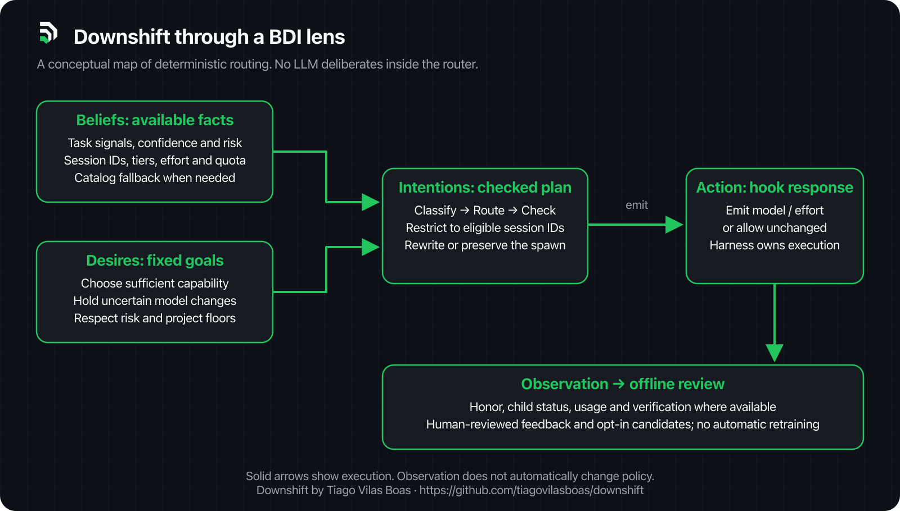
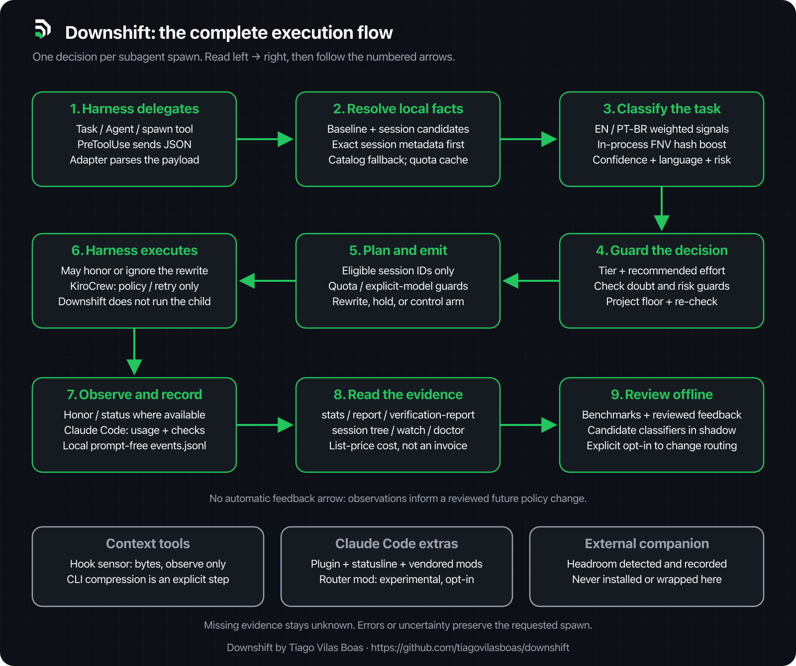

# Downshift

Downshift by Tiago Vilas Boas · https://github.com/tiagovilasboas/downshift

*Repositório GitHub: [`downshift`](https://github.com/tiagovilasboas/downshift) · CLI `downshift` · licença Apache 2.0.*

O **Downshift** dá ao seu agente de código o modelo certo e menos ruído, sem nenhuma chamada extra de IA. Tudo roda localmente: prompts nunca são guardados, nada sai pela rede e todo hook falha aberto.

**Os três pilares, nesta ordem:**

1. **Roteamento de modelo por subagente.** Cada subagente recebe um modelo e um esforço do tamanho certo; na dúvida, o seu modelo fica. Cerca de 1 em 10 spawns ficam sem roteamento, como grupo de controle. *Status:* Implemented. Claude Code Completed (reescrita observada como honrada); Codex e Cursor Functional; OpenCode Beta; Antigravity e KiroCrew Experimental ([matriz de harnesses (EN)](../reference/harness-matrix.md)).
2. **O Compactor (`downshift compact`).** Saída mais curta de comandos da lista permitida. Ele envolve todo subcomando `git` e as famílias de teste e build listadas (a linha `git-*` da [matriz de harnesses (EN)](../reference/harness-matrix.md#shell-command-rewrite-downshift-compact-on-by-default-2026-10-19)), mantém o código de saída e deixa falhas intactas. Não é o comando `/compact`. *Status:* Implemented, ligado por padrão. A reescrita automática para a forma compacta é só no Claude Code; nos demais, o agente roda `downshift compact -- <comando>`.
3. **DCI (code intelligence).** O agente lê só o código que a mudança toca. Opt-in. *Status:* Implemented (v0.4). Bytes e latência medidos; qualidade da resposta não medida.

**Números, sempre com a ressalva ao lado:**

- Roteamento: cerca de 12% mais barato em tarefas mecânicas, em um único teste controlado (um operador, Claude Code, 2026-10-15, preço de tabela; as checagens verificam estrutura, não qualidade). Do uso natural ainda não há economia atribuível. Veja o [registro do A/B (EN)](../evidence/subagent-routing-ab-2026-10-15.md).
- Compactação: medida em bytes num corpus sintético de teste. 82,3% nos 26 de 248 arquivos que foram compactados, 23,7% no total. Sua mistura de saídas vai variar. Veja o [registro do corpus (EN)](../evidence/compaction-corpus-2026-10-21.md).
- DCI: frio 295 ms, quente p95 5,64 ms, pacotes de 568 a 2801 bytes. Veja o [registro do DCI (EN)](../evidence/dci-v04-blast-radius.md).
- Relatórios mostram tokens, não dólares.

**Para onde ir agora:** [instalar (EN)](../guides/install.md), [como funciona (EN)](../design/architecture.md), [evidência (EN)](../guides/evidence.md), [capability matrix (EN)](../reference/capability-matrix.md).

`downshift setup` liga os hooks e, no Claude Code, o plugin e os modelos descobertos, em um único binário Go sem daemon.


Quando você dispara um subagente em ferramentas como **Claude Code**, **Codex** ou **Cursor** (os harnesses Completed e Functional, abaixo), cada um é direcionado para a categoria de modelo adequada à complexidade da demanda **antes da execução começar**, e só quando o classificador está confiante e nenhum guardrail segura. O desenvolvedor continua operando normalmente.

Toda funcionalidade é construída nas camadas compartilhadas e calculada para todos os harnesses. **O Claude Code é o harness principal**: é onde o Downshift está mais completo (modelo da sessão inferido, hooks de uso e de fim do filho, comando `/downshift`, statusline, política de sessão com `opusplan`) e mais verificado. Os demais rodam o mesmo núcleo; a [matriz de harnesses](../reference/harness-matrix.md) diz o que cada um honra hoje, e o [guia do Claude Code (EN)](../guides/claude-code.md) explica a relação com o `opusplan`.

**Status por harness.** Cada harness tem exatamente uma de quatro palavras de status, rastreável a um arquivo de evidência ou a um teste (a suíte `cmd/downshift/conformance_test.go` roda os mesmos 8 cenários de roteamento contra todo hook registrado). Detalhes por harness: [matriz de harnesses (EN)](../reference/harness-matrix.md).

| Harness | Status | O que isso significa | Evidência |
|---|---|---|---|
| **Claude Code** | Completed | Reescrita observada como honrada em um filho real, uso e fim do filho registrados, plugin e política de sessão | [reescrita honrada](../evidence/claude-code-rewrite-honored-2026-10-06.md) · [auditoria de cobrança](../evidence/billing-gap-audit.md) · [A/B de roteamento](../evidence/subagent-routing-ab-2026-10-15.md) |
| **Codex** | Functional | O hook emite a reescrita em um spawn real; que o harness a aplicou é inferido, não observado; sem uso do filho | [Codex](../evidence/codex-rewrite-honored-2026-10-02.md) |
| **Cursor** | Functional | O hook emite a reescrita em um spawn real; que o harness a aplicou não foi confirmado; sem uso do filho | [Cursor](../evidence/cursor-rewrite-honored-2026-10-10.md) · [diagnóstico](../evidence/cursor-gap-diagnostic.md) |
| **OpenCode** | Beta | Integração de primeira classe em desenvolvimento: adapter, route wire e suíte de conformidade no repositório; plugin e primeira observação real ainda em andamento. Sem reivindicação de produção | [matriz (EN)](../reference/harness-matrix.md#status-per-harness) |

**Experimental (prova de conceito).** Antigravity e KiroCrew têm um filho observado em um build cada (KiroCrew em modo política: bloqueia e pede novo spawn, sem reescrita no lugar) e nenhum fim de filho registrado. Os adapters, testes e hooks continuam no repositório e calculam todas as funcionalidades; a instalação está no [guia de instalação (EN)](../guides/install.md#experimental-harnesses). Evidência: [Antigravity](../evidence/antigravity-executor-ack.md) · [KiroCrew](../evidence/kirocrew-native-hook-2026-10-10.md). O Grok CLI continua apenas por configuração, sem reescrita por hook.

O Downshift não é um chat secundário, não gera código, não é proxy HTTP e não altera a saída de ferramentas em voo. É uma **camada de otimização de infraestrutura**: intercepta o pedido no hook de spawn, classifica a demanda em milissegundos na CPU local, valida se a mudança é segura e, quando aplicável, reescreve o modelo do subagente de forma transparente.

**O que está provado e o que não está.** Um A/B controlado em 2026-10-15, um operador, Claude Code, mesmas tarefas em braço roteado e braço de controle: em peças mecânicas entregues uma por subagente (o teto) o custo caiu cerca de 12% com os mesmos 12 de 12 aceitos; em tarefas naturais a maioria dos spawns foi segurada e a diferença de custo não é atribuível ao roteamento. A [escada de evidência (EN)](../guides/evidence.md) separa teoria de tabela, estimativa de telemetria, benchmark controlado e resultado em tarefa real; custo por tarefa concluída foi medido uma vez, não ainda em carga natural.

---

## A suíte num relance

Um binário, um diretório de estado, cada peça calculada para todos os harnesses. As palavras de status são as da [capability matrix (EN)](../reference/capability-matrix.md); cada linha de lá aponta o código, o teste ou a evidência datada que a sustenta.

| Peça | Uma frase | Status |
|---|---|---|
| **Roteamento determinístico de subagentes** | Um hook `PreToolUse` classifica a tarefa e reescreve só o modelo e o esforço daquele subagente, a partir da lista de modelos da própria sessão. | Implemented; honrado no Claude Code (observado), inferido no Codex, não confirmado no Cursor |
| **Guardrails: dúvida nunca gasta dinheiro** | R1 a R9 seguram downshifts, upshifts e escolhas de fronteira sem confiança; categorias de risco mantêm um piso; baseline adivinhado só desce ao tier small. | Implemented, testes de invariante (`cost_safety_invariants_test.go`) |
| **Piso de tier por projeto** | `.downshift/policy.json` exige um tier mínimo por classe ou risco num repositório; só sobe, nunca desce. | Implemented, todos os harnesses |
| **Gate de cota e crédito** | Uma marca do hook ou um snapshot nativo de uso segura a reescrita para um modelo sem crédito; snapshot velho deixa de segurar após 1 h. | Implemented, not validated everywhere ([quota, EN](../guides/quota.md)) |
| **Visão de sessão e statusline** | `downshift session --tree`, `/downshift`, `downshift watch`, uma linha de stderr por spawn e uma statusline com as janelas de cota. | Implemented; statusline só no Claude Code ([session view, EN](../guides/session-view.md)) |
| **Telemetria e relatórios de custo com grupo de controle** | `events.jsonl` sem prompt, tokens por filho, cerca de 1 em 10 spawns sem roteamento, `downshift stats` e `downshift report` (só tokens). | Implemented; uso só no Claude Code; tokens observados, não fatura |
| **Política de contexto** | `setup` define `opusplan` e plan mode do Claude Code para chaves que você não definiu (o mod You should know é opt-in: `setup --you-should-know`); o compressor nativo só observa bytes. | Implemented, limitado: política de sessão só no Claude Code ([guia do Claude Code, EN](../guides/claude-code.md)) |
| **Code Intelligence (DCI)** | Descoberta Git, extração Go AST e multi-linguagem (TS/JS, Python, Rust, PHP, Java, C#), grafo de chamadas saintes e índice reverso (*Blast Radius*), ranking BM25 Production-First, abstenção e injeção de contexto estrutural de até 3.500 bytes (configurável 512..16384 via `--budget`) com zero persistência de prompts via `UserPromptSubmit`. Subcomando `downshift dci impact`. | Implemented (v0.4); telemetria em `downshift stats --dci` |
| **Mods** | savvy-progress, filetree e downshift-dock como plugins irmãos do marketplace (o `setup` instala os três no Claude Code); downshift-router como protótipo opt-in. | Shipped, vendorizados e pinados; router Experimental ([mods, EN](../../mods/README.md)) |
| **Companions** | Headroom (proxy de compressão padrão) é detectado e registrado, nunca instalado nem encapsulado. | Documentado ([companions, EN](../guides/companions.md)) |
| **Escada de evidência** | Cinco degraus, do preço de tabela ao custo por tarefa concluída, cada número citado do arquivo que o guarda. | Degrau D alcançado uma vez (2026-10-15); degrau E não medido ([evidence, EN](../guides/evidence.md)) |

---

## Os LLMs que ele conhece

Os dados de modelo ficam no [`catalog.json`](../../internal/catalog/catalog.json) embutido (versão 2, atualizado e com preços verificados em 2026-10-19, `prices_as_of`; 56 entradas, preços renovados por um PR semanal do workflow `sync-prices`), nunca em código Go; um override do usuário no diretório de estado é mesclado por cima. Por harness: Claude Code com as famílias `claude-haiku` (small), `claude-sonnet` (mid), `claude-opus` e `claude-fable` (frontier) e `grok` via configuração; Cursor com variantes thinking da Anthropic, `gpt-5.6-sol`, `gemini`, `grok`, `glm`, `muse-spark` e os slugs `composer`; Codex com `gpt-6-luna` e `gpt-5.6-luna` (small), `gpt-5.6-terra` (mid), `gpt-6-sol`, `gpt-6.1-sol` e `gpt-5.6-sol` (frontier) e `gpt-6-astra`; Antigravity com os aliases Gemini `flash_lite`, `flash` e `pro`; KiroCrew com as famílias Anthropic.

Regras válidas para todos, fixadas em `internal/catalog/catalog_test.go`:

- **Busca exata, depois alias, depois prefixo de família**: uma versão nova de uma família conhecida resolve para o tier dela.
- **`routing:"explicit_only"` nunca é escolhido automaticamente.** Hoje são dois: `gpt-6-astra` (Codex) e `claude-fable-5-1-thinking-high` (Cursor). Se o subagente já roda um deles, `Plan()` o preserva em vez de rebaixar.
- **Prefixos `provider/` são removidos na busca do catálogo**: IDs no estilo OpenRouter podem resolver por família. Um ID ausente do catálogo ainda pode rotear com metadados válidos da sessão ou ordem declarada de capacidade; sem essa evidência, o spawn é mantido. Um prefixo de família não fornece o preço de uma geração nova.
- **Inferência de sessão no Claude Code**: sem `session-models.json`, a lista da sessão é inferida do modelo atual como a escada do catálogo abaixo dele, então o roteamento só desce; os outros harnesses precisam de lista no hook, `downshift models discover` ou do arquivo ([session models, EN](../reference/session-models.md)).

## Da decisão à execução

O BDI é uma lente conceitual: **crenças** são os fatos disponíveis sobre tarefa e
sessão; **desejos** são os objetivos fixos de capacidade e segurança;
**intenções** são os planos de roteamento que passaram pelas verificações.
O Downshift decide com regras locais. O harness executa o subagente.



O fluxo completo separa a decisão, a aplicação pelo harness e a observação do
resultado. Os números indicam a sequência; as caixas inferiores mostram recursos
que ficam ao lado do roteamento.



**A sessão vem antes do catálogo.** Ela define todos os candidatos; metadados
exatos válidos têm precedência. O catálogo fornece informações de fallback.
Uma lista declarada em ordem de capacidade pode classificar IDs novos; a ordem
de uma lista nativa de disponibilidade não prova capacidade. Metadados inválidos
rejeitam aquele ID, e preço ausente continua desconhecido.
[Contrato de sessão (EN)](../reference/session-models.md).

**Verificação observada:** `downshift verification-report` agrupa o último teste,
lint ou type-check reconhecido no transcript do filho e seu custo estimado por
tier. Hoje esse sensor é do Claude Code. `passed` não prova que a tarefa está
correta; `none` pode significar comando não reconhecido ou transcript indisponível;
`unrecorded` indica ausência do campo. [Guia e limites (EN)](../guides/verification.md).

Código, responsáveis por cada etapa e mapa de guia/sensor:
[arquitetura (EN)](../design/architecture.md#guide-and-sensor-map).

## Além do inglês

Duas camadas ([classificador, EN](../contrib/classifier.md); versão em português: [02 · Classificador](02-classificador.md)):

1. **Classificador determinístico (sempre).** Sinais regex em inglês e português votam; o guarda de idioma zera a confiança fora dessa cobertura.
2. **Boost semântico por hash de palavras (padrão, em processo).** Um embedder FNV compara o prompt a centróides embutidos e pode subir uma classe hesitante; nunca desce, nunca num prompt sem sinal e nunca cria COMPLEX sozinho. `DOWNSHIFT_MINILM=0` desliga. A subida é `SEMANTIC_BOOST`.

MiniLM por comando externo, E5 multilíngue e Graphify saíram do produto em 2026-10-17. Logs antigos podem ainda mostrar esses códigos.

## Mods e companions

Mods são plugins do Claude Code 2.1.287+ com um módulo de hooks, a única exceção à regra de nunca empacotar terceiros (decisão do owner, 2026-10-17): cada um vendorizado byte a byte de um upstream MIT pinado, listado no [NOTICE](../../NOTICE), sem lógica de roteamento, nunca escrito pelo `downshift setup`. Procedimento e testes: [mods/README.md (EN)](../../mods/README.md).

- **savvy-progress**, **filetree** e **downshift-dock**, plugins irmãos do marketplace (`/plugin install savvy-progress@downshift`, `/plugin install filetree@downshift`, `/plugin install downshift-dock@downshift`; o `downshift setup` os instala com `claude plugin install`, `--no-plugin` pula): barra de progresso com painel `/agents-info`, um painel de árvore de arquivos do que o Claude lê, escreve e commita, e uma faixa (código original do Downshift) que reabre os dois painéis. Os dois primeiros são vendorizados; não cabem dentro do plugin porque um plugin carrega um único módulo de hooks e os três mods ligam em `session.start` sem matcher.
- **downshift-router** (Experimental, desligado por padrão; [mods/downshift-router/](../../mods/downshift-router/README.md)): roteia a partir do evento `agent.spawn` em processo chamando o mesmo binário `downshift claude-code` pelo mesmo contrato de stdin; fail-open, nunca nega. Não rode junto com o hook de settings: cada spawn é roteado duas vezes (observado em 2026-10-17). Desenho: [mod-router (EN)](../design/mod-router.md).
- **Recomendados, não empacotados** ([companions, EN](../guides/companions.md#claude-code-mods-downshift-recommends)): You should know (nativo do Claude Code, desligado por padrão; o `setup` só liga com `--you-should-know`; cada checagem é um pedido cobrado em segundo plano), Token Weather, Replay Theater e reflect-mod. Companion: Headroom (padrão, proxy de compressão, detectado e registrado). O Downshift não instala, não lança nem encapsula nenhum deles.

**Evidência.** A [escada (EN)](../guides/evidence.md) separa o que é estimado (preço de tabela, telemetria) do que é medido (benchmark controlado, A/B em tarefa real). A comparação de três braços do [protocolo de benchmark (EN)](../guides/benchmark-protocol.md) (Opus fixo, `opusplan` nativo, `opusplan` + Downshift) ainda não tem arquivo de evidência; até ter, "economiza além do `opusplan`" segue não provado.

---

## O Que Você Ganha

* **Eficiência Real de Tokens:** Tarefas triviais e mecânicas rodam em modelos econômicos (~75% mais baratos que o Opus na tabela de preços dos provedores), reservando os modelos de fronteira para desafios arquiteturais, concorrência e alto risco.
* **Classificação local e telemetria sem prompts:** O roteamento processa a tarefa em memória; o log registra metadados, sem o texto da tarefa ou caminhos. O harness continua responsável pelo envio do trabalho ao provedor escolhido.
* **Sem LLM no roteamento:** Regex e boost FNV por palavras rodam dentro do binário, sem chamada de rede no caminho do hook. O tempo depende do tamanho do payload; medições e limites estão na [auditoria (EN)](../evidence/hardening-audit-2026-10-15.md).
* **Segurança e Continuidade (Fail-Open):** Na dúvida ou em caso de qualquer falha técnica, o Downshift não interrompe o trabalho: o fluxo segue normalmente com o modelo original da sessão.

> **⚠️ Nota de Transparência:** `rewrite_emitted` na telemetria indica que o Downshift emitiu com sucesso a instrução de troca de modelo. Os tokens do filho, que no Claude Code vêm do transcript lido no `SubagentStop` (o `PostToolUse` traz o modelo resolvido, não tokens), são contagens observadas: o Downshift não mostra dólar, e nenhuma contagem é a fatura. Para detalhes dos critérios de saída do beta, consulte [`docs/reference/beta-exit.md`](../reference/beta-exit.md).

---

## Comportamento Prático no Dia a Dia

| Tarefa do Subagente | Complexidade | Decisão do Downshift | Modelo Típico |
|---|---|---|---|
| Renomear uma variável ou corrigir typo | **TRIVIAL** | Mantém/reduz para modelo econômico | `haiku`, `luna`, `flash_lite` |
| Ajuste pontual em arquivo ou componente isolado | **SIMPLE** | Mantém no modelo econômico | `haiku`, `luna`, `flash_lite` |
| Implementar feature completa em vários arquivos | **MEDIUM** | Direciona para modelo intermediário | `sonnet`, `terra`, `flash` |
| Re-arquitetura de sistema, auth multi-tenant ou concorrência | **COMPLEX** | Direciona/mantém no modelo de fronteira | `opus`, `sol`, `pro` |
| Pedido vago ou sem sinais claros de intenção | *Ambíguo* | Não altera. Preserva o modelo original da sessão | Modelo ativo |

As faixas de capacidade permanecem equivalentes entre os ambientes suportados:
* **Codex:** `gpt-6-luna` (Small) · `gpt-5.6-terra` (Mid) · `gpt-6-sol` (Frontier)
* **Claude Code:** `claude-haiku-4-5` (Small) · `claude-sonnet-5-5` (Mid) · `claude-opus-5-5` (Frontier)
* **Antigravity (Experimental):** `flash_lite` (Small) · `flash` (Mid) · `pro` (Frontier)

---

## Navegação da Documentação

A estrutura abaixo detalha cada etapa do ciclo de vida da requisição, combinando os objetivos de arquitetura de produto com os respectivos pontos de código:

| Documento | Foco | O que cobre |
|---|---|---|
| [01 · Entrada do Fluxo](01-entrada.md) | Ciclo de Vida | O que o Downshift intercepta no stdin, limites de payload e o que é ignorado |
| [02 · Classificador](02-classificador.md) | Decisão | Heurísticas de regex, matriz de sinais ponderados e o limiar de confiança |
| [Visão BDI e fluxo completo (EN)](../../README.md#bdi-agentic-view-beliefs--intentions) | Arquitetura | Primeiro a lente conceitual, depois o caminho executado e os limites de observação |
| [03 · Gestão de Marchas](03-marcha.md) | Política | As faixas de capacidade (Small/Mid/Frontier), regras de downshift e upshift seguro |
| [04 · Fallbacks e Tolerância](04-fallbacks.md) | Resiliência | O contrato fail-open: como o sistema reage a erros sem quebrar o fluxo do dev |
| [05 · Catálogo e Sessão](05-catalogo-e-sessao.md) | Permissões | Preço de lista versus modelos realmente autorizados na sessão ativa (`session-models.json`) e, desde `downshift models discover`, os modelos que o próprio harness informa ([session-discovery](../reference/session-discovery.md), em inglês) |
| [06 · Adapters de Harness](06-harnesses.md) | Integração | Especificidades de integração: Claude Code, Codex e Cursor; Antigravity e KiroCrew (Experimental) |
| [07 · Boost semântico por hash](07-minilm.md) | Classificação | FNV em processo, centróides, condições de subida e privacidade; o nome do arquivo é histórico |
| [08 · Telemetria e Métricas](08-telemetria.md) | Observabilidade | Estrutura do `events.jsonl`, métricas normalizadas e auditoria sem vazamento de prompt |
| [09 · Decisões Técnicas e Trade-offs](09-decisoes.md) | Engenharia | Racional de arquitetura, compensações técnicas e próximos passos do projeto |
| [10 · Candidato em shadow](10-candidato-shadow.md) | Avaliação | Observar um candidato softmax sem trocar o roteamento de produção |
| [11 · Compressor Nativo de Contexto](../design/context-optimization.md) | Otimização | Compressor determinístico em Go e sensor de telemetria passiva |
| [12 · Code Intelligence DCI (EN)](../design/code-intelligence.md) | Otimização | Índice invertido, call-graph multi-linguagem, blast radius e injeção estrutural |
| [13 · Plugin, skills e agente (EN)](../design/architecture.md#packaging-layers-what-an-agent-harness-loads) | Empacotamento | As cinco camadas que um harness carrega: memória (`AGENTS.md`), skills (`skills/`), hooks (binário; `hooks/hooks.json` no plugin), agente de exemplo (`agents/`) e o plugin do Claude Code (`/plugin install downshift --marketplace tiagovilasboas/downshift`) |
| [14 · Companions (EN)](../guides/companions.md) | Ecossistema | Headroom como companion padrão (detectado e registrado, nunca instalado pelo Downshift), mods do Claude Code recomendados (You should know, Token Weather, Replay Theater, reflect-mod), padrões que o Downshift segue mas não empacota |

---

## Relatórios e Auditoria de Economia

Para auditar o histórico de rotas, ver a economia estimada em tokens e acompanhar as métricas locais:

```bash
# Relatório consolidado dos últimos 30 dias
downshift stats

# Métricas detalhadas do Downshift Code Intelligence (DCI)
downshift stats --dci

# Filtrar janela temporal (ex: 7 dias)
downshift stats --days=7

# Resumo em JSON higienizado para auditorias (sem texto de prompt nem caminhos)
downshift stats --export

# Inspecionar impacto e blast radius de uma função ou arquivo
downshift dci impact Tokenize
downshift dci impact --json internal/codeintel/parse.go

# Simular injeção de contexto estrutural para um prompt
downshift dci inspect --json "Qual função processa pagamentos PIX?"

# Diagnóstico de saúde e benchmark local do DCI
downshift dci doctor
downshift dci benchmark

# Verificações observadas e custo estimado por tier (Claude Code)
downshift verification-report

# Visão ao vivo da sessão no terminal (tokens por tarefa: downshift report)
downshift watch
```

---

## Testando a Tomada de Decisão no Terminal

Você pode simular e inspecionar qualquer decisão diretamente pela linha de comando, sem precisar abrir uma sessão de agente:

```bash
# Simular uma tarefa trivial no Codex partindo de um modelo de fronteira
downshift try "renomeie a variável userId em auth.go" codex gpt-6-sol

# Simular uma tarefa complexa de arquitetura no Claude Code
downshift try "rearchitect auth module to support multi-tenant" claude-code claude-haiku-4-5
```

A saída exibe a complexidade detectada, o tier recomendado, se os tokens da tarefa rodariam num modelo mais barato ou mais caro que o pedido (sem preço nem porcentagem) e a confirmação se o modelo seria reescrito pelo hook. Para o guia completo de instalação e configuração nos clientes, consulte o [README principal da raiz](../../README.md).
