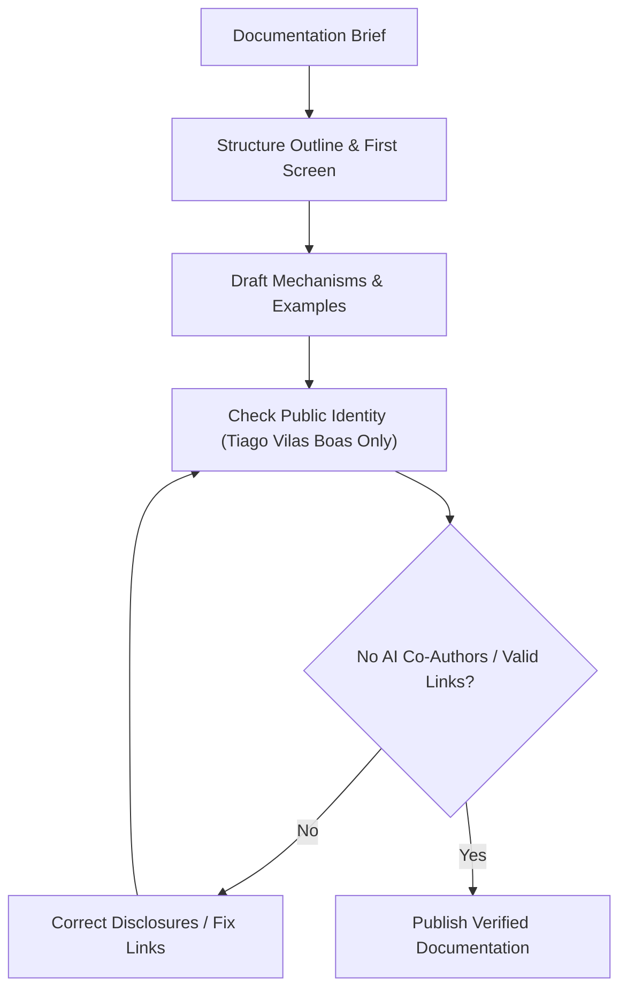

# Documentation

- Enforce public author identity: reference exclusively `Tiago Vilas Boas`. Never expand or disclose full or historical names.
- Never add AI coding assistants, agents, or synthetic markers as commit authors, committers, or co-authors in any document or repository.
- Structure technical guides for quick scannability: state purpose, target audience, minimal usage example, and tradeoffs.
- Document mechanisms and verifiable facts rather than intentions or speculative designs.
- Verify cross-links, markdown syntax, and code references (`file://` or relative paths) before concluding.

