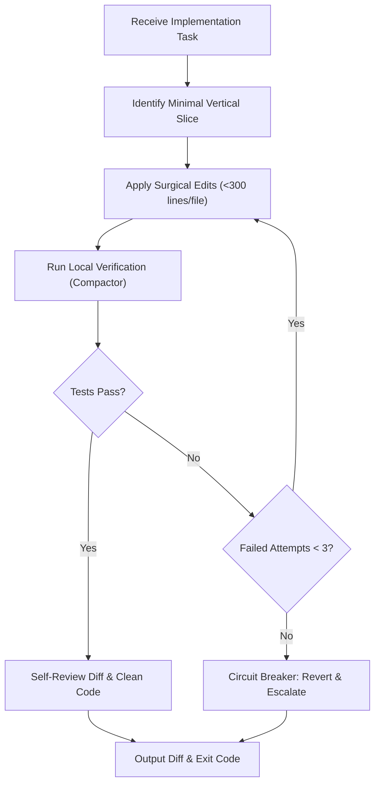

# Implementation

- Follow the Minimal Change Principle (YAGNI): modify strictly what the task requires; do not refactor or reformat unrelated code.
- Respect domain boundaries and the Dependency Rule: domain code never depends on external transports, frameworks, or storage adapters.
- Keep source files under 300 lines and focused on a single responsibility (SRP); split large files by domain of action.
- Preserve existing comments, docstrings, and documentation integrity unless explicitly requested to update them.
- Run local tests immediately after each edit using `downshift compactor -- <test-command>`.
- Circuit breaker: if local verification fails 3 consecutive times, revert the failing changes, preserve diagnostic logs, and report the blocker.

