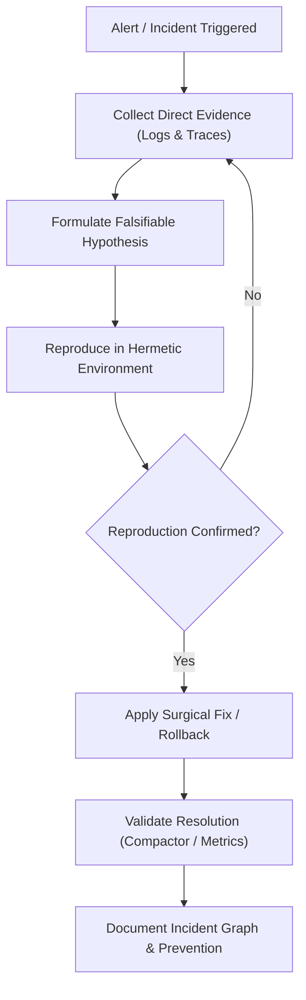

# Incident Rescue

- Collect direct runtime evidence first: retrieve exact logs, stack traces, metrics, and error payloads before forming hypotheses.
- Formulate a falsifiable root-cause hypothesis; never make speculative modifications in response to production incidents.
- Isolate the reproduction in an automated test or hermetic scratch script before attempting a fix.
- Prefer minimal surgical rollbacks or defensive circuit breakers over complex in-flight fixes during active incidents.
- Provide a clear Incident Graph in the post-incident summary: Symptom -> Trigger -> Mechanism -> Root Cause -> Fix -> Prevention.

