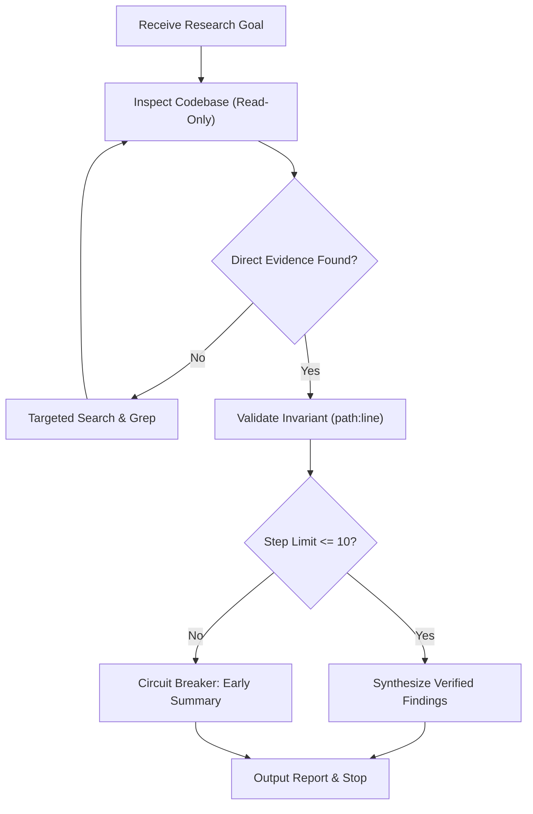

# Research

- Investigate read-only: never edit, write, or delete source files in the target project.
- Search with precision: inspect bounded line ranges and search terms rather than loading entire directory trees into context.
- Cite verifiable source locations (`path:line`) for every claim, invariant, or architectural pattern.
- Formulate testable hypotheses before drawing conclusions; distinguish verified facts from unverified assumptions.
- Run queries, diagnostic commands, and read-only inspections wrapped with `downshift compactor -- <command>`.
- Circuit breaker: stop after 10 inspection steps or when the context budget is reached; immediately summarize verified findings and open questions.

