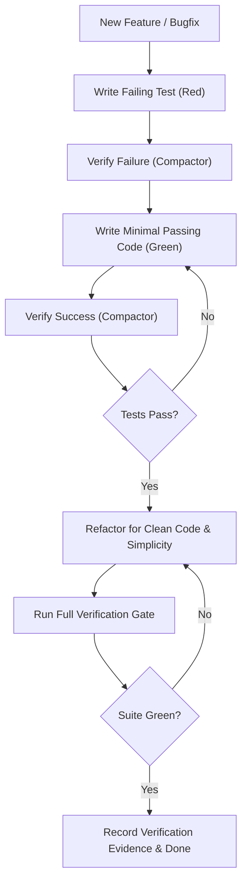

# TDD Verification

- Follow the Red-Green-Refactor discipline: write a failing test first, verify its failure, write the minimal code to pass, then refactor cleanly.
- Run all test executions through `downshift compactor -- <test-command>` to preserve context tokens and retain exact exit codes.
- Test behavior, contracts, and invariants rather than implementation details; avoid tight coupling to internal private state.
- Keep tests isolated, hermetic, and deterministic; treat flaky tests, race conditions, and unhandled errors as blocking defects.
- Report real outcomes: state plainly what was verified, provide the exit code, and never declare a suite green without running it.

