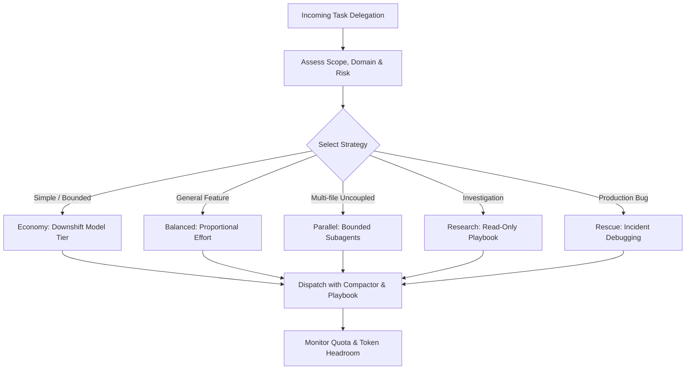

# Universal Skill

- Select the execution strategy matching the subagent scope:
  - `economy`: Simple, bounded, or mechanical tasks (downshift model tier to flash_lite / haiku-5-5).
  - `balanced`: Default strategy for general implementation, feature work, and standard refactoring.
  - `parallel`: Split independent, uncoupled files into concurrent subagents (respecting session capacity limits).
  - `research`: Read-only investigation and codebase survey with zero file mutation.
  - `rescue`: Focused emergency incident debugging and root-cause analysis.
- Preserve context tokens: execute allowlisted build, test, and git commands wrapped via `downshift compactor -- <command>`.
- In-process MCP coordination: query `downshift_providers`, `downshift_playbook`, and `downshift_status` before initiating large subagent delegations.
- Enforce the session ceiling: never exceed 5 active agents total across the session tree (root + at most 4 subagents).
- Fail open: when routing uncertainty exists, hold the requested model and effort tier without interrupting execution.

